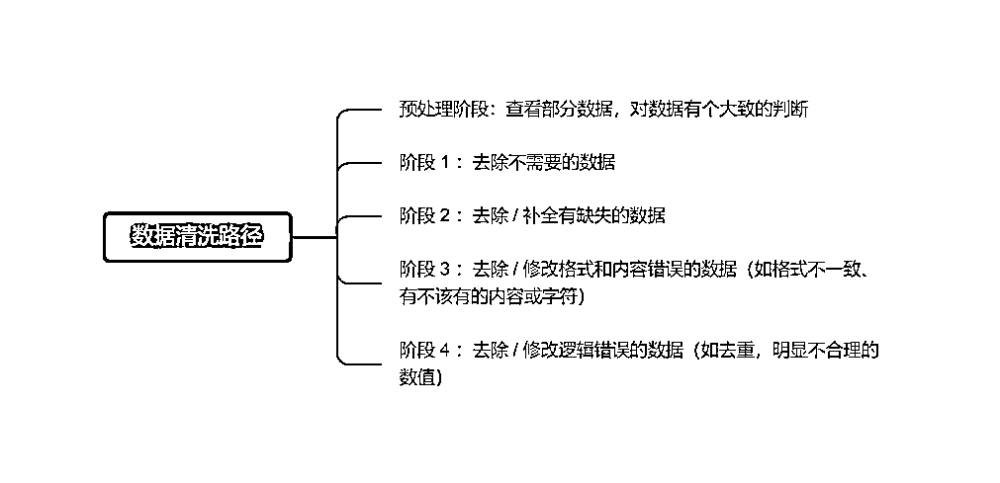
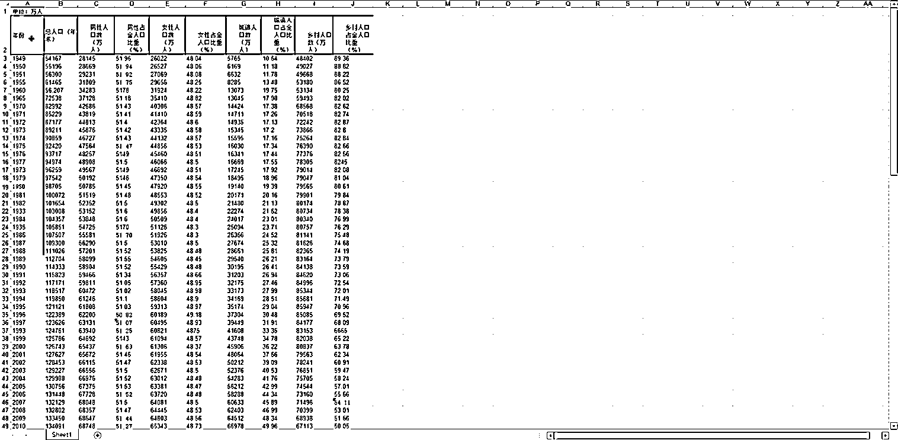

# 9.1 第一步：先把数据表备好

这里说的待分析数据表，并不是直接拿原始表格来用，而是先对原始数据做清洗，再按实际需求留下必要内容后得到的表格。需要说明的是，清洗这一环没法只交给 ChatGPT，仍然要由我们人工动手。

当数据体量很大时，也可以借助 Python、SQL 或现成的数据清洗软件来处理。

清洗完成后，把结果存进 Excel，供后续分析调用。下面以统计局统计年鉴中 1949—2021 年的人口普查数据表作为示例：

