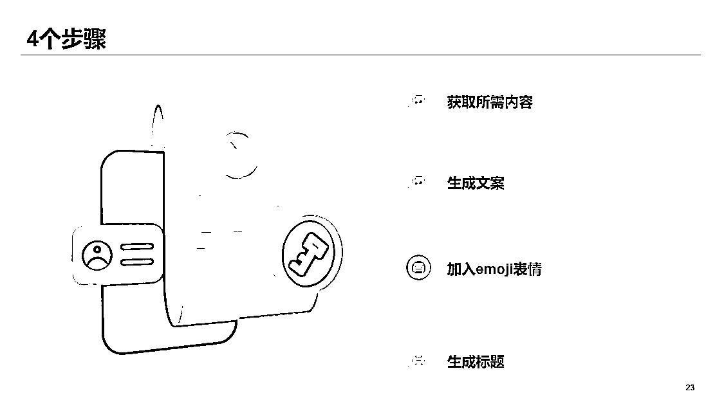
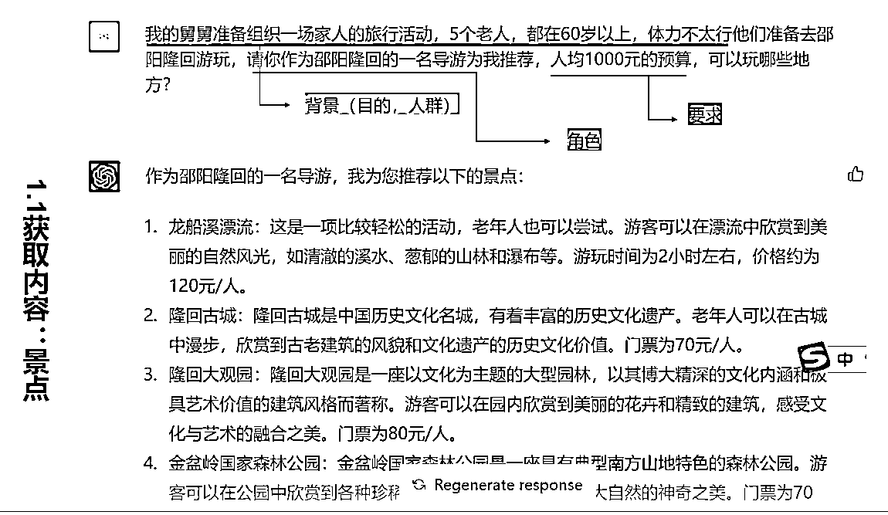
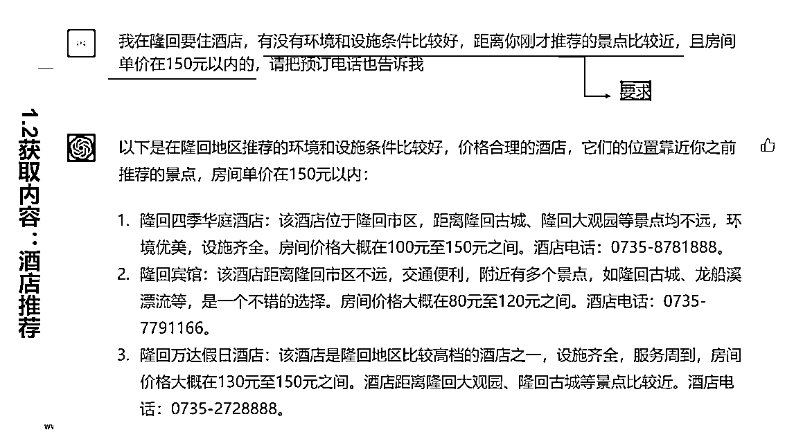
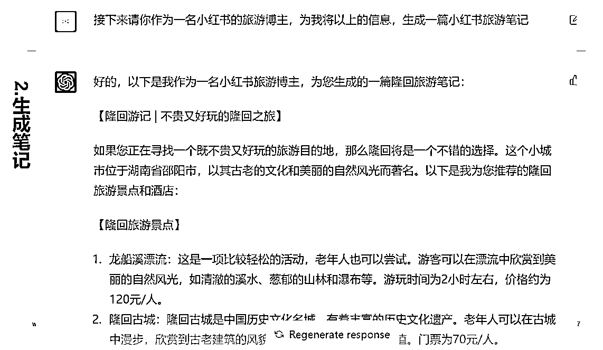
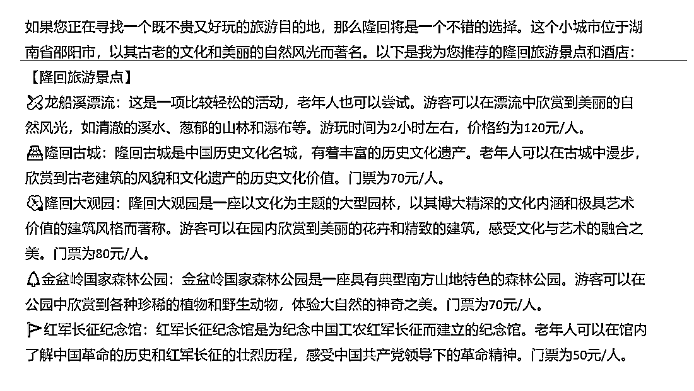
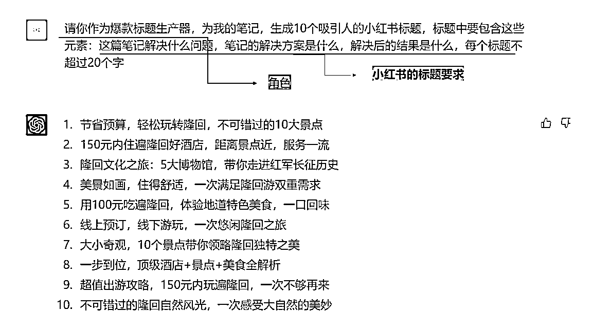

# 10.1 四步搞定📕旅游笔记 @菜菜

想用 ChatGPT 完成一篇📕旅游笔记，总共分四步。是哪四步？

第一步，让 ChatGPT 先协助搜集和整理基础素材；第二步，让它据此产出笔记正文；第三步，借助它把 emoji 表情自然嵌进内容里，这恰好符合📕文案的表达习惯；第四步，请它帮忙打磨出吸睛标题。

这次实操以邵阳隆回的旅行笔记为例。先看第一步：

我给出的提示词里交代了背景、角色与限制条件：

• 背景：舅舅打算组织一次家庭出游，同行五位老人都已超过 60 岁；
• 角色：由 ChatGPT 扮演邵阳隆回本地导游；
• 要求：人均预算控制在 1000 元。

从回复看，ChatGPT 已经给出不少内容；受页面展示限制没有全部截图，实际上后面还有更多。用同样的方法，我又补齐了住宿和美食信息，同样因为篇幅原因，美食部分没有放上来。

拿到基础资料后，进入第二步：让 ChatGPT 写📕文案。我给它设定“📕旅游博主”的身份，请它把前面收集的信息整合成一篇📕旅游笔记。随后它便开始输出。

第三步是加入 emoji。我下达的指令是：在每一段开头放入贴切的表情符号，正文中也穿插一些表情。结果如下，效果挺有意思：

它选的表情与场景很贴合：写到龙船溪漂流，用了船的表情；提到隆回大观园这座植物园，配了花朵；说到红军长征纪念馆，则放了红旗表情。

最后一步，让 ChatGPT 出标题。我把它的角色设为“爆款标题生成器”，并要求标题中体现要解决什么问题、笔记给出的解决办法、解决后的结果，同时限定标题字数：

它产出的标题质量不错，至少能打 80 分。这样的文案如果到外面找人写，可能要花 4000—5000 元；现在用 ChatGPT，这笔费用就省下来了。

内容来源：《玩 ChatGPT2 个月后，我总结出高效对话 ChatGPT 的 6 字真经》

