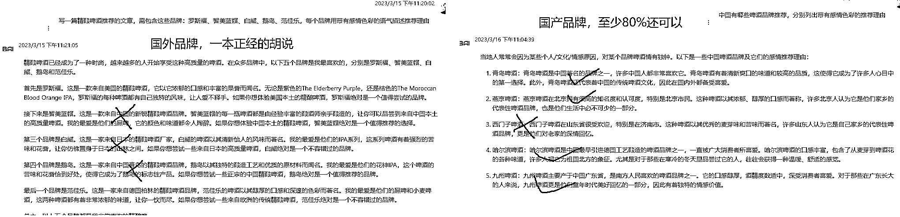
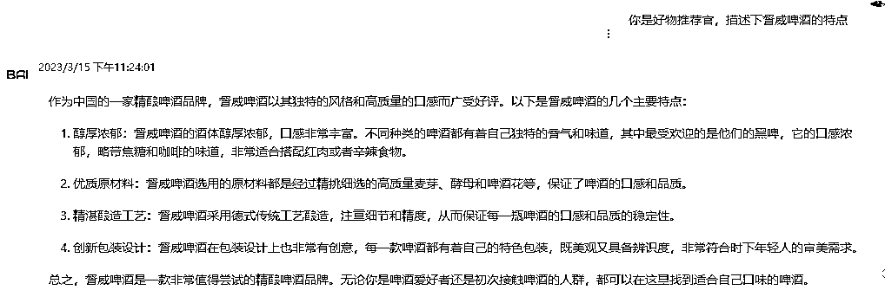
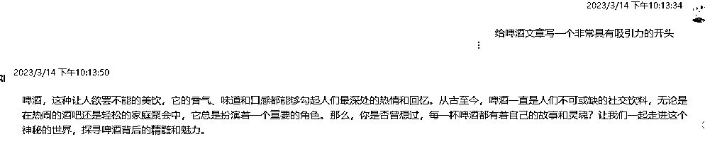
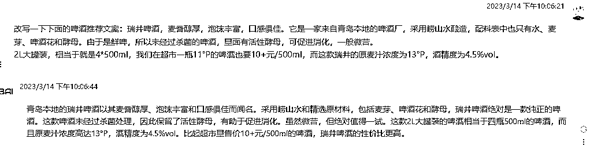
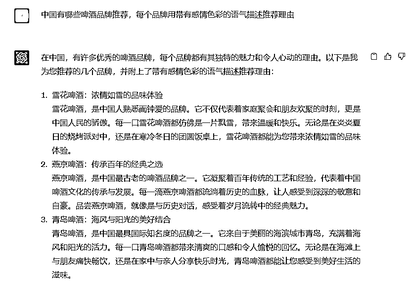
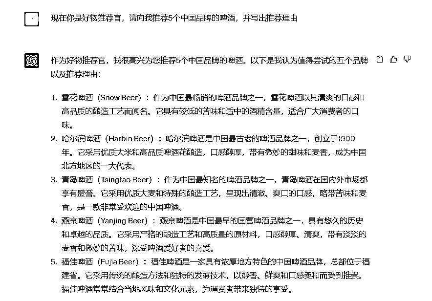

# 10.2 案例二：用 ChatGPT 写知乎好物文，三招搞定 @大胡子

**方法一：先让 ChatGPT 拉一份好物清单**

第一步，不妨直接让它按品类给出推荐名单。比如这样问：“中国有哪些啤酒品牌值得推荐？请逐一列出，并附上推荐理由。”

实测下来，问国产品牌时它通常答得比较清楚；一旦涉及海外品牌，就容易卡壳，尤其那些被译成中文的名字，经常张冠李戴。

**方法二：单独追问某个产品，把推荐理由写透**

清单里有些回答难免笼统。这时可以锁定某个品牌单独发问，让卖点更细、更有说服力。下面这个海外品牌，ChatGPT 虽然把产地答偏了，但推荐理由写得相当具体，内容拿来就能用：

再试着让它给那篇啤酒稿子拟一个抓人的开头：

我实际用过、效果不错的提问词有这几条：

1. 说说范佳乐白啤有哪些特色；
2. 范佳乐白啤拿过几次奖？分别是什么；
3. 为一篇啤酒文章写一个特别抓人的开头；
4. 写一篇啤酒推荐文，覆盖 5 款国产精酿，并逐一说明推荐理由。

**方法三：借同行爆款做改写**

不会写稿、也不懂怎么设计提示词？有个几乎零门槛的办法：找同行的爆款文章做参照，交给 ChatGPT 重新改写。下面就是让它改写我旧文案的结果：新版本基本逻辑没跑偏，还规避了抄袭风险。

有个细节别忽略：想让产出更贴合需求，先给它设定角色。下面两张图对比了未设定角色和设定角色后的回答，后者明显更对路。

Plus 版在准确度上通常更好一些，但不管免费版还是 Plus 版，生成内容后仍可能需要人工再打磨。这个玩法更适合你已经熟悉的行业和产品——只有懂行，才分得清它是在认真作答，还是在编。

内容来源：《通过 ChatGPT+RPA，帮我在知乎上自动卖货》

