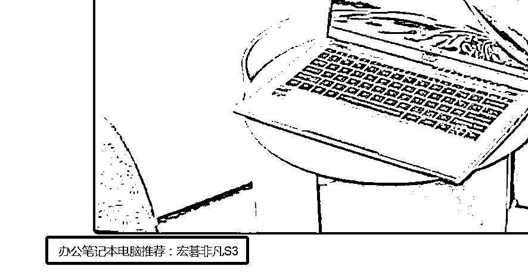

# 10.3 案例三：ChatGPT 写百家号带货稿 @刘伟

选题敲定后，真正的重头戏是把正文写出来。下面以办公电脑推荐为例，说说怎样借 ChatGPT 完成一篇百家号带货稿。

示例标题可以设为《办公笔记本电脑推荐：适合办公用的笔记本电脑推荐》，也可以换成《办公笔记本电脑推荐：办公笔记本电脑哪个品牌好》。写正文时别忘记：“办公笔记本电脑推荐”和“适合办公用的笔记本电脑推荐”要尽量反复出现；整篇控制在 1000—1400 字，两个关键词累计出现 8—12 次比较合适。

具体怎么做？先围绕关键词去其他平台搜 3—5 篇同题文章，挑出可用的段落，再交给 ChatGPT 做中文改写。可以这样下指令：“请用中文重写以下内容：xxxxxxxxx 你找到的文章片段 xxxxxxxxx”。

成稿可按四步搭骨架：

第一步，开篇总述，比如移动办公越来越常见。

第二步，说明挑选适合办公的笔记本要看哪些点。

第三步，放 3—4 款产品推荐即可。

• 办公笔记本电脑推荐之一：联想 XXXX（此处自然出现一次关键词），配图 A，图注也可带上关键词

• 办公笔记本电脑推荐之二：华为 XXXX，配图 B
• 办公笔记本电脑推荐之三：惠普 XXXX，配图 C

第四步，收尾概括，例如上面几款办公本可供参考，愿大家挑到称手的设备。

发布前，先用在线原创度评估工具测一遍。按经验，一篇 1500 字左右的稿子，若检测出的严重重复低于 10 次，基本就能过关。

内容来源：《对于零基础新手最友好的副业之一——百家号图文带货》
