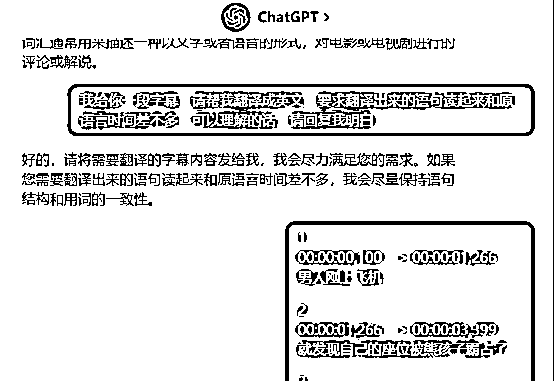
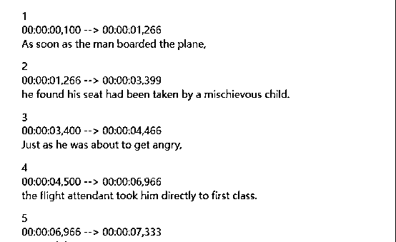
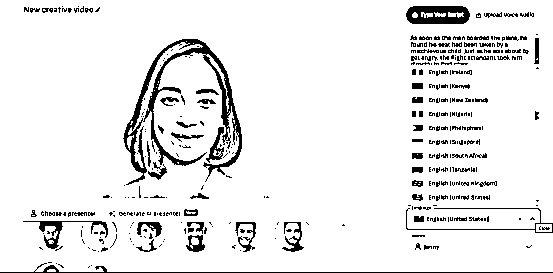

# 10.4 案例四：用 ChatGPT 搞定 TikTok 影视解说 @A 😇路途

做影视解说类账号，最大的痛点就一个字：慢。过去，一条完整的视频从零到成品，流程相当繁琐——先写解说文案，再翻译成目标语言，接着配音、做外文字幕，最后还要剪辑。每一步都要花不少精力，想想就让人头大。

但现在有了 ChatGPT，这套流程被大幅压缩。从提取字幕到翻译完成，再到配音、合成画面，整个过程不到三分钟就能跑完。ChatGPT 在其中最核心的贡献，就是字幕翻译。

具体操作也很简单：先把原视频的字幕提取出来，然后丢给 ChatGPT，让它一次性翻译成你需要的语言。

从结果看，翻译后的文本长度和原文几乎一致，不会出现明显偏差。

接下来，你既可以选择传统方式配音，也可以用现在流行的 AI 数字人——直接把文案扔进去，就能自动生成动态的数字人口播视频。工具链接：[`studio.d-id.com/editor`](https://studio.d-id.com/editor)

最后一步，把做好的字幕和数字人视频拖进剪辑软件，对齐一下，基本就能直接发布了。整体流程顺畅，语速自然柔和，画面和字幕也高度匹配，几乎不需要额外调整。

同样的思路，放在国内短视频的解说赛道同样行得通。比如圈友 @惟乔 就把 ChatGPT 用在了短剧 CPS 项目里，具体怎么批量产出解说类短剧，可以参考这篇实战分享：《新手用赚钱的方法做短剧 CPS，一个月 1.4w+收益》中的「如何快速批量产出解说类短剧？」章节。

过去做一条视频的时间，现在能做出 20 条，而且质量还不降级。这个效率提升，对于做影视解说的创作者来说，确实是真香。

内容来源：《如何使用 ChatGPT 帮助你在 TikTok 变现？》

