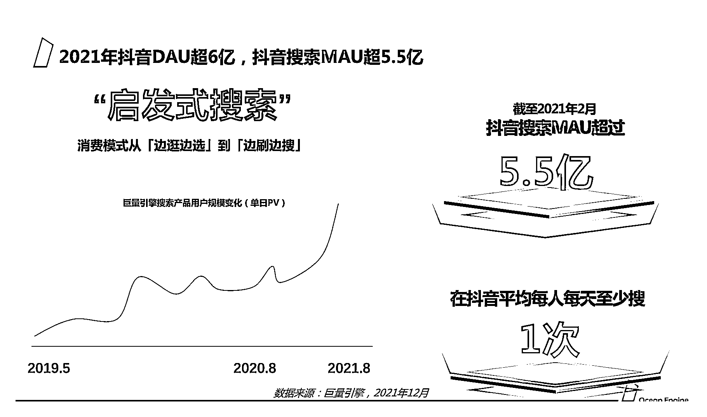
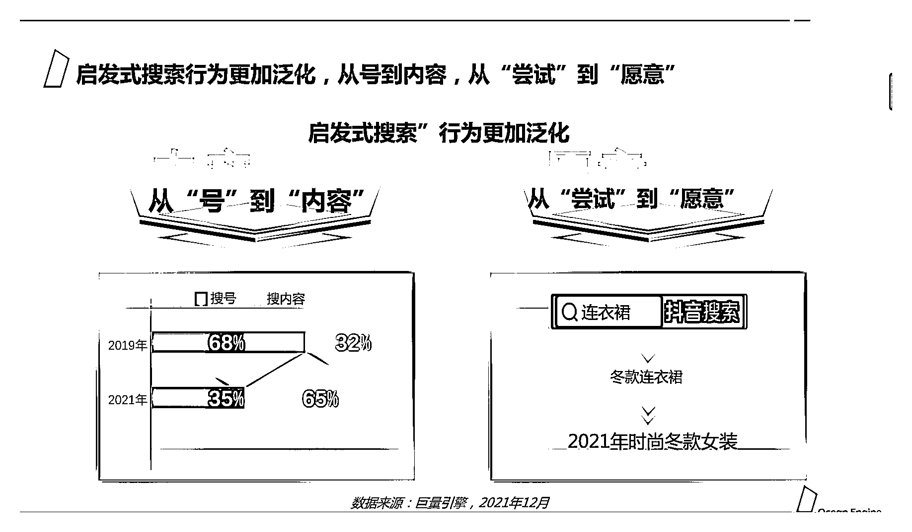
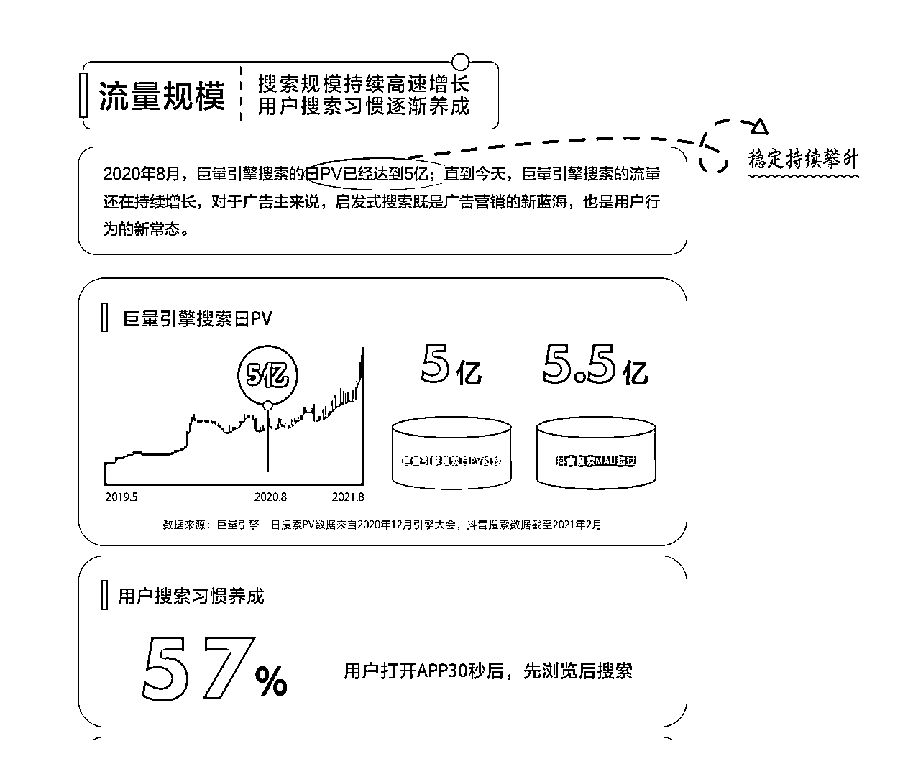
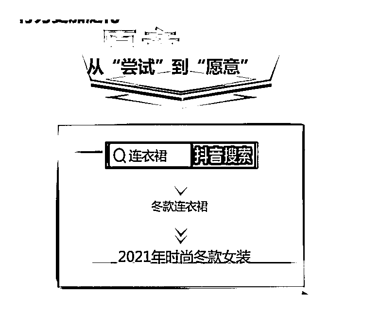
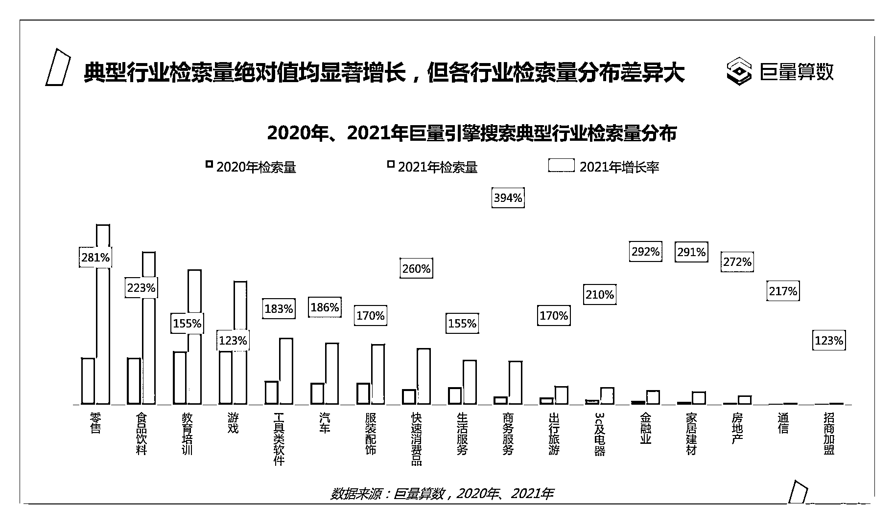
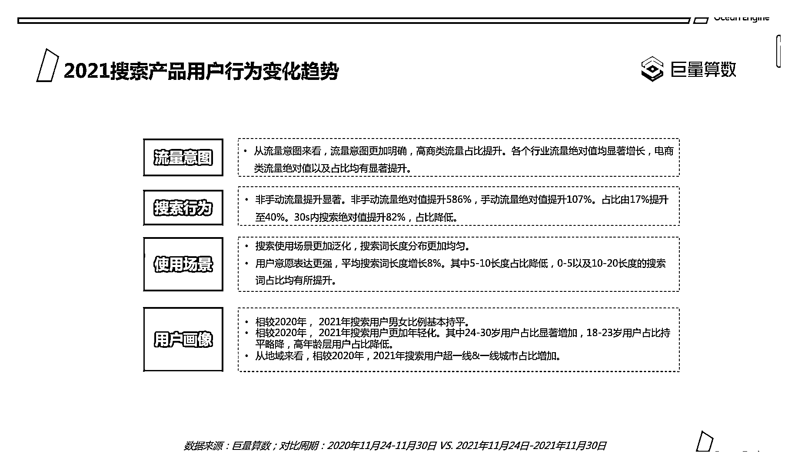
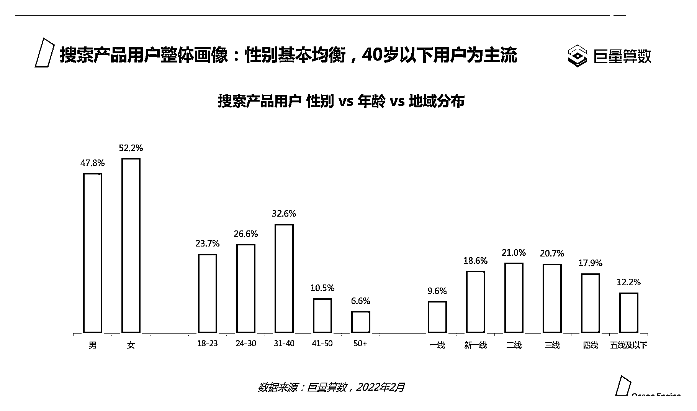
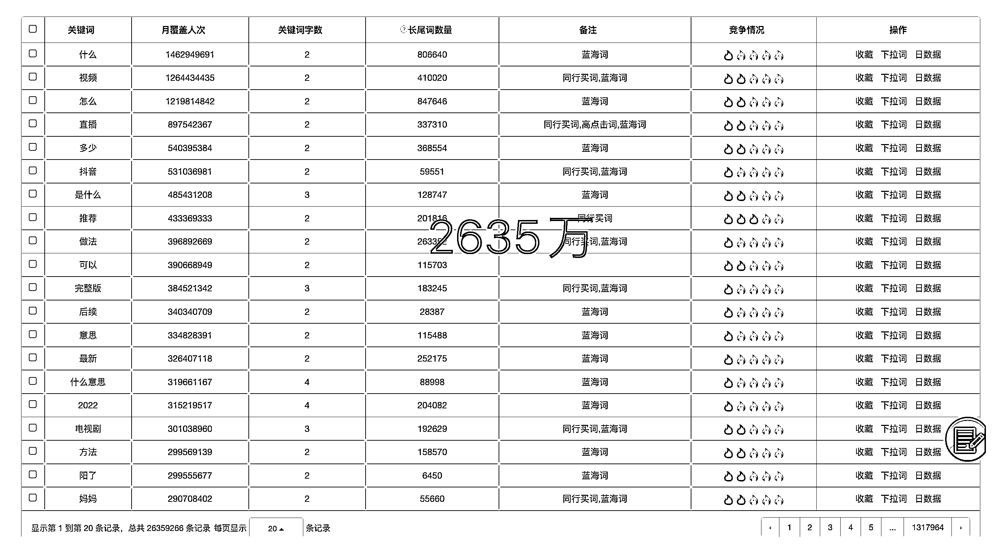
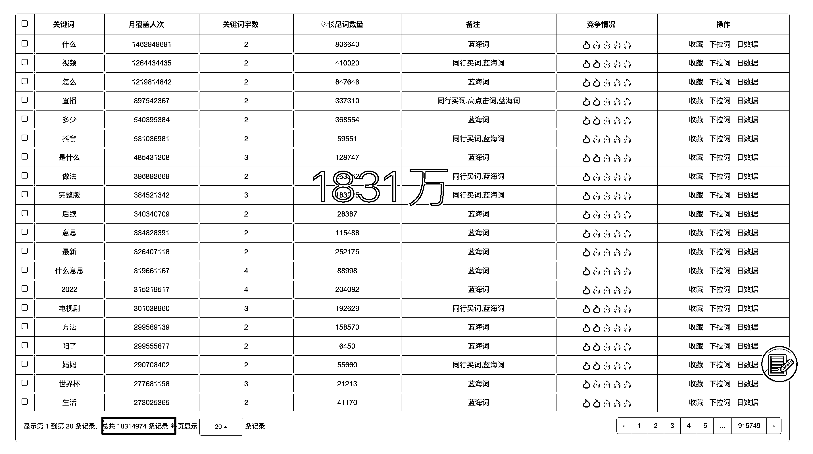
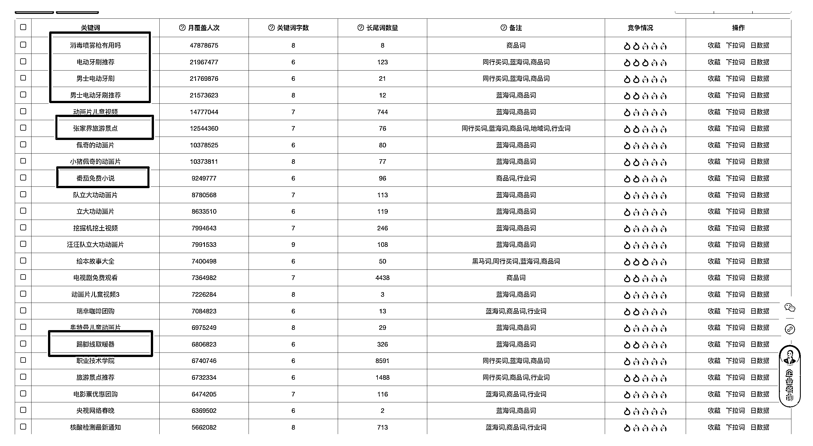

# 1.2 抖音搜索，为什么现在必须做？

流量天平正在倾斜：抖音、小红书持续升温，百度、淘宝的流量池却在收窄。

搜索往往被视为精准流量的入口。原因不复杂：用户是带着明确问题来搜的，诉求更清楚，转化意愿也更强。PC互联网年代，搜索就是核心入口，百度曾凭这一点压过腾讯、阿里，坐上 BAT 头把交椅。如今百度的光环虽淡，但“搜索”这个行为并没有退场。

过去人们查信息去百度、找商品上淘宝，两条搜索主线分别覆盖内容和交易。可百度 2000 年上线，淘宝 2003 年上线，至今都已二十多年，市场早被各路玩家切分完毕，竞争密度极高。

相比之下，抖音 2016 年上线，日活约 7 亿；小红书 2013 年起步，日活约 1 亿。两个平台都有超过六成用户会主动搜索，这股搜索流量体量惊人。

回想一下自己的习惯：遇到问题先点开抖音或小红书搜一搜，是不是越来越常见？

## 1、抖音搜索的数据信号

先看抖音平台的发展脉络。依据抖音 2021 年 12 月底公开的数据（2022 年数据未披露），能读出几个关键启发：

### 1）搜索正逐渐成为日常习惯

官方数据显示，截至 2021 年 12 月底，抖音搜索月活突破 5.5 亿，人均每天至少搜一次，每天搜索人次在 6 亿以上。

用户搜索的对象，正从“找账号”转向更多“找内容”。内容类搜索占比从 2019 年的 32% 升至当下的 65%，提升幅度很大；当时预判到 2022 年底可能达到 90%。而且搜索流量仍处早期，未来增长空间难以估量。

### 2）商业价值持续走高

用户搜索目的更清晰，购买意愿也更强：从“连衣裙”到“冬款连衣裙”，再到“2021 年时尚冬款女装”，词越搜越细。

电商相关搜索流量增长明显：零售上涨 281%，食品饮料上涨 223%，教育培训上涨 155%。

还有多个行业的搜索量涨幅超过 200%，增长势头很猛，流量红利肉眼可见。搜索用户中女性占 52%，高于男性的 48%；24～30 岁用户占比明显增加，一线及超一线城市用户占比也在上升，消费能力随之增强。

## 2、抖音搜索还有蓝海红利

所谓红海，是需求大、竞争也大；蓝海则是需求大、竞争相对小。

抖音眼下有两个主要流量入口：推荐流量和搜索流量。推荐流越来越卷，考核看 5 秒完播率、2 秒跳出率和互动数据等。而从官方增长率看，搜索流的竞争还没那么拥挤，至少多数关键词仍算蓝海词。

下面从“词”和“人”两个竞争维度来看。

### 1）关键词竞争度

自研“极客增长”工具收录约 2600 万个关键词，其中搜索量大、竞争小的有 1831 万条。按 1831÷2635 计算约 69.4%，接近七成属于蓝海词。

### 2）从业者竞争度

再看“人”的维度：在 5000 万条抖音 KOL、KOC 样本里，抽样 2000 万条博主视频后发现，99% 的抖音博主并不懂 SEO，标题和话题要么过短，要么缺乏信息量。

整体看，搜索里能找到不少蓝海机会，例如下图：

借助工具，很快能看到一批有价值的蓝海词：比如“男士电动牙刷推荐”，月覆盖 2157 万人次，竞争度仅 2；“番茄免费小说”月覆盖 924 万人次，系统竞争度同样是 2。类似的可挖掘商业词还有不少。

我们去年做了一个基于抖音 SEO 的旅游号，停更一年后，每天仍有约 1000 次搜索曝光，93% 的播放来自搜索。

账号主页可点这里查看：[涵涵在杭州的主页 - 抖音](https://www.douyin.com/user/MS4wLjABAAAAu7pVcXoW8WD9UtQYBu_T1ioTZkW-tRNuS_d9SfUE852vKCzU6WUdL0aLRlF_bFgN)

[1662106409518540.mp4](https://search01.shengcaiyoushu.com/upload/doc/XEb4d9F4WogubixyOM9cMVeen0d/KRIcbE66ho7KNtx8seBcUbyFnfc)[1662106588939932.mp4](https://search01.shengcaiyoushu.com/upload/doc/XEb4d9F4WogubixyOM9cMVeen0d/W3bcb8lOuoUpjNxcYD2cFOwVnWh)

自然流量要天天维护内容，付费流量又烧钱。相比之下，抖音搜索流量有几个优势：

• 竞争小：仍是流量蓝海，排名提升相对轻松；
• 见效快：小词通常 1～5 天起效，大词约 1 个月见效；
• 成本低：不必天天更新，每月围绕一个词更新一条视频即可；
• 更精准：需求明确，成交概率更高；
• 不违规：操作手法正常，不用冒险踩红线。