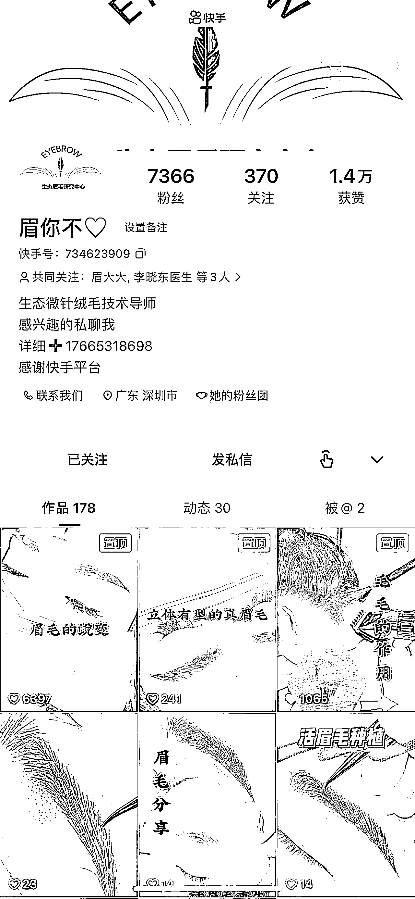
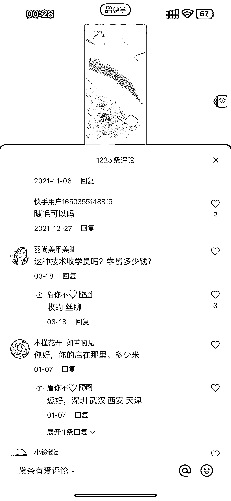
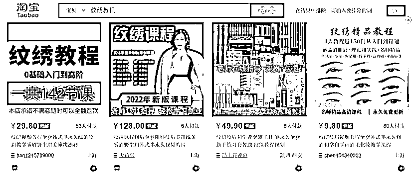
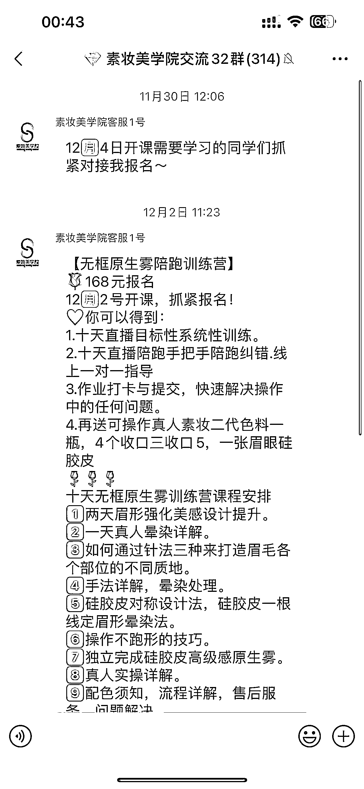

# 2.2 老项目里找新机会

我手里运营着七八个抖音、快手、📕账号，账号覆盖男性、女性、中老年和年轻群体。这样做是为了让平台按不同人群给账号打标签，再观察各类用户偏好什么内容。我的项目灵感大多来自“刷”和“看”，从身边场景里找需求。

比如植眉：把后枕部的细软毛囊移植到眉毛位置。这个私域项目我自己调研过，收入分两块：一是给直接客户做种植，单客约1万至3万元；二是做相关技能培训，收费约2万元。培训必须动手实操，光看线上课只能弄懂流程，手法依旧生疏。

这里能切入的方向，是卖线索和线上课程。其实不少美容机构已经在做，比如雍禾，但它的主业仍是植发，并非专攻植眉。说句实在话，和这类机构合作并不复杂，有兴趣的可以去了解。

纹绣这行大家不陌生，我做过：用淘宝店做前端引流，再把线索转给线下机构，由他们在🛰️群里成交价格从三千到一万多的技能培训。我的淘宝单店卖教程，每月收入约4万到5万元；同行大多卖十几、几十元，我那时定价199元，算最贵的一档，做法是把市面上课程尽量买齐，再整理、筛选、分类。另一块收入，是给机构供线索，一条几十元。

这个项目背后切中的是一群想创业的女性。纹绣门槛已经低到不必开门店，一套设备就能上门服务，这类人只要把同城线上引流做好即可。但只看线上视频根本学不会；视频最多让人知道要投入多少成本、买什么设备、大致操作流程和手法，真要上手还是得去机构练。

植眉可以看成纹绣的升级版：纹绣属于半永久，过一年半载往往要补做，还会造成轻微创口，效果也不如原生毛发自然，大城市做一次要花大几千甚至上万；植眉做完即刻见效且维持永久，价格虽高一些，但面向的是高净值人群，转化相对容易。

