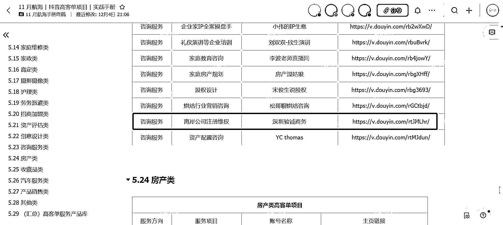
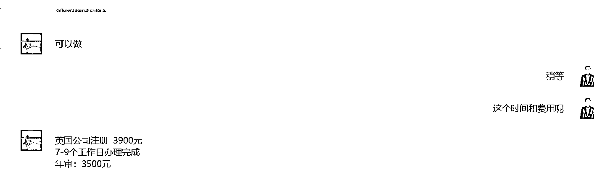
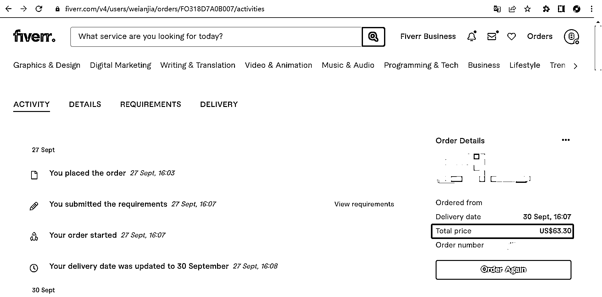
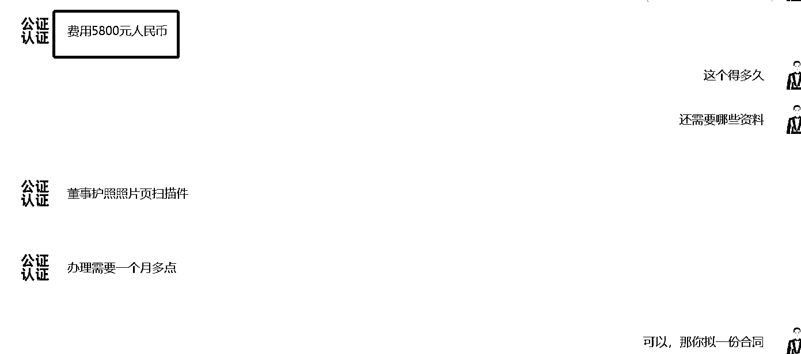
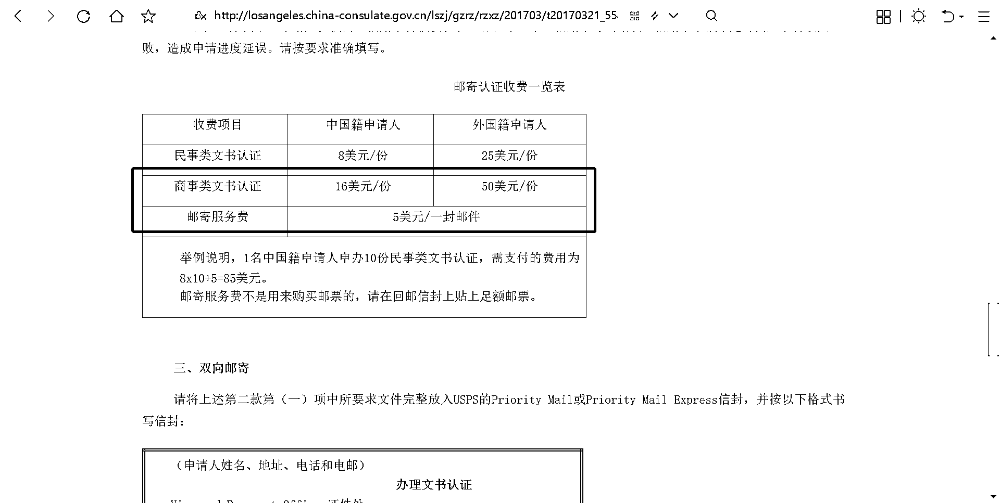
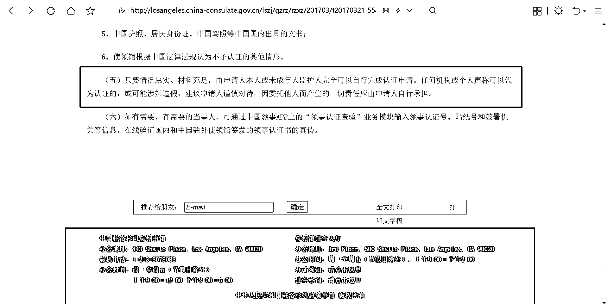

# 2.3 思路三：高客单中介，信息差赚钱

其实在我翻到生财手册里的案例库之前，就已经注意到一个专门帮人注册离岸公司、维护离岸公司的账号，听起来有点像国内的公司年审和代记账。这个账号主推香港公司，毕竟做跨境生意的大多需要香港主体。巧合的是，我那时在淘宝做虚拟类服务，也注册过美国、英国、香港、新加坡这些地方的公司，所以对这个领域里的门道并不陌生。

举个直观的例子：在国内的猪八戒网上，注册一家英国公司要花3900元，每年维护还要再交3500元；可如果去Fiverr上找一个本地代办，注册一家英国公司只要60美元。

专业的事就该交给专业的人，我们完全不用去琢磨对方是怎么搞定注册地址、电话这些细节的。这就像国内办个体工商户、食品经营许可证、二类医疗器械备案一样，交给代办就行，很多情况下相关部门并不会上门核实地址，除非你要开设银行对公账户。

所以，你真正要做的只是把流量引过来，再把信息差用起来。更妙的是，公司只要还在运营，每年几千元的维护费就是一笔长期收入。

顺着这个思路，我再分享一个自己调研过的延伸方向，一单利润能做到4000元往上。这个方向就是：国外公司的文件如果要在国内使用，需要办领事认证。领事馆并不存在任何第三方代理机构，官方收取的费用其实只有几十美元。

但问题在于，大多数人自己对整套流程不熟悉，于是“找代办”就成了刚需。国内声称能办的机构不少，报价却能相差1000多元，这本身就是信息差；知乎上不少引流的人，说白了就是“倒爷”。

简单来说，境外文件拿回国内使用需要认证或公证，反过来，国内文件拿到境外使用也一样。还有哪些细分类目值得做？大家不妨自己去下面这个官网深挖，说不定能遇到契合自己的方向：
[`losangeles.china-consulate.gov.cn/lszj/`](http://losangeles.china-consulate.gov.cn/lszj/)

内容来源：《如何挖掘蓝海高客单项目》