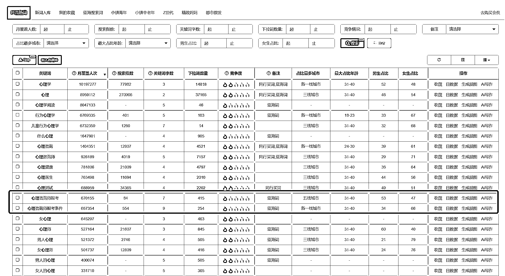
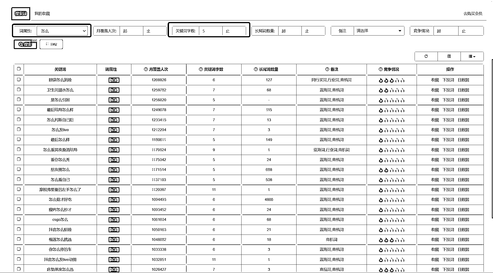

# 2.4 思路四：用选词工具挖高客单项目

高客单生意并非全靠凭空挖掘，多数需求其实早已存在。只要用精准的行业关键词去筛选，就能找到更细的高客单方向。极客增长大数据选词工具中设有商机挖掘模块，下面就用它演示如何锁定高客单需求。

1、从行业词根里翻商机

以心理学为例，打开极客增长个人版选词工具，搜索词根“心理”，就能看到对应的词库。

接着按“月覆盖人次”排序，心理相关搜索最热的关键词便一目了然。浏览一遍词汇后，会发现心理咨询、心理测试等常见商机，同时还能看到一个与高客单价相关的词：心理咨询师报考。

了解心理学的人大概知道，心理咨询通常每小时收费约300到800元，但多数咨询师一年收入不足5万元，可见它眼下算不上很优质的项目，其中的坑只有踩过的人才明白。

心理咨询师报考则是另一番景象。有心理咨询需求的人里，真正会去做咨询的并不算多；相反，想学心理学、报考心理咨询师的人却很多。当下市场上已经没有国家认可的咨询师证供人报考，对想做心理咨询培训生意的人而言，这反而是一个机会。心理咨询培训的客单价大多在3000至100000元之间，确实是个值得关注的商机。

同样的方法也能迁移到其他行业。心理只是示例，类似领域同样可以用关键词挖出机会。

2、从需求词里找商机

在极客选词工具的商机挖掘模块中，把词属性限定为“怎么”，关键词字数设为“5”，筛出的相关需求就很清楚。

眼袋怎么消除、卫生间漏水怎么办、床垫厚度怎么选，这些需求背后都可能是高客单生意，分别对应美容人群、装修家居人群等，能够继续挖掘出相应的高客单价项目。

工具入口：[`dyinseo.com/DouyinKeywordBusiness/index.html`](https://dyinseo.com/DouyinKeywordBusiness/index.html)