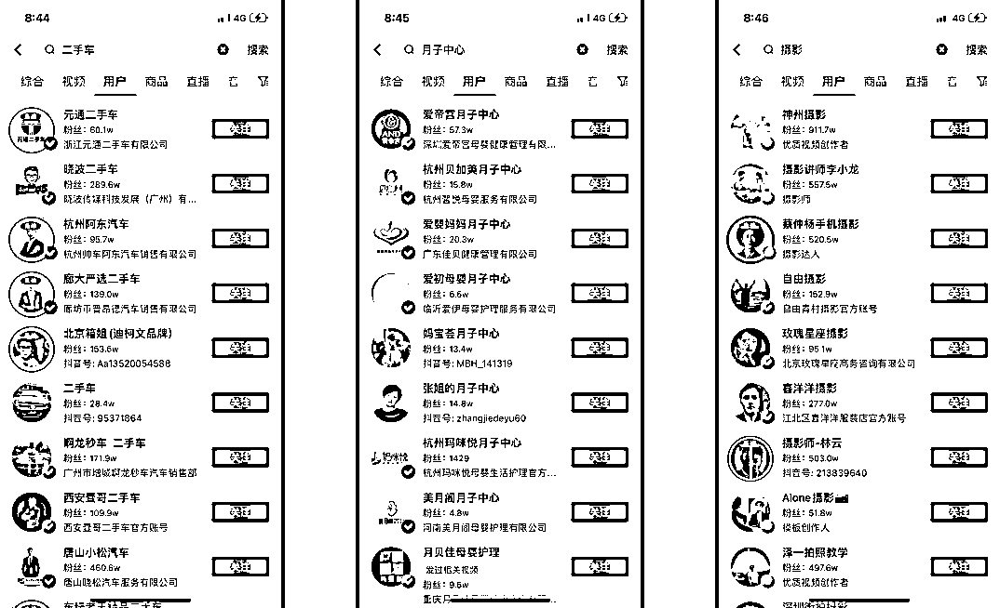
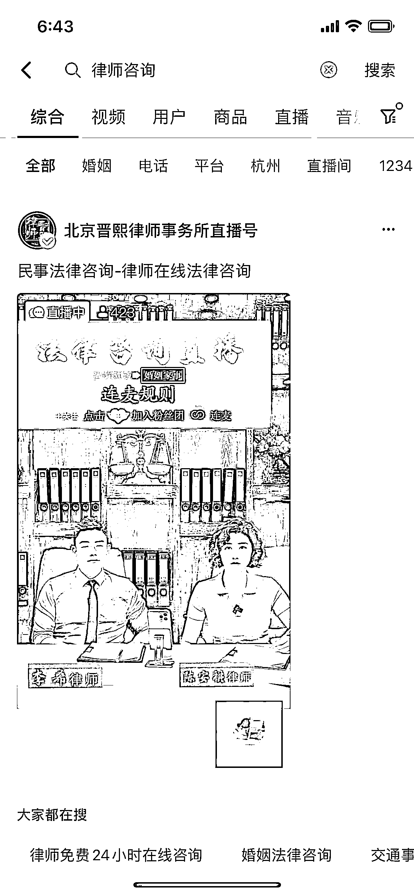

# 3.1 认证账号，排名更靠前的是谁？

认证状态会不会影响搜索排名？哪类账号更容易拿到优先位？如果把选择缩成两项：A 是蓝V与黄V（蓝V为企业认证，黄V为个人认证），B 是普通个人号。答案选 A。

在关键词搜索结果里切到用户列表，常见且价值较高的搜索词下，前排常被蓝V、黄V占据，未认证用户出现得相对少：

再搜竞争激烈、带变现潜力的词，排在前面的依旧多是蓝V或黄V：

平台为什么更偏向它们？关键在于这两类认证账号在权重体系中更占优势。

有些领域没有黄V甚至讲不了相关内容。以医疗为例，大量话题要求医生资质，黄V代表专业与门槛，能帮平台降低风险；蓝V则是企业专属，背后有公司背书，安全系数更高，同样能减少平台风险。因此，账号是否认证会成为平台排序时的参考因素。
