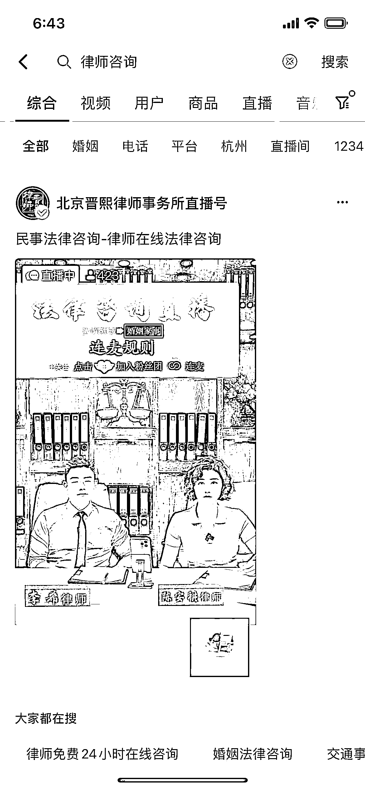
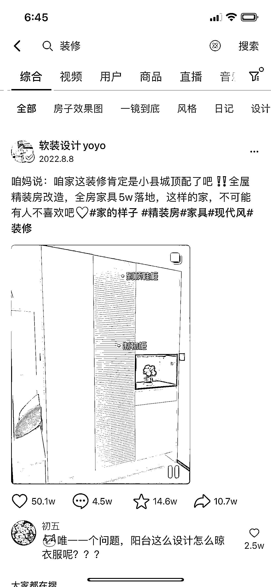
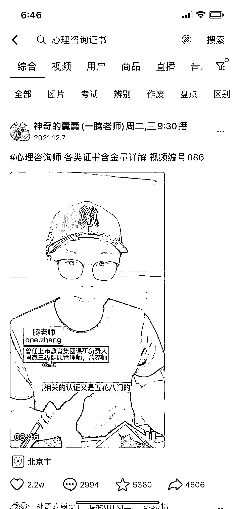
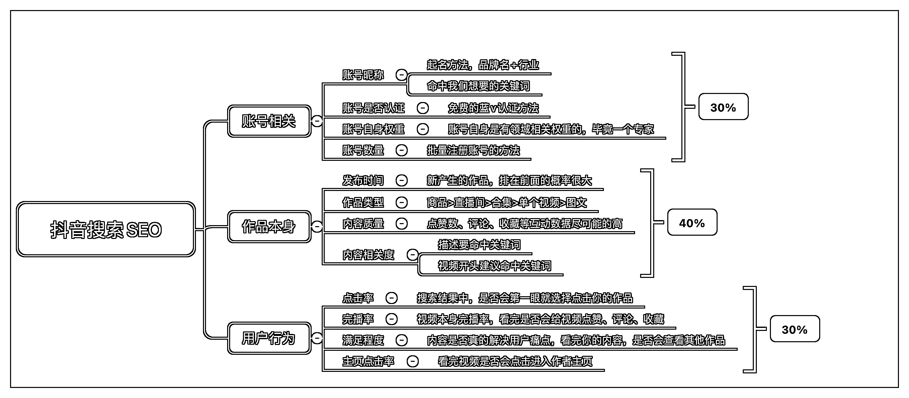

# 3.2 核心关键词

先看一个问题：在内容完全一致、其他条件都不变的前提下，哪种账号更容易获得更高的排名优先级？

A. 账号名称中包含你想优化的关键词  
B. 账号名称中不包含关键词  

正确答案是 A。

名称里带有目标关键词，平台在识别内容时会更轻松，推荐也会更精准。尤其是做直播间、抢搜索流量的时候，账号名称的作用非常明显。

下面这两张图，账号名称要么直接包含关键词，要么用了近义词来对应：

你可能会有疑问：第三张图里，账号名称并没有针对「心理咨询证书」这个词做优化，为什么排名照样靠前？

原因很简单——排名权重不是只看名称这一项，一共涉及 12 种排名因素。单点不决定全局，只能说「心理咨询证书」这个关键词竞争还不够大，所以即使名称没带，也能排上来：

完整梳理一下，12 个排名影响细节是这些：

