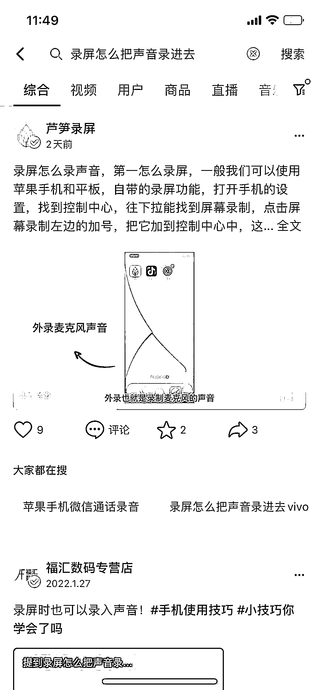
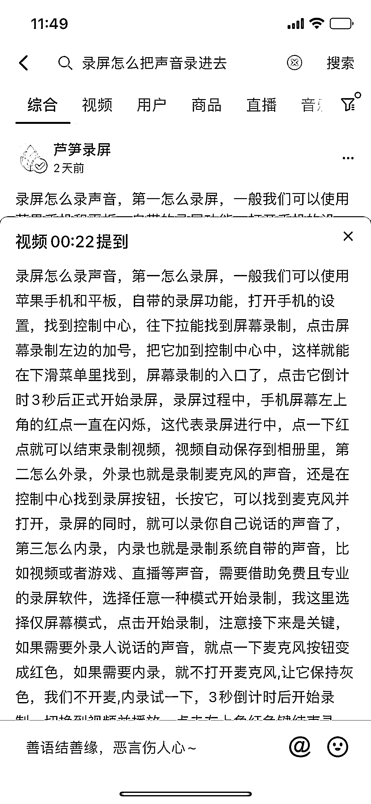
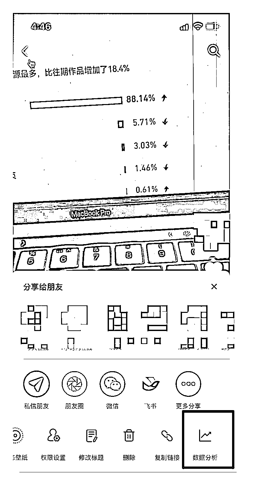

# 3.6 标题关键词，别漏

标题里非得出现关键词不可吗？
答案很明确：要。同义词也能用，但最好还是原关键词本身。

你想抢哪些搜索词，比如“录屏软件”，这个关键词就得在合集标题、视频描述、话题以及视频内容里都出现。这样平台算法无需反复推测视频对应什么需求，用户看着也更友好，还能直接看到自己搜索的词。

同一个关键词，至少要在下面几个位置出现不止一次：
- 作品描述里有没有它
- 作品内容里有没有提到它
- 作品合集名称和合集描述里有没有它
- 作品话题里有没有它
- 作品封面里有没有它

视频里也要把关键词说出来吗？要。抖音能识别视频语音，用来提升判断准确度，所以视频内容里也要自然带出这个词：

在描述里添加话题，有哪些实际收益？
- 话题权重会持续累积，做排名更轻松；
- 带上话题，排名表现会更好；
- 还可能借到对应话题合集的一部分流量；
- 但话题最多加5个，不要硬塞无关话题，否则会影响推荐流量。

补充一句：如果你在学课程之前发过视频，没做SEO优化，可以按图1里的“修改标题”入口调整，搜索流量会逐步涨起来。

作品发布后的30天内，手机端仍可修改标题、话题和封面等信息。
超过30天，就得到抖音创作者中心电脑端操作：[`creator.douyin.com/creator-micro/home`](https://creator.douyin.com/creator-micro/home)
