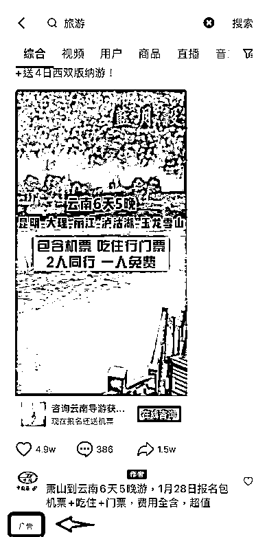
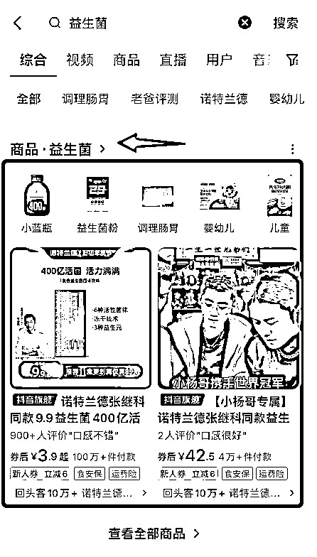
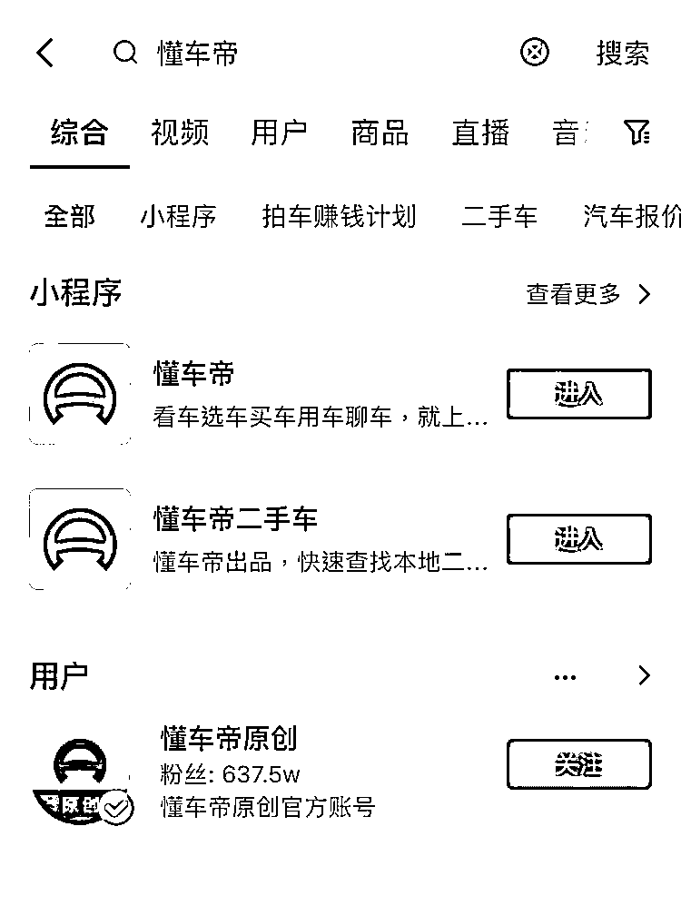

# 3.11 电脑端与手机端搜索差异

你可能会好奇：在抖音上，用电脑搜和用手机搜，得到的结果是一样的吗？

答案是否定的。两者在排名和展示内容上有着明显区别。最典型的差异在于，手机端会混入商品推广、商业广告以及小程序等额外内容，而电脑端则显得“干净”得多，基本只呈现常规搜索结果。

我们不妨看几个直观的例子。搜索“旅游”时，手机端会优先展示广告位，但在电脑端则看不到这些：

再比如输入“益生菌”，手机端的结果里会出现商品卡片，而电脑端完全没有这类内容：

又比如查找“懂车帝”，手机端会直接弹出小程序入口，电脑端同样不会显示：

简单总结：如果你想看到更纯粹的搜索结果，电脑端是更好的选择；而手机端则承载了更丰富的商业化内容。