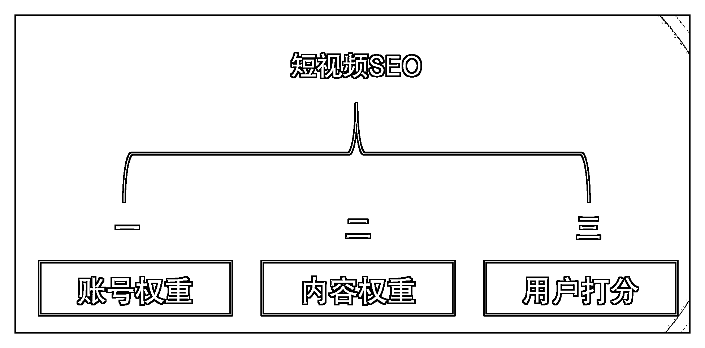
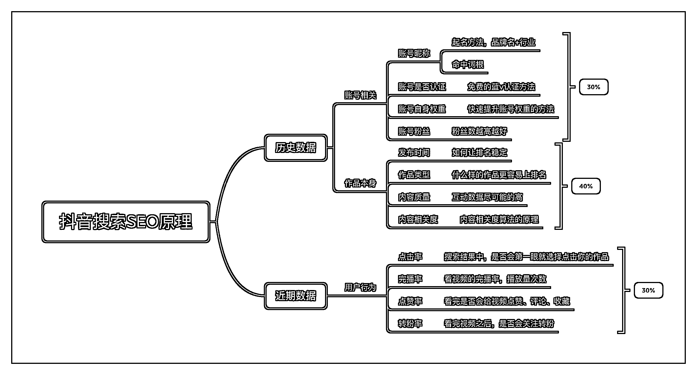
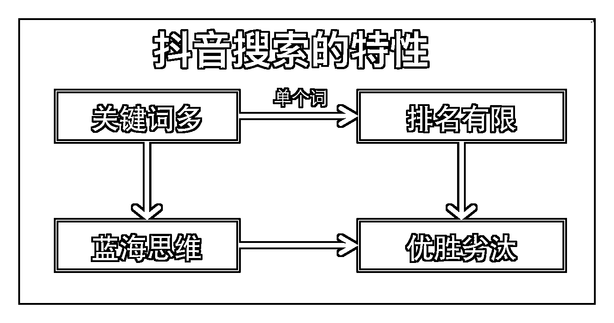

# 3.15 抖音SEO排名：先找蓝海，再赢竞争

在抖音做搜索排名，底层其实遵循两套竞争法则：一是“优胜劣汰”，二是“蓝海思维”。我把影响抖音SEO的关键因素整理成一张脑图，拆成三组来看：账号属性、作品本身、用户行为。

另一张脑图则梳理了12个可以直接落地的排名优化细节：

其中特别要重视蓝海思路：不要只盯着热词，而要从海量关键词里筛出竞争相对小、更适合自己的蓝海关键词。

原因很直接——单个关键词下的搜索结果位置有限，想让作品排上去，内容得分就得压过同一关键词下的对手。

只有把这两件事同时做好，最终才更容易拿到理想排名。

