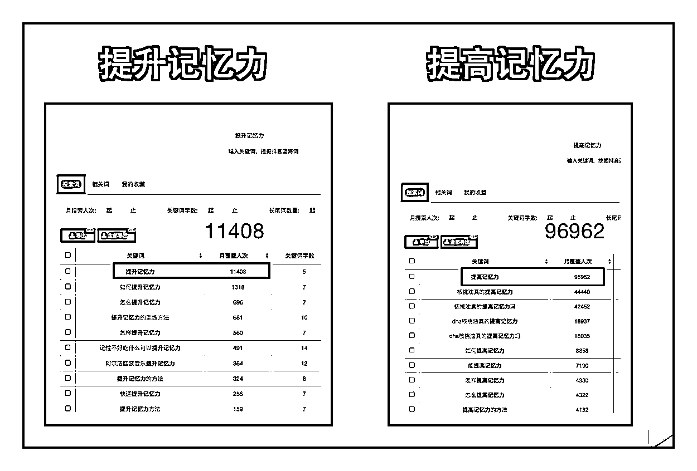
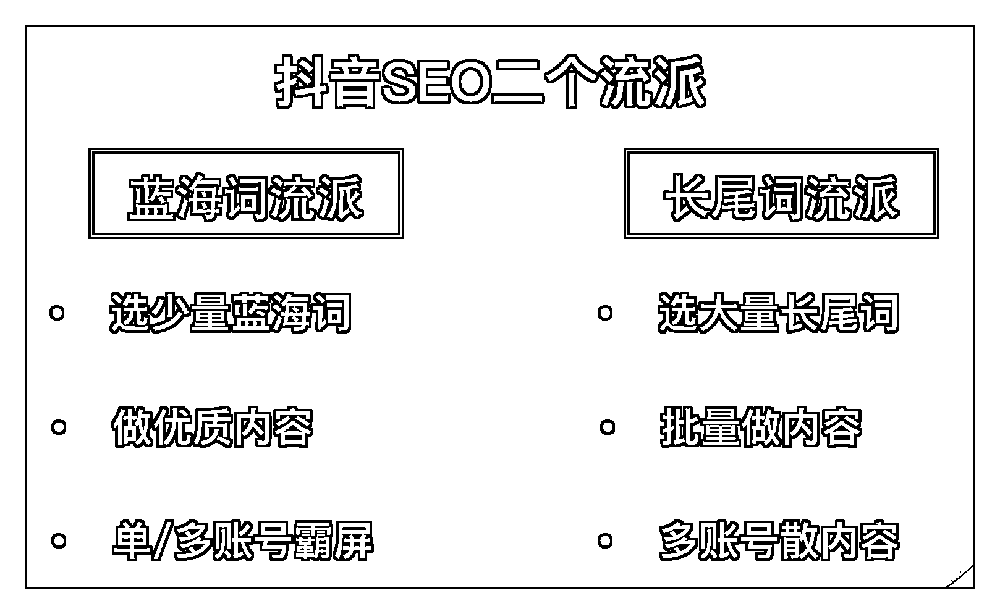
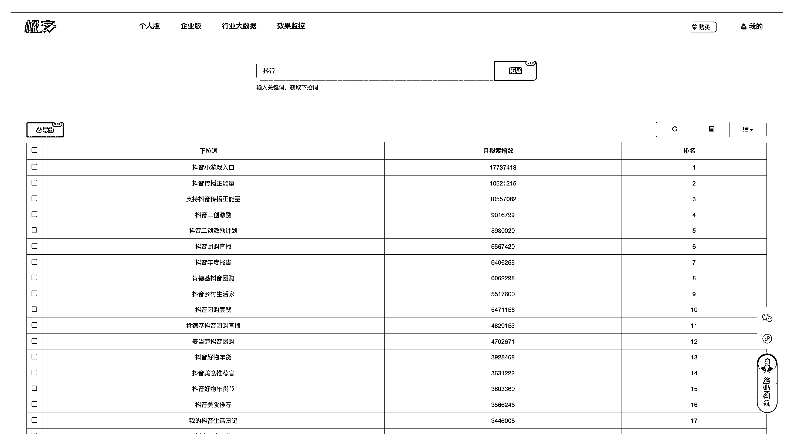

# 4.2 抖音SEO，选词为何如此重要？

前文提到了搜索流量在抖音中的占比情况。抖音SEO真正的价值，就在于想办法把这部分搜索流量的比重拉高，也就是让作品在搜索结果中获得更靠前的排名。

如果被问到做抖音SEO最关键的是什么，我会毫不犹豫地回答：选词。选词在抖音SEO中的分量至少占到50%以上。选择比努力更重要，方向一旦错了，再厉害的排名技巧都起不了作用。

举个例子：“提升记忆力”这个关键词的月覆盖人数是11408，而“提高记忆力”的月覆盖人数是96962，后者的搜索人数几乎是前者的9倍多。如果没数据支撑，就算其他条件都一样，结果也可能差出十倍。

所以，做抖音SEO最重要的事依然是选词，核心逻辑就是找到蓝海词。整个找词方法可分为两个流派：蓝海词流派和长尾词流派。

蓝海词流派的做法是：只选少量蓝海词，数量控制在100个以内。这些词的平均月搜索量在几万上下，发布内容始终绕着这些词来做。做完一轮后，可以换一个新账号，把这些关键词再做一遍，从而实现关键词霸屏。

长尾词流派的做法是：选大量关键词，数量1000个起步，上不封顶。数据显示，词越长，竞争度大概率越小，因为越长的词，被抖音博主靠运气命中的机会越低。这类词多为抖音下拉词，月搜索量一般在1000以内。操作上适合批量产出内容，尤其适合内容生成成本较低的行业。

为了让搜索数据更好看，一个作品不要只抢占一个关键词，而是可以争取在3~5个词上都获得排名，前提是这些词都与作品内容紧密相关。

长尾词流派最需要解决的问题，就是如何快速找到大量下拉词。通过下面这个链接，可以批量获取抖音下拉词，同时还支持数据导出。

[传送门：](https://dyinseo.com/DouyinSugKeyword/index?keyword=%E6%8A%96%E9%9F%B3)[抖音下拉词链接，需要登录后查看](https://dyinseo.com/DouyinSugKeyword/index?keyword=%E6%8A%96%E9%9F%B3)

