# 方法一：把关键词挖到细处

想了解抖音上现在哪些词正在升温，可以一次性批量拉出关键词数据，入口在这里：

[`dyinseo.com/KeywordDouyin/index.html`](https://dyinseo.com/KeywordDouyin/index.html)

如果想对具体词做更细的筛选，不妨按下面这套流程走：

第一步：到极客增长工具里输入你感兴趣的方向词

拿「创业」来试，一搜就能看到返乡创业、餐饮创业、农村创业养殖这类词——搜索需求不小，竞争却不算激烈，这恰恰是典型的流量洼地（提醒一句：工具里标注的竞争度和蓝海词只是系统给出的参考值，最终还要结合自己的内容制作能力来判断）：

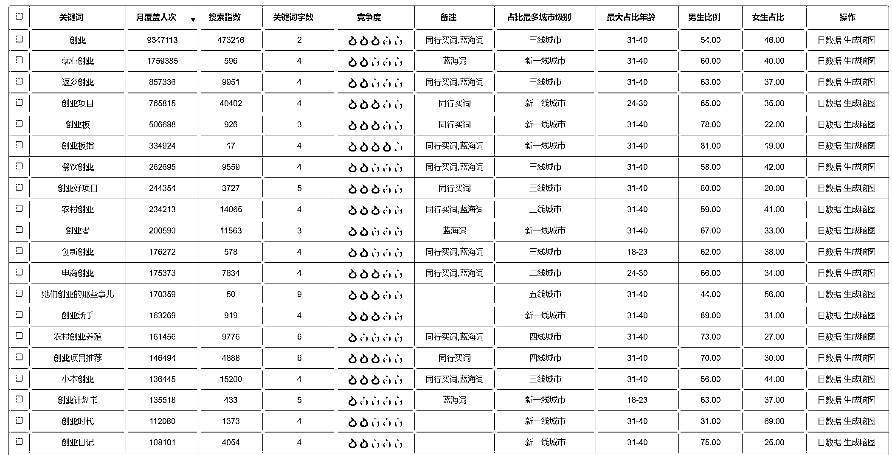

第二步：回到抖音搜索框去验证

锁定一个蓝海方向之后，直接在抖音搜索框敲入对应词，借助下拉推荐去挖更多用户真实需求。比如：

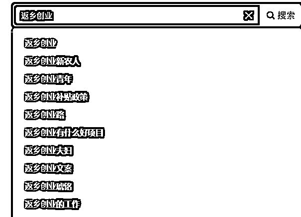

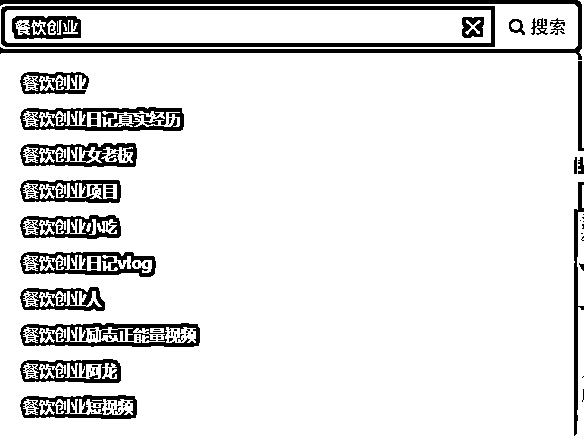

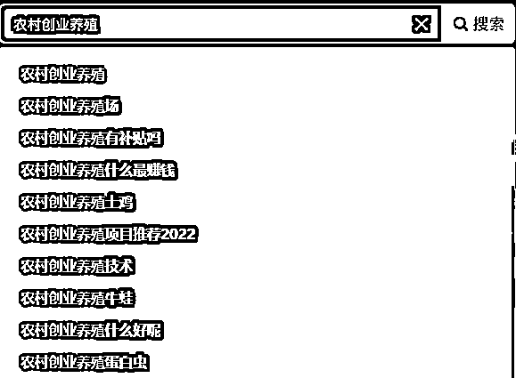

第三步：再回工具做更细的检索

在抖音那边找到更精准的词之后，回到工具继续往下搜。

查询关键词的小技巧：实际搜索时，结果里往往会混进不少干扰项。比如搜二手车，会蹦出二手车价格、推荐、交易市场、直播等一堆不同维度的内容。可你只想看宝马二手车的相关词，直接搜出来的结果又不够丰富。

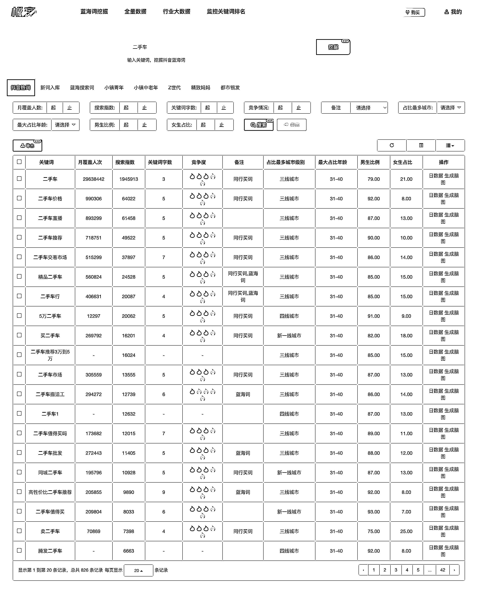

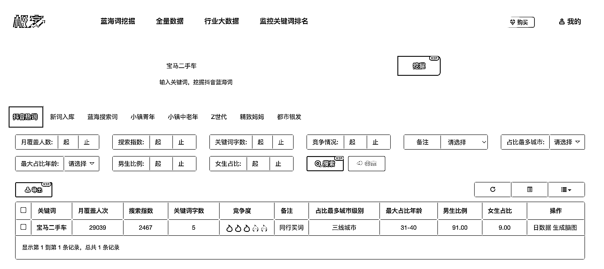

这时候可以改用“宝马 + 二手车”的组合形式，结果就会丰富很多。也就是同时包含关键词 A 和关键词 B：

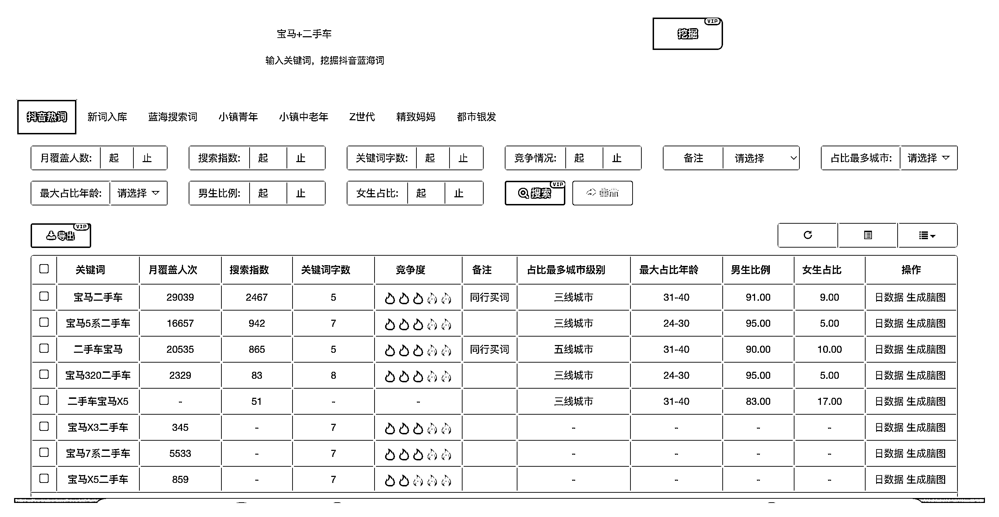

如果反过来，你不想在结果里看到二手车，那就用“-”来排除。它的意思是把某个词屏蔽掉：关键词 A - 关键词 B 。

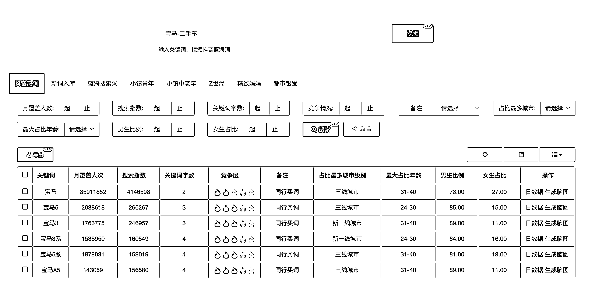

想包含任意一个关键词，则写成：关键词 A 关键词 B 。

选词时值得留意的几点：

• 做同城业务的话，区域范围要卡准；
• 月搜索量只有几十的词，不建议碰；月搜索量超过百万的，先放一放，等积累够经验再动大词；
• 竞争度高的词算不上好词；
• 意图模糊的词也不是好词（词越长需求越明确，词越短需求越模糊，最好挑四个字以上的）；
• 别人视频里大概率会讲到的词，别去做，比如“社群营销的六大核心流程及打法”这种；
• 品牌词转化率通常偏高（不一定非要是自己的品牌，竞品品牌词也可以）；
• 客单价尽量往高了选，低客单价除非搜索量特别大，否则没必要去抢搜索流量；
• 别盲目迷信搜索指数。

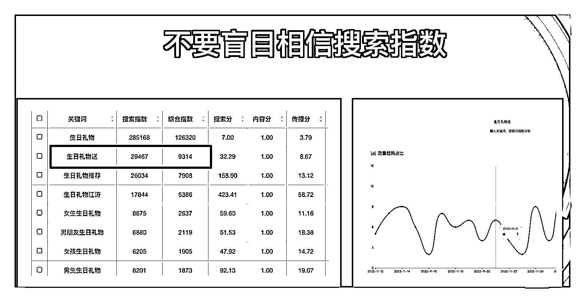

这话不完全对，因为背后还藏着两个变量：

• 关键词搜索量会影响转化率；
• 关键词搜索量也会影响客单价。

所以，并不是搜索量越大就越好，真正值得做的是转化率高、客单价也高的词，搜索量越大越划算——具体还得看你的业务类型。

部分关键词解析：

假如你做的是本地同城二手车生意，下面这些词哪些值得做、哪些不值得做？

实操案例：

场景模拟：假如你做的是本地同城二手车生意，下面这些关键词里，哪些值得做、哪些不值得做？

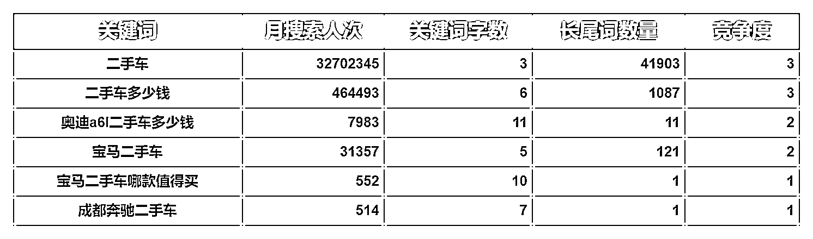

正确答案

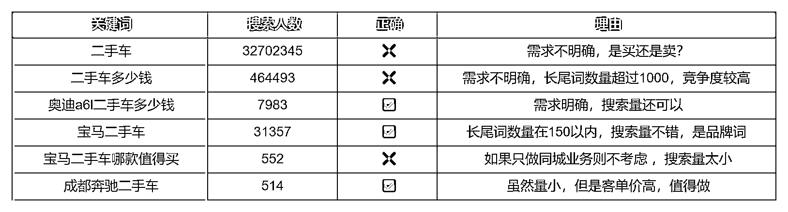

