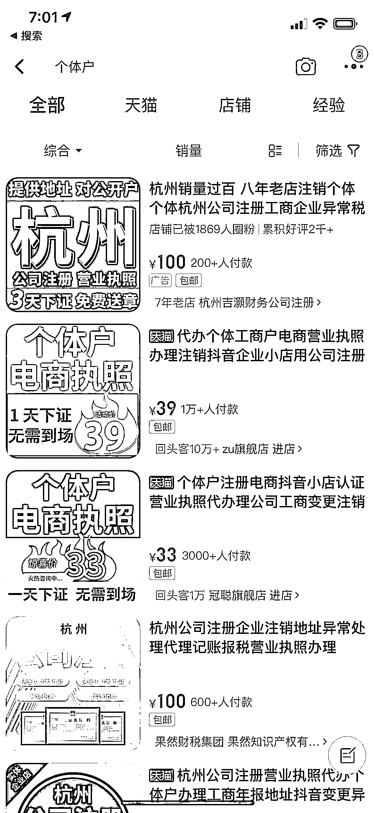
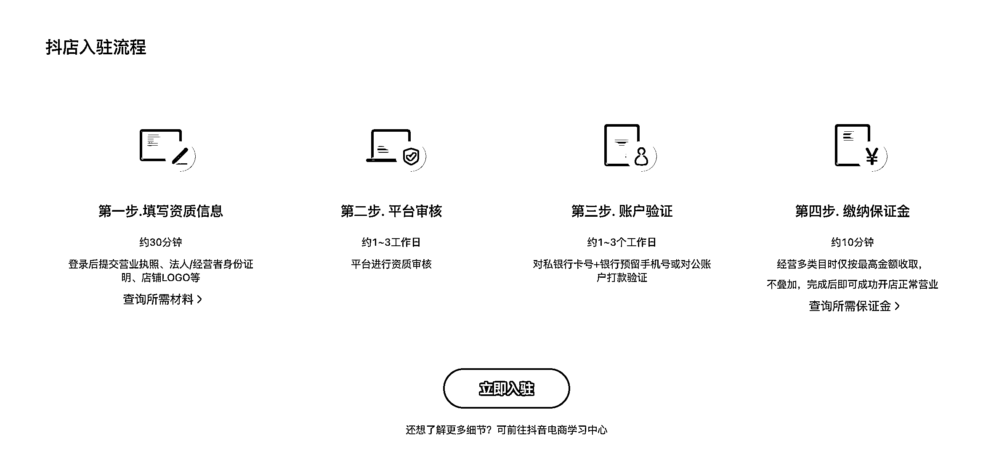
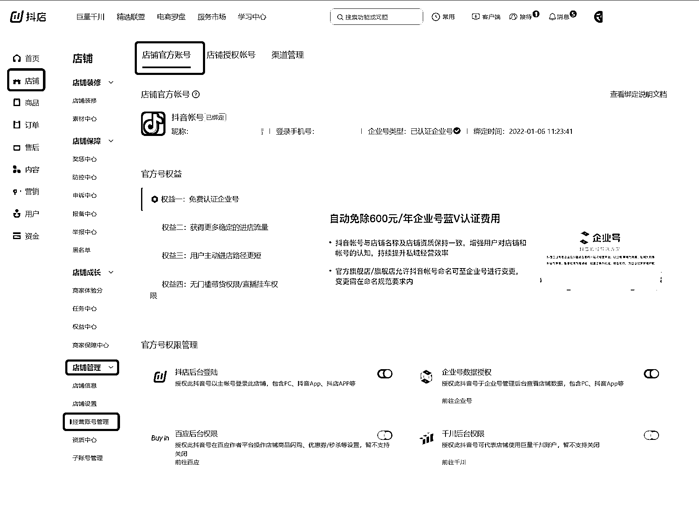
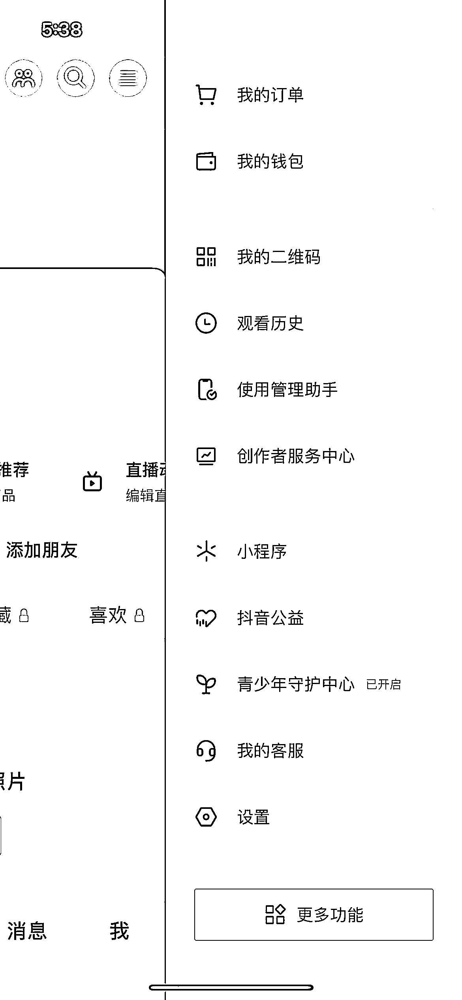
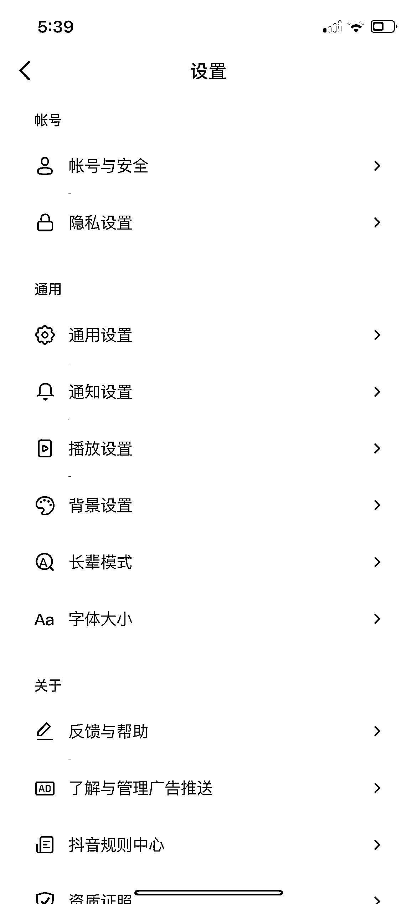
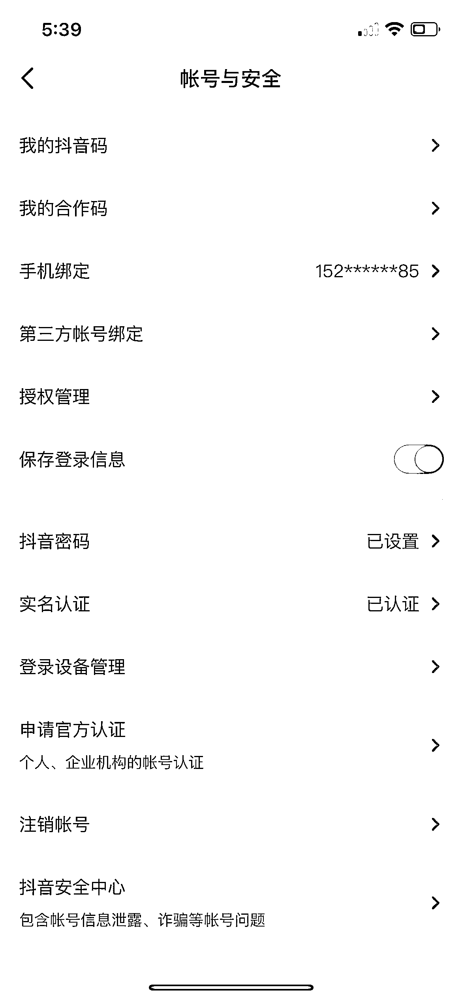

# 方法二：蓝V和黄V怎么拿？

蓝V账号能获得平台权重加成，这一点前文已经说明。那具体该怎么申请？蓝V主要面向企业或个体工商户开放，常规认证费用是600元；如果已经开通抖音小店，这笔认证费可以省掉，但需要缴纳4000元以上的保证金，具体金额会因行业不同而变化。此外，部分内部渠道报价约150元就能完成蓝V认证，但前提是账号粉丝数超过500。个体工商户所需保证金通常只有企业主体的一半，具体办理方式在淘宝搜索相关服务即可找到。

想开通抖音小店？可以查看“店铺官方账号企业号认证说明”：[店铺官方账号如何认证企业号？](https://school.jinritemai.com/doudian/web/article/111648)

官网：[`fxg.jinritemai.com/`](https://fxg.jinritemai.com/)

黄V认证怎么申请？入口在：设置 -> 账号与安全 -> 申请认证。

