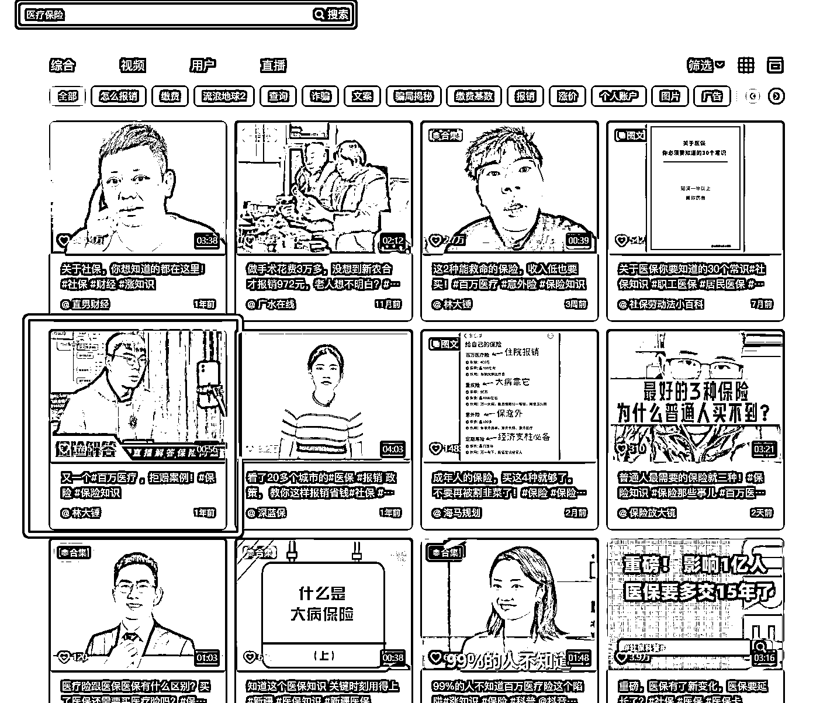
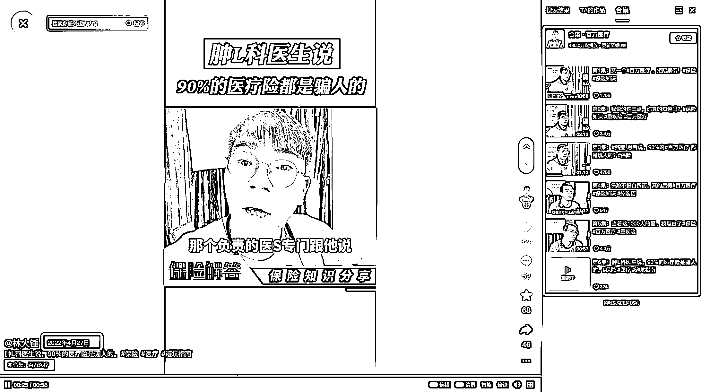
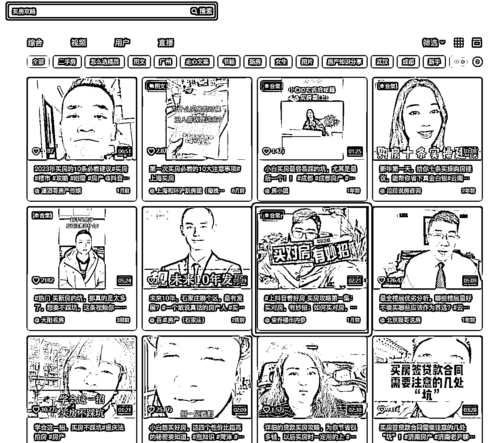
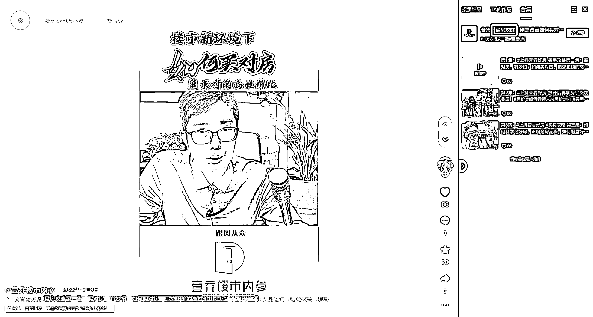
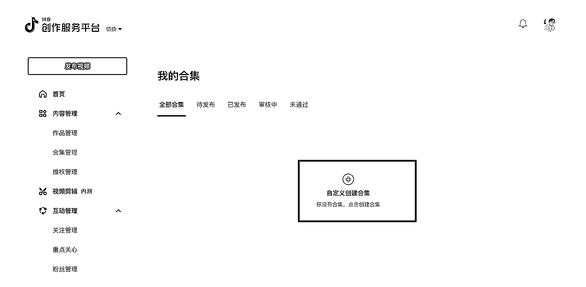
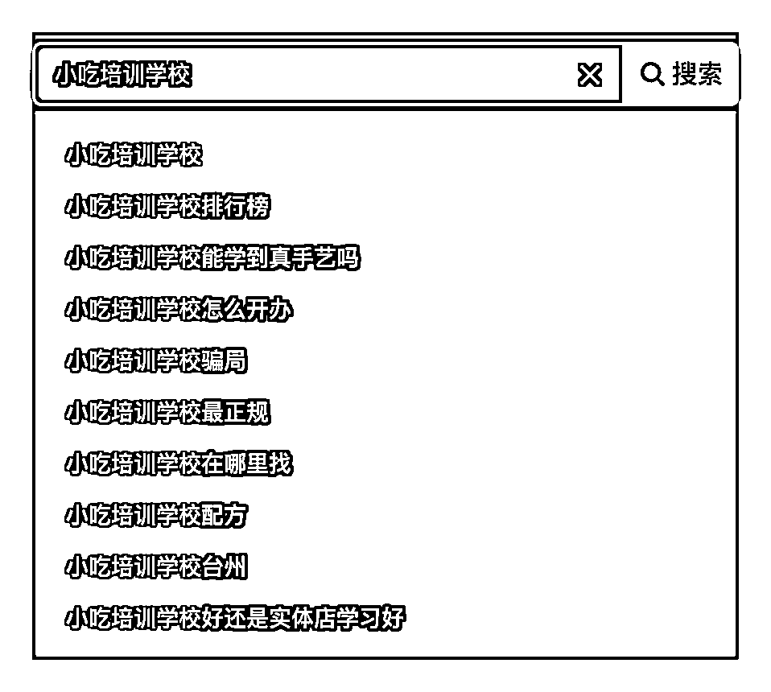

# 方法三：用合集抬高关键词排名

合集的价值常被低估。它不只是把内容归档，更能让合集里的每条作品共享累积权重，同时拉长作品的有效更新周期，让旧内容持续获得曝光机会。

先看“医疗保险”相关案例。正是持续运营合集、把权重叠加起来，才让一年多以前发布的视频至今仍能稳定占住这个关键词的搜索位置：

再看“买房攻略”。这个词月搜索量约15万，一条只有66个赞的视频却排在前列，原因就在于用合集打法把关键词完整覆盖。哪怕互动数据不占优势，排名依然能上去：

合集怎么建？登录抖音创作者服务平台，进入以下地址操作：
[`creator.douyin.com/creator-micro/content/collection/manage`](https://creator.douyin.com/creator-micro/content/collection/manage)

有人会问：不清楚合集里该发什么内容。办法是围绕目标关键词看抖音搜索下拉词。比如做“小吃培训学校”，下拉词就能提供选题方向：

