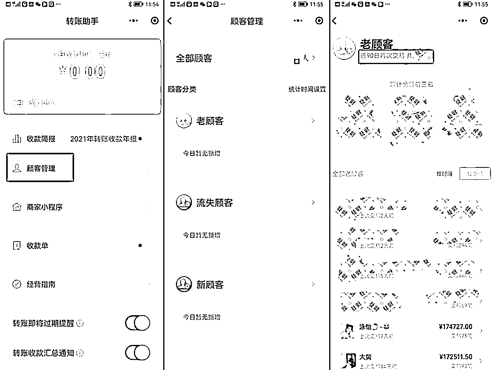

# 6.1.2 CRM：用数据把客户经营做细

做高客单价社群，客户管理如果只靠脑子记，很容易漏掉重要的人。我建议先把微信后台的统计工具“微信转账助手”用起来，它能帮我们看清每位客户的消费轨迹。点进转账助手，找到“顾客管理”，CRM 的基础工作就可以从这里起步。

进去以后，系统会把客户分成几类：老客多少、流失多少、新客多少，而且能具体看到是谁，后面管理就方便多了。我的划分逻辑是：三个月内持续复购、没有断档的算老客；以前常买、近三个月却没动静的算流失客；最近三个月才开始下单的算新客。这个时间范围可以自己设，考虑到我们卖的是高客单价产品，三个月内有过消费，其实已经算不错了。

知道这些信息后，就可以动手分析：老客里有哪些人、贡献了多少金额、下了多少笔。这些人当然要重点盯。再看她们的下单频率和平均客单价，基本能勾勒出核心客群的消费力，对产品定价和选品都有参考价值。再配合后面要讲的客户信息搜集，就能判断她们的购买偏好和个人情况。这样选品时大概知道老客喜欢什么，做维护时也更容易送到对方心坎里。

流失客户同样值得重点跟进，尤其是那些消费金额高的。三个月没下单，原因要一个个查：是哪里不小心得罪了客户，还是家里出了变故暂时买不了？分析完以后，还得用方法把客户唤醒。

1. 唤醒顾客的方法

1）多在朋友圈互动。人都希望被关注，客户流失了，就去她的朋友圈多评论、多点簪，让她感受到你还在意她，有时候客户自己就回来了。

2）偶尔制造小惊喜。能谈得上流失的客户，之前一定消费过。可以时不时送束花、送份下午茶。只要对方不是遇到变故导致消费不起，通常上面两个方法就够用了。

3）如果还是唤不醒，就必须在新客户上多下功夫，把流失的部分补回来。把新客慢慢养成老客，或者持续拉新，营业额才能稳中向上。

当然，这些数据还能挖得更深，这里先不展开，感兴趣可以私下聊。高客单价往往意味着相对高的利润，所以值得花时间分析、想办法。另外，数据不会骗人。如果社群只有一个人运营，单靠感觉，难免有时会遗忘重要客户；统计能提醒我们去管理好关键人员。但工具只是工具，客户服务还是要一对一去做，每个顾客都得当成独立个体来对待。

说清这个工具后，我再分享更细的操作：

2. 需要搜集顾客信息

这一步和微信转账助手配合使用，会更精细；如果时间不够，只用转账助手也够。核心是记录每笔订单信息。可以在 Excel 里列好这些字段：顾客姓名、下单日期、产品名称、图片、数量、拿货价、售价、购买品类，方便以后做数据分析。同比、环比看一看，哪些品类卖得好，哪些品类缺位，后续选品就有依据。很多人靠日常积累的感觉做决策；我零售管理出身，更习惯用数据加详细分析来参考。

客户信息可以这样收集：

1）第一类数据

年龄（生日）、性别、职业及职务、工作单位、常见场合、家庭结构、配偶信息、子女信息等。收集这些，是为了找共同话题，也能提供不一样的价值。知道客户的职业、职务、单位和常出席的场合，推荐产品时更容易贴合她的身份和场景。同时，我们运营的是高客单价社群，群里每个人本身就是资源，多留意说不定就能帮大家互相链接，提供更多价值。再比如，了解家庭结构和配偶信息，对选品也有帮助。我群里 98% 是女性客户，配偶的吃穿用她们往往可以帮忙买；知道配偶的大致情况后，推荐男士产品销量通常也不会差。另外，群里客户大多和我年纪差不多，都开始有宝宝了，高客单价的母婴产品可能是我未来要嫁接的方向。知道子女生日，还能在孩子生日时送上祝福或礼物——子女的破壳日也是母亲的母难日，这个体贴做到位，客户的感受会完全不同。

2）第二类数据：顾客的个人风格资料

包括个人基础风格（优雅、时尚、性感、浪漫等）、偏好、发色、肤色、妆容偏好、体型。这部分可以按群内所售商品做细微调整。整理这些信息，除了帮助自己带货，还能挖掘客户的隐形需求。我整理客户资料，对卖品牌包包衣服有帮助，后面还有更大作用。比如以后我要开服装店、卖自己的服装，就有了具体的客户风格画像，选品会更有方向；假如开美容院，也知道客户可能偏好哪种类型。总之，数据样本量够大，这些信息对后续其他方向的创业也会有帮助。

这些信息怎么知道？行话叫“非销”，从客户闲聊里获取，另外就是从客户朋友圈里获取。

以上都是 CRM 的基础数据信息管理。拿到数据后的分析、措施是第二步，第三步是管理。这个方法的好处是，先给你一个思考方向。作为社群群主，不管什么性格，都能做，至少能到及格分。有些群主社交能力很强，靠感觉就能把群做得很活跃，把每个客户都照顾得很好；但肯定也有人没这种能力，或者没那么多时间。方法和 SOP 的好处，就是相对不那么考验个人性格和能力，甚至可以复制成流程交给员工，把自己解放出来。

3. 把顾客进行分类管理

很多公司会按消费能力给顾客分类，不同类别享受不同待遇。美德目前的客户基数还没大到要做很深的层级划分。我的做法是：购买 10 次以上算老顾客，年消费 3 万以上算我的 VIP，都会认真真心对待。新客户只要沟通有礼貌，买不买都不重要，也会耐心对待。有了基础分层后，就可以给 VIP 客户设计专属仪式感。具体做法在仪式感打造部分已经详细分享过，这里不再重复。