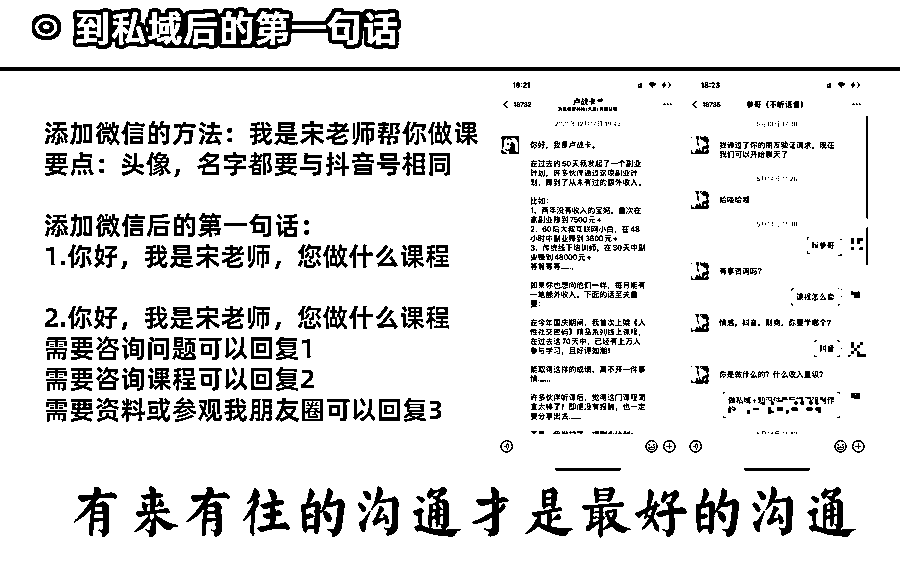

# 6.2.1 先加上人，成交才有下文

不少人花了很大力气才把微信加上，却卡在下一步：到底怎么聊，才能把成交往前推？我的建议是，先做好下面几件小事，转化率通常能很快提起来。

**破冰话术：**

开场白的分量比很多人想得重。我们做过测试，把不同长度的破冰话术放在一起对比，结果挺反直觉——话越短，成交效率往往越高。来看这张图：

图右侧是两段聊天记录，分别来自参哥和卢战卡。你第一眼看到那两句招呼，分别是什么感受？真轮到你，你更愿意回谁——“卢”还是“参”？记住，破冰不是自说自话，关键是让对话有来有回。

别把加上微信当成终点。第一时间把人加上，是成交链路的第一要务；加上之后，开场这一句，才决定后面有没有戏。