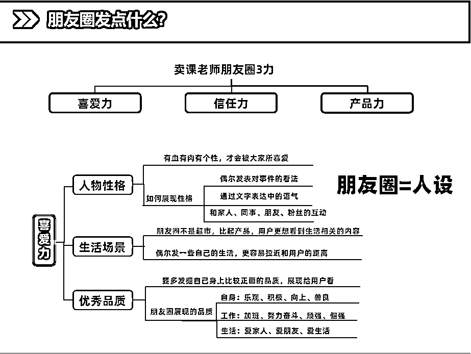
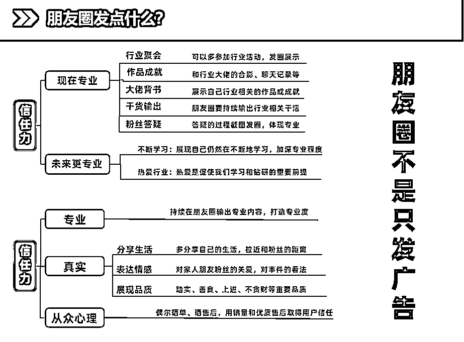
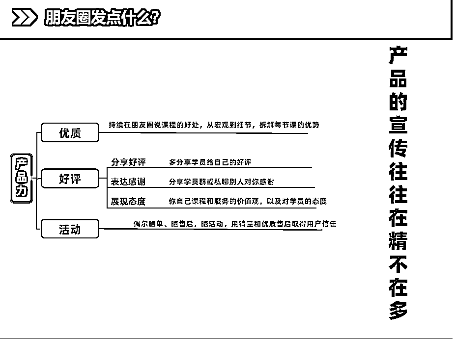

# 6.2.3 今天的你，认真发朋友圈了吗？

想把私域转化做到位，朋友圈这步不能少。朋友圈经营得好，订单自然会找上门。至于怎么发，我整理了几个公式，方便你直接套用：

- 高客单价的成交，卖的不是产品，而是你这个人
- 而“你这个人”的关键，在于朋友圈里透出的温度、信任感和专业度

我以前也有个误区，总觉得自己朋友圈里高手如云，越比越不好意思晒。后来才想明白，那些真正厉害的人根本没空刷你的朋友圈，他们自己都在忙着发内容、吸引同频的人。更何况，总有人现在不如你、正需要你的分享。所以，别纠结“发得够不够好”，先“发出去”再说，行动永远比空想有价值。

接下来给你三个朋友圈选题框架：喜爱力、信任力、产品力。

最后提醒一句：进阶玩法是给朋友圈做“千人千面”，按不同标签分组，发适合他们看的内容。