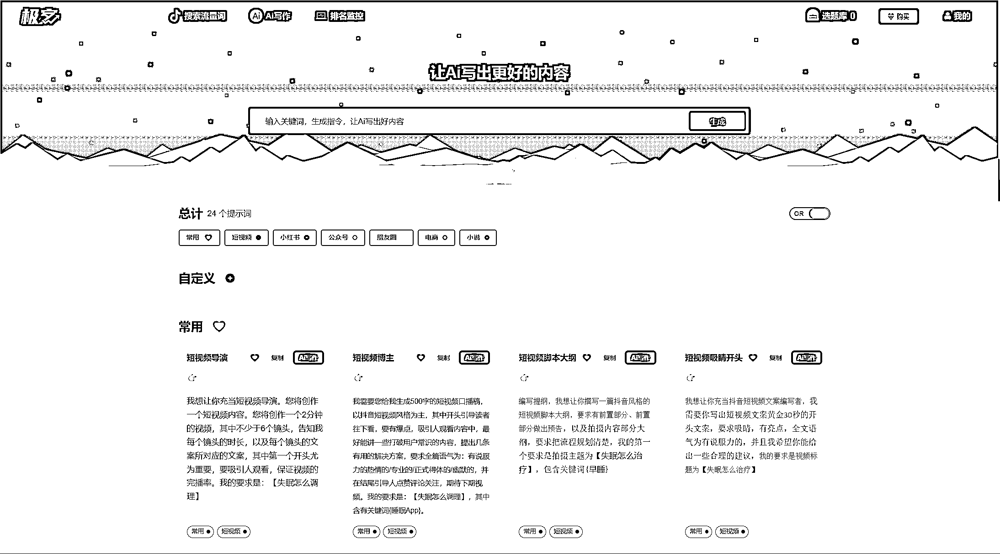
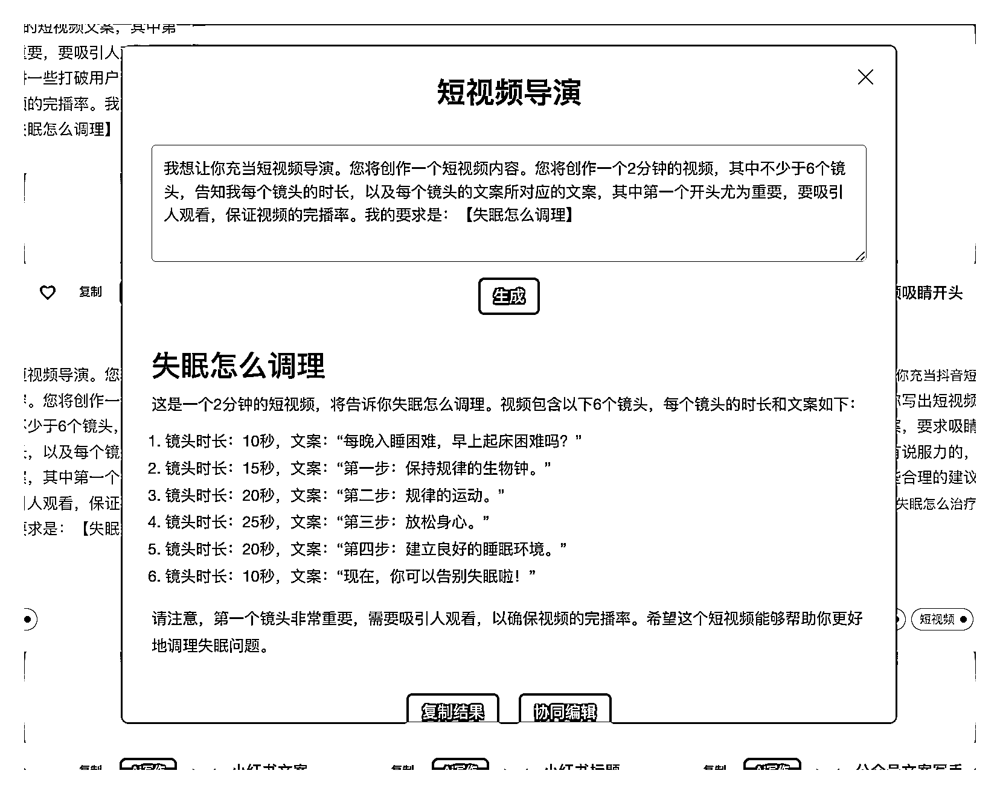
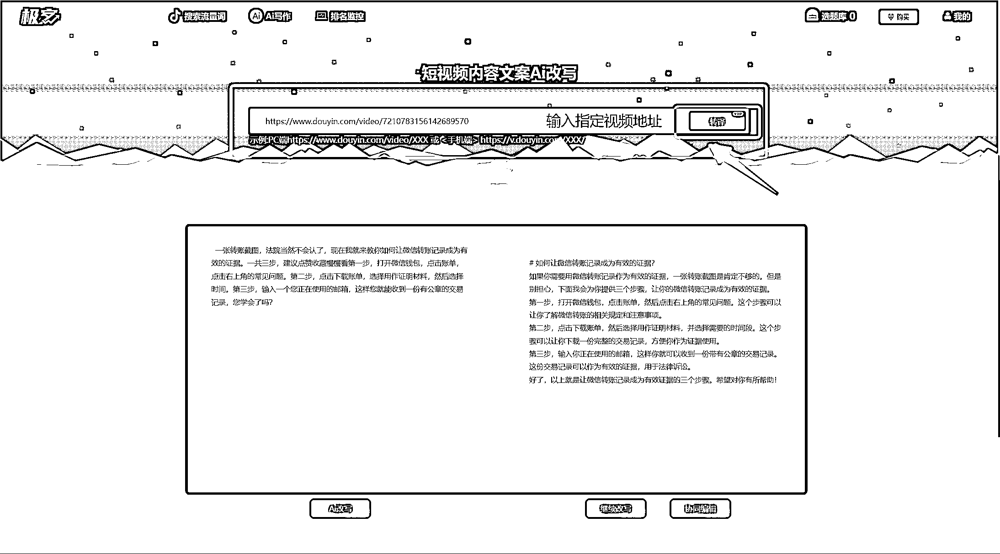
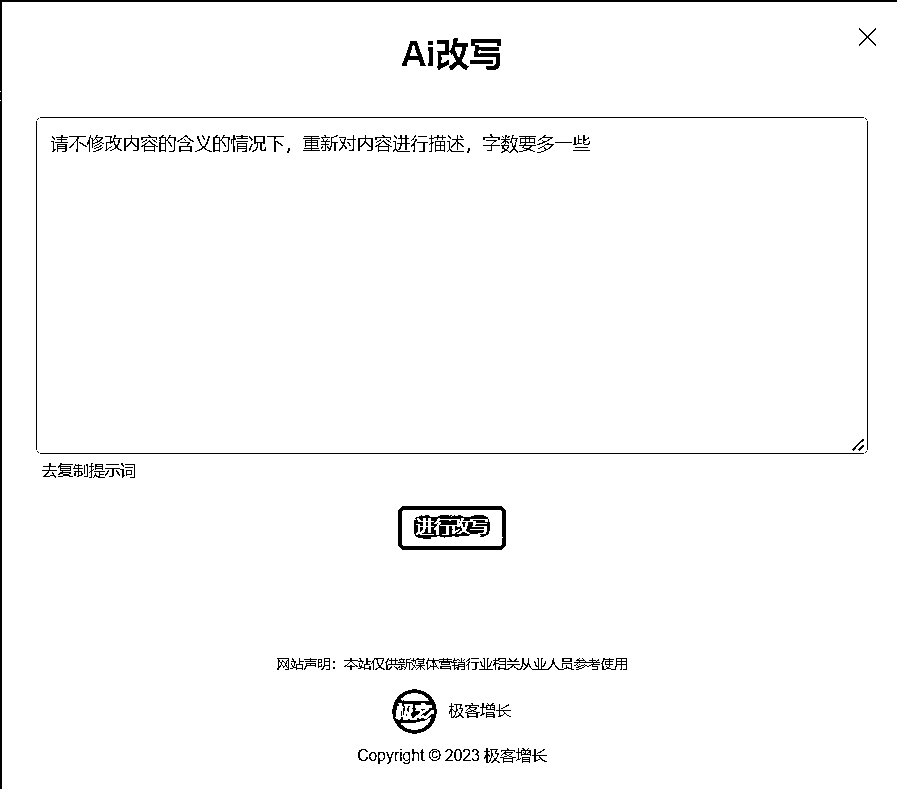
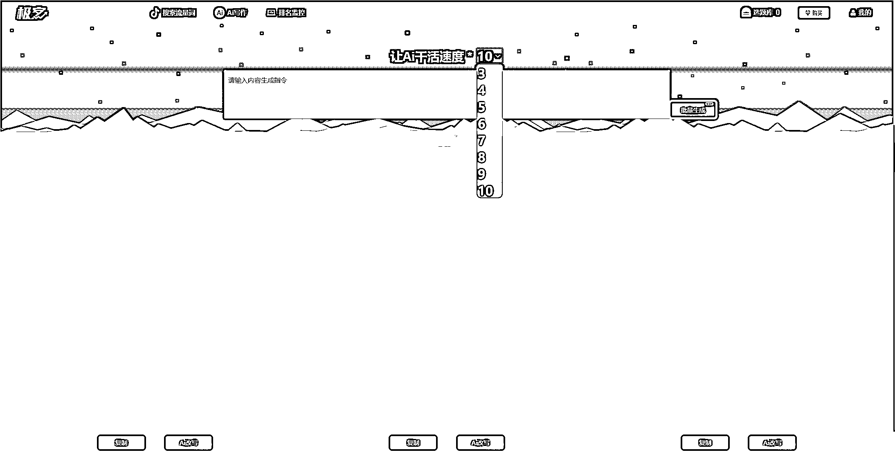
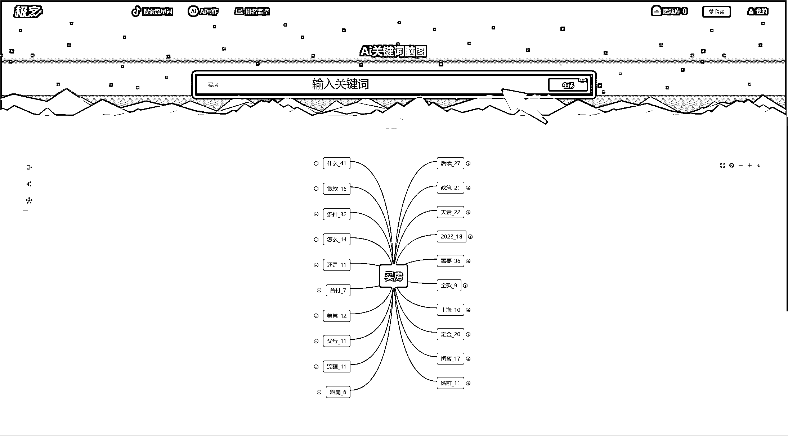

# 7.1 极客 AI 工具：短视频高效出稿指南

短视频创作里，从定方向到写脚本再到批量成稿，极客 AI 工具能把几件事一次打通。下面按四个用法拆开说。

**1. 先定创作场景，再让 AI 开写**
进入 AI 写作模块，先按目标确定创作场景，再根据场景挑选可参考的提示词模板。比如要写短视频脚本，可以选短视频脚本大纲模板；有更具体的要求，也能自行设定。按下“AI 写作”，生成流程随即启动：

**2. 锁定对标内容，一键改成新脚本**
运营抖音搜索时，常见做法是研究搜索结果里排在前五的内容并加以借鉴。此时可锁定对标账号的视频，一键完成改写。

操作流程：
1）先拿到视频链接，电脑端和手机端都能操作。再点“转译”，原始口播文案就会显示出来。
2）按下“AI 改写”后会弹出提示词编辑窗，既能按自己的需要调整，也能沿用系统默认提示词。

3）执行改写，新版文案立即生成。若效果不理想，点“继续改写”反复优化，直到满意。

**3. 一次产出多篇文案，量大也能接住**
如果任务要求大批量出稿，“AI 加倍改写”就很合适。输入指令后，系统会一次给到 3 至 10 篇文案，你只要挑出合意的再稍作修改即可。

**4. 关键词生成脑图，灵感不足也能找选题**
创作灵感不够、不清楚内容该往哪个方向走时，可让 AI 关键词脑图接手：填入关键词，一键生成脑图；它支持二级目录，能延展出更多选题思路。

