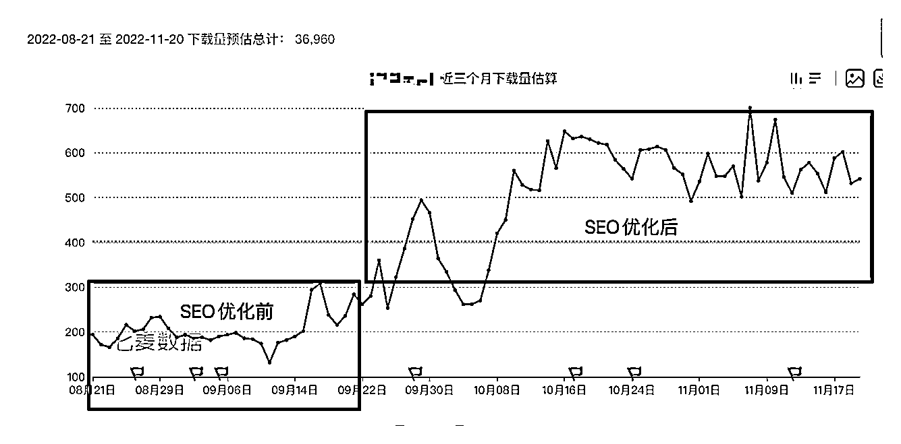

# 案例3：工具类APP如何用抖音SEO撬动增长

这是一个工具类APP的创业案例。项目刚起步，产品体验不错，年费定价在99元到199元之间，但用户增长和变现一直是个难题。创始人把希望押在了抖音SEO上。

**1）流量来源**

- 内容形式：抖音短视频
- 流量通道：完全依赖抖音SEO的自然搜索流量

**2）变现产品**

- 形态：软件（自营APP）
- 品类：工具类产品
- 获取成本：每位用户下载激活大约要花15～20元
- 价格：年费99～199元

**3）变现路径**

- 载体：将用户引导至第三方平台
- 动作：下载并激活APP

**4）抖音SEO优化全记录**

- 流量痛点：因为是垂直小众应用，买量成本居高不下，单个下载激活就要15～20元，非常肉疼。所以想靠SEO撕开一个口子，拿到更便宜的流量。
- 优化动作：之前发的视频数据平平，转化很差。后来借助极客工具去深挖用户真实痛点，找到竞争小、需求明确的蓝海关键词。只用了一个月，就卡住了3个核心关键词（涉及客户隐私，具体词就不展示了）。
- 优化效果：从9月21日发布抖音内容开始，只看苹果端数据——
  - 日均下载量从200涨到600，翻了3倍，一个月新增下载量超过1万。
  - 工具（效率）分类排名从第400名爬到第200名。
  - 按下载转化率5%、年费199元估算，一年能多带来14328000元营收。
  - 按单个用户最便宜的15元获客成本算，一年能省下2160000元推广费。

案例总结：大多数创业者其实不会用数据去发现用户痛点。但只要找准了那几个核心痛点，你就能以很低的成本，持续稳定地拿到流量。