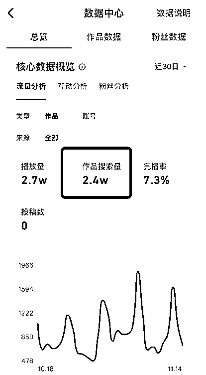
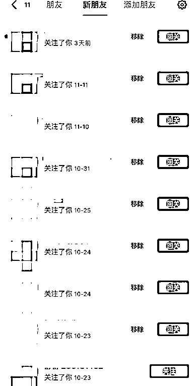
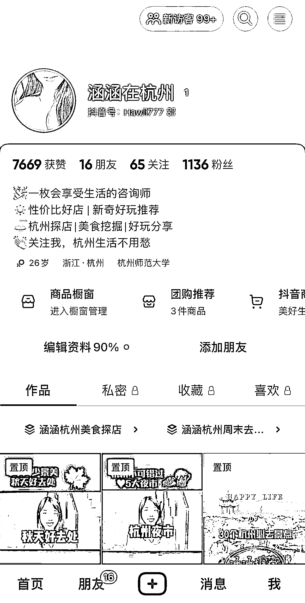

# 案例 4：同城团购的长尾搜索实验

这个案例来自我们自己的实操。为了验证搜索流量能不能长期存在，我们围绕 SEO 思路做本地生活带货，前后只发了大约 20 条短视频。一年后回看，每个月仍有数万次搜索流量；按 12 个月累计，就是几十万次搜索流量。搜索流量的持续性，在这里体现得很明显。

1）流量从哪来
• 内容载体：抖音短视频
• 入口构成：一部分来自抖音推荐流，另一部分来自抖音搜索（SEO）流量

2）卖什么
• 商品形态：实体产品
• 所属领域：本地生活带货
• 货源方式：销售第三方商品

3）怎么转化
• 承接方式：把用户引到线下完成交易
• 成交策略：主推利润款，直接促成下单

案例小结：让作品持续吃到长尾流量，是我们追求的目标之一。具体做法是先用关键词筛选避开激烈竞争，再稳定、持续地获取搜索流量。即便账号已经一年没有更新作品，搜索端带来的流量依旧可观。