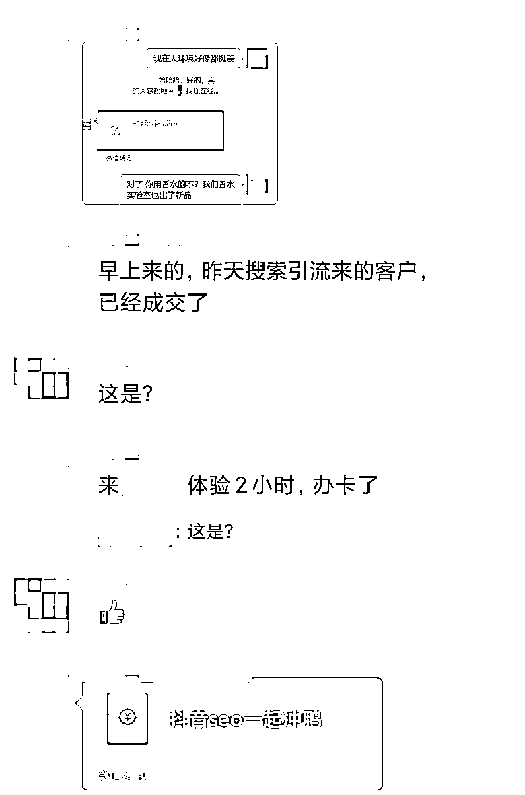
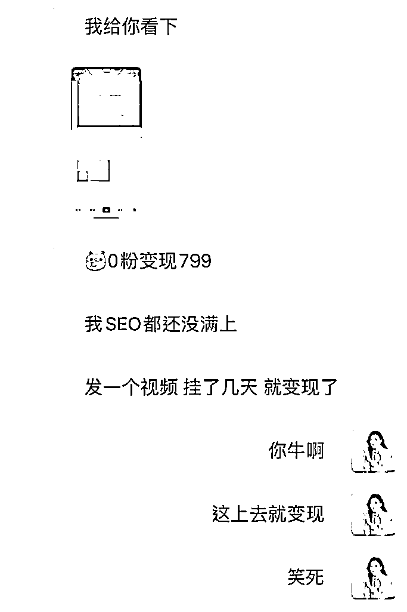

# 案例5：0粉小店靠同城SEO开单

背景：一位做本地生意的学员，想帮自家门店带客。店里卖的是实物商品，业务聚焦同城，货源由自己负责，单笔成交大致在500—1000元，前期经营还处于亏损状态。

1）获客入口
内容用抖音短视频来做；流量有两条线，一条来自平台推荐曝光，一条来自抖音搜索排名。

2）卖什么
产品是实物，业务落在同城，货源自己把控，价格带保持在500—1000元。

3）怎么成交
先把线上客户引到门店完成交易；成交时不绕弯，直接主推利润款。

4）同城SEO打法
最头疼的是附近同行密集，习惯用低价抢客，流量难拿且投入高。他的打法是抓住本地属性，把“同城+品类词”作为关键词方向，内容里融入门店特色，同时把老板的人设做鲜明。学完抖音SEO课程后，他马上用于实际经营：账号还没粉丝，就吸引了精准客户并成交；多个平台的搜索结果里也频繁出现他的内容，后来还拿到羊城晚报的独家采访机会。

复盘：效果很快显现。对实体店来说，抖音SEO能绕开传统抢流量的混战，显著降低获客成本。