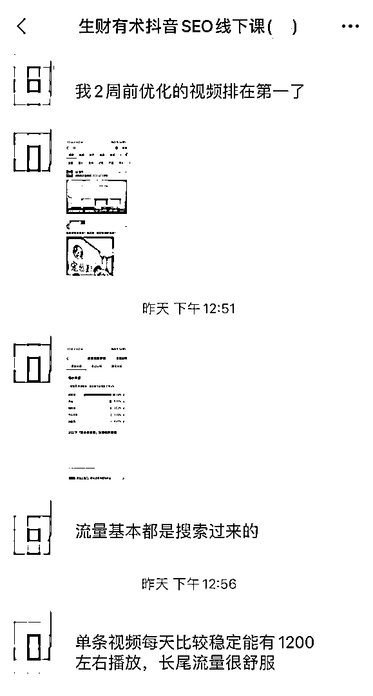
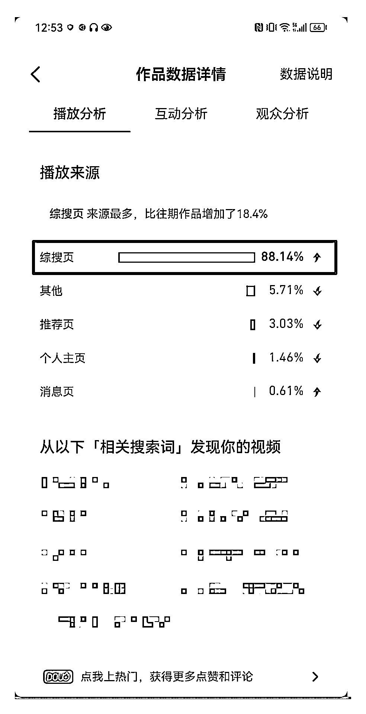

# 案例 6：宠物医疗靠搜索词获客

这位学员来自线下课，做的是宠物医疗生意，客单价在200元以上。早期他花钱搭了短视频团队，本想靠内容打出结果，但投入许久，效果始终不理想。来参加抖音SEO线下课之前，短视频团队已经被他砍掉，他把获取精准客户的希望，转向了抖音搜索优化。

在内容与流量上，他做的是抖音短视频，流量主要来自两块：平台推荐流量和抖音SEO流量。变现端卖的是实体产品，属于宠物医疗品类，货从第三方渠道来，客单价200+。成交方式是把用户引到私域，在私域里直接推利润款完成成交。

抖音SEO这块，他在线下课现场就把用户痛点梳理了一遍，接着挖掘合适的蓝海词，最后把方向定在宠物疾病上。词选好后，他回公司立刻开干。优化效果也出来了：他做的词月搜索量大约3～4万，排名做到第一之后，稳定的精准流量持续进来。

