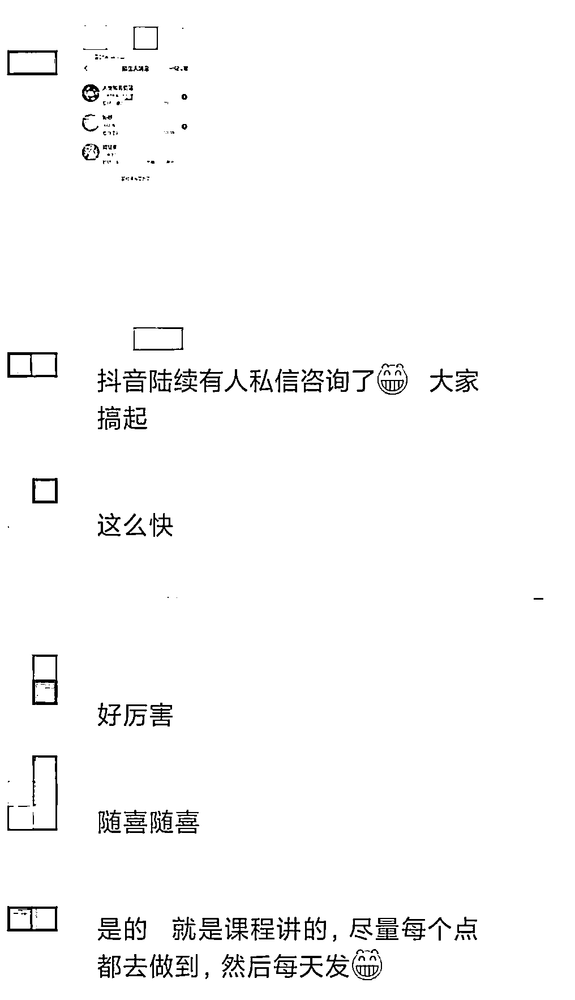
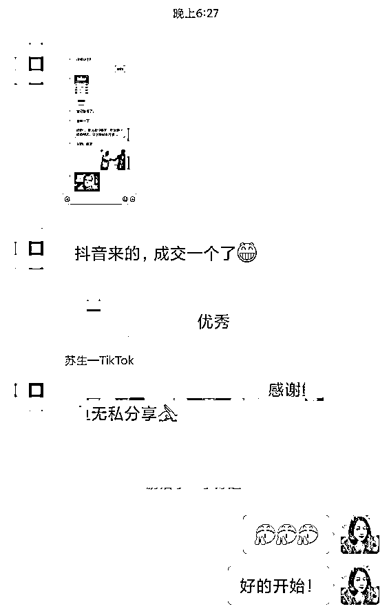
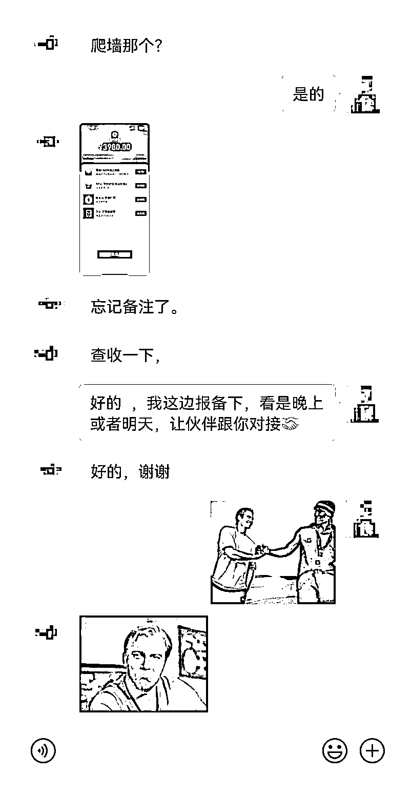

# 案例 2：小众跨境培训，靠搜索拿下首单

这位学员做的是跨境电商方向的培训。抖音上搜这类内容的人不算多，但需求很对路，同行竞争也有限，课程定价大概在 4000 元。

**获客入口**
- 内容载体：抖音短视频
- 流量打法：抖音搜索优化（SEO）

**卖什么**
- 产品形态：虚拟课程
- 课程品类：跨境培训
- 供货方式：自己出货
- 价格区间：客单价约 4000 元

**怎么成交**
- 承接方式：先引到私域，再完成交易
- 成交动作：直接推利润款

**搜索优化怎么打**
- 原来的难点：品类偏窄，起步阶段视频流量不高，来的人也不够精准，所以想借抖音搜索拿到更对口的客户。
- 具体做法：结合业务特点，先锁定产品词，迅速抢占精准需求；等跑稳后，再扩成品类词和痛点词，把流量池做大。
- 实际结果：他照着课程方法执行 2 天就见到效果，引流 8 个人；不久后成交 1 单，金额 3980 元。

案例总结：客单价够高，搜索量小并不是问题；流量不必多，够精准才关键。