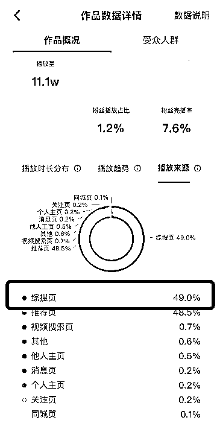
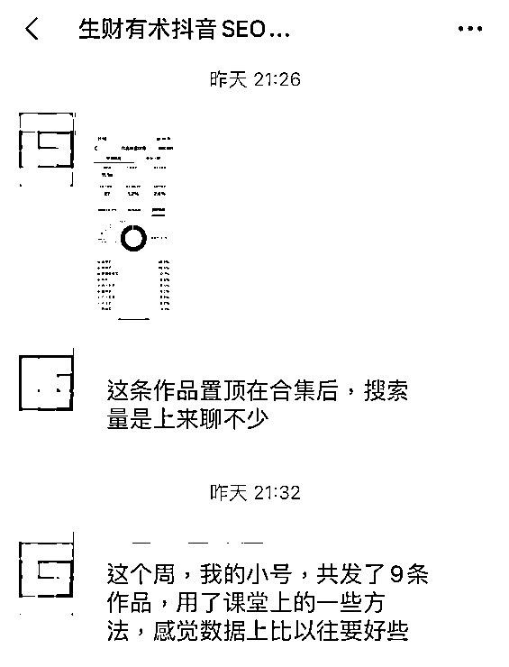

# 案例 4：高端二手车用搜索放大精准流量

这个全国二手车项目也覆盖同城场景。一位经营城市高端二手车的学员，原本已有自己的抖音账号，想系统学习搜索打法，获取更多高意向流量；其成交单价大致在 20 万至 100 万元之间。

1）流量入口
内容以抖音短视频为主，获客渠道分为两块：平台推荐流量，以及抖音搜索流量。

2）变现产品
销售的是实体车源，品类为城市高端二手车，货源由学员自己组织，价格区间为 20 万至 100 万元。

3）成交路径
先把客户沉淀到私域，或邀约到线下完成交易；转化上主推利润车型，走直接成交路线。

4）抖音搜索优化
原来的难点在于：单个客户价值很高，但此前短视频带来的流量不够精准，因此希望进一步提升意向度。团队通过线下培训，并结合数据分析，最终确定采用品牌词策略，直接承接“品牌 + 二手车”相关搜索流量；这类流量面向全国，不受地域限制。

优化后的结果是：一条视频累计播放 11.1 万次，其中 49% 来自搜索，搜索量明显增长，学员也把关键词排名稳定在第一的位置。

案例总结：关键词选得准、方法用得对，通常都能做出结果。