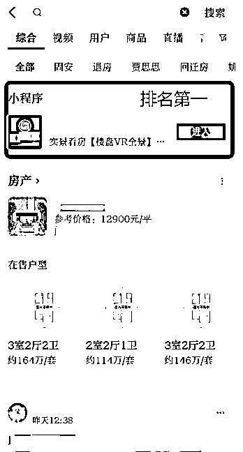
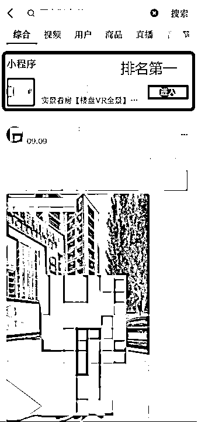
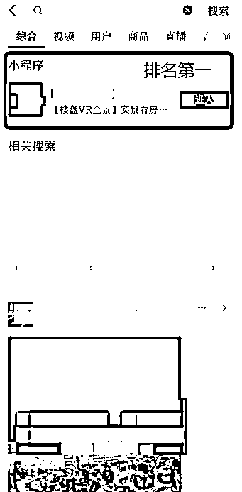

# 案例6：房产小程序，靠搜索找到新出路

今天拆解一个很有意思的案例。主角是负责北京周边新房项目的房产人，那边市场竞争相当激烈，常规打法已经很难抢到客户。

他选了一条不太一样的路：用抖音短视频获取流量，但重点不是拼热门推荐，而是吃抖音SEO的流量。简单说，就是把搜索流量接住，让有购房意向的人自己找上门。

变现端走的是实体产品路线，卖的是房产，具体来说属于高客单价的第三方房源。成交方式也很有特点：先引流到私域，或者引导到线下完成交易，本质上是直接卖利润款。

再说大家最关心的SEO优化环节。他当时面临的最大痛点是：同行太卷，各条渠道都挤满了人，拍摄成本又高，不想再靠堆量烧钱。于是我们帮他系统梳理了所有楼盘相关的搜索数据，挑出10个月搜索量大概在1000左右的楼盘关键词，对应注册了10个小程序。最终结果：4个小程序排在第一位，其余几个也都挤进了前五。

这个案例给到的启发是：如果你的行业适合用小程序承载业务，又希望做得省力一点，不妨认真考虑这个方向。

