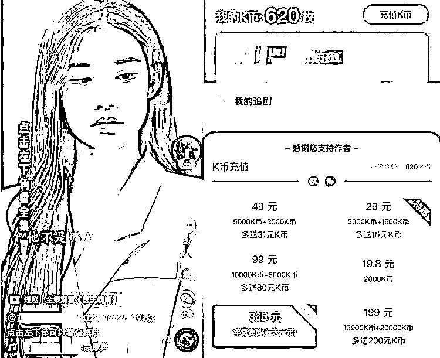

# 1.1.3 短剧付费：高潮处设卡

这类短剧的拉新打法，和网文推文有相通之处：观众追到最吊胃口的节点，画面突然停住，想继续就得先付费。

项目盈利的关键，是促成观众掏钱；常见路径有两条——逐集购买观看权限，或者直接开通会员：

从内容源头看，多数作品脱胎于网络爽文。眼下容易爆的桥段，往往是主角先藏锋芒、后突然翻盘，主打“憋屈到扬眉吐气”的爽感。抖音上常被网友玩梗的“歪嘴”系列——龙王、战神一类赘婿故事，就是典型；估计不少人都见过类似片段。

参考资料：三份相关材料，分别涉及推广流程、CPS 收益和分销入门科普。

