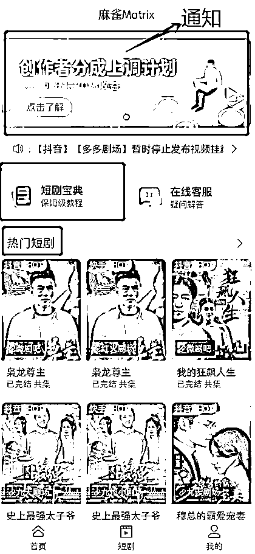
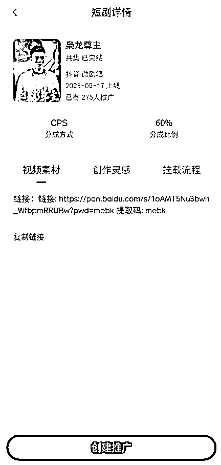
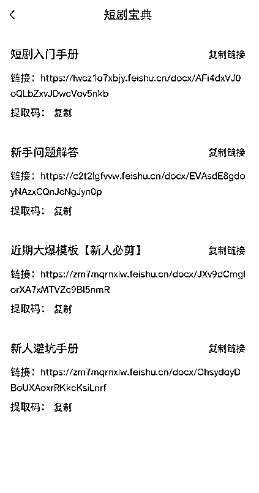
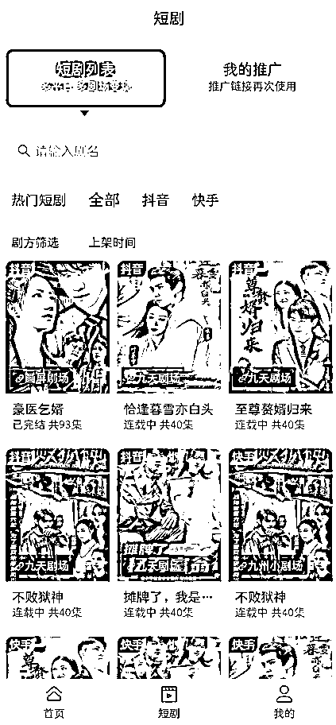
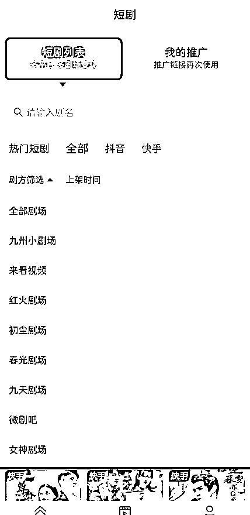
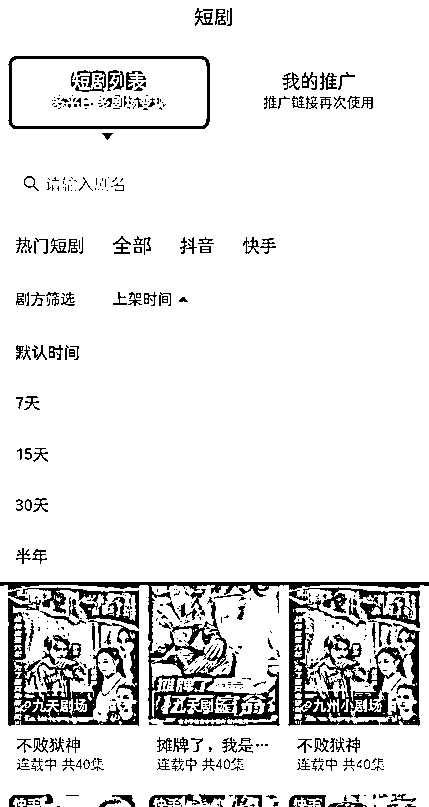
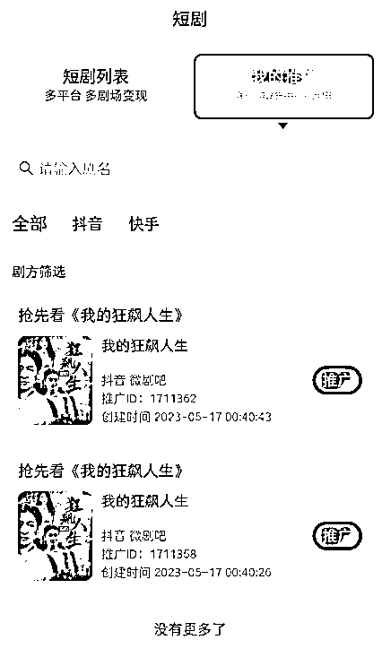
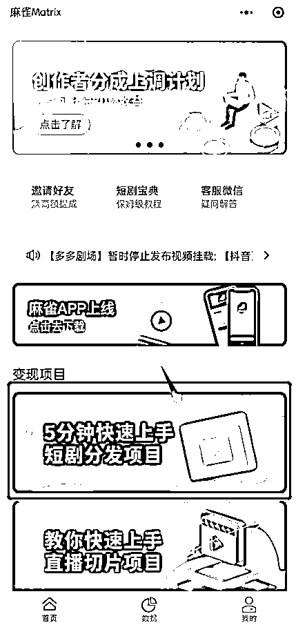
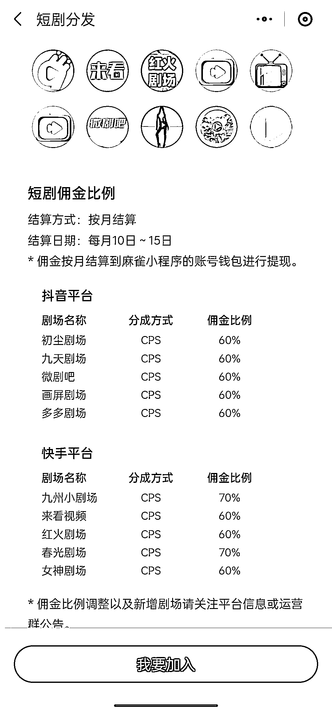

# 3.1.3 麻雀 Matrix 功能速览

打开 APP 后，会看到几个主要页面，这里做个快速说明。

首页集中展示三块内容：「重要通知」「短剧宝典」「热门短剧」：

「热门短剧」点进去就能为相应剧目建立推广（配图只是示例，并非推荐）；

「短剧宝典」则收录官方手册、新手常见问题、爆款模板等资料，按自己需要取用：

切换到页面底部的「短剧」入口后，会出现「短剧列表」与「我的推广」两块。前者汇总麻雀 Matrix 当前可推广的全部短剧，并支持按剧方、上架时间筛选：

后者展示你之前生成过的其他短剧链接，推广链接可直接复用：

至于分佣比例等细节，位于小程序主页，点开即可查看；结算方式为按月结算：

