# 3.2.2.1 短剧推广怎么上手

打开创作猫后，最先看到的通常是「学习」频道。这里放着上手教程、项目任务说明等内容，作用就是带你快速认识平台里的各个玩法。要是你对「短剧 CPS」的某个环节没弄明白，不妨先在这个页面搜一搜，很可能已有现成答案。

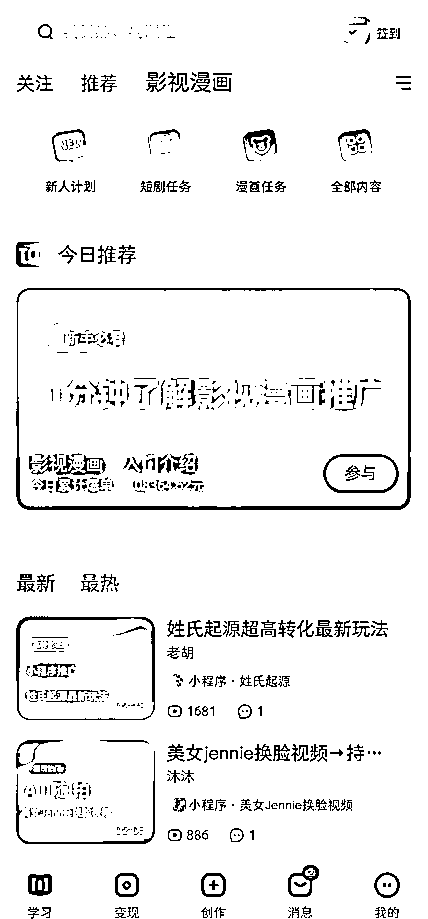

想找能变现的入口，就点底部「变现」。这里藏着创作猫里最值得重点研究的板块之一：你能浏览当前可推广的短剧，并直接点进对应剧目开启推广。

选「影视漫画」后，短剧类型会铺开，平台还做了归类，例如「最新热剧」「爆款推荐」「超高转化」等。想提高出爆款的概率，可以从这些分类里挑。

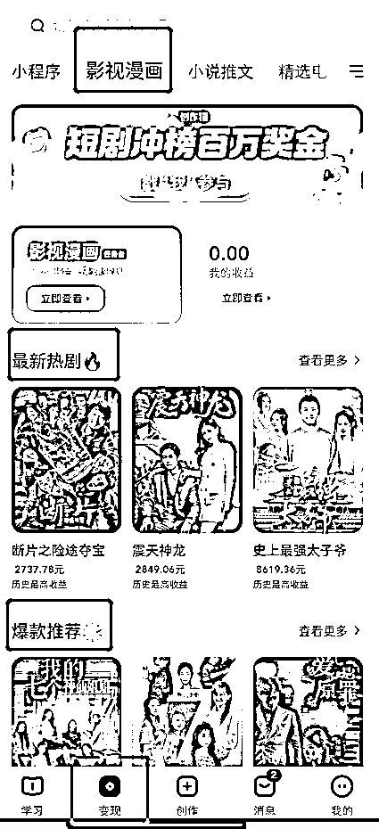

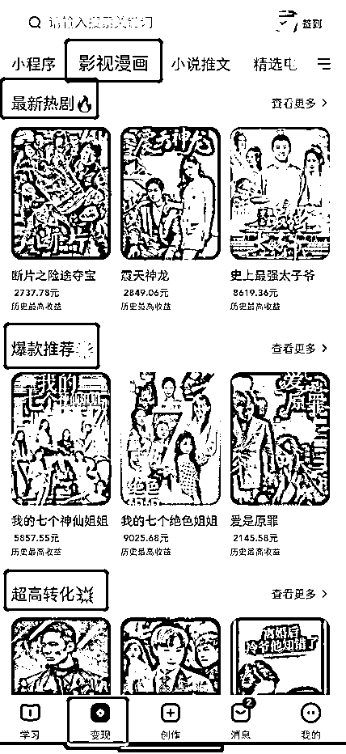

继续下滑，还有更多剧目等着你；渠道、分成类型、上架时间等条件都能用来筛选和排序。

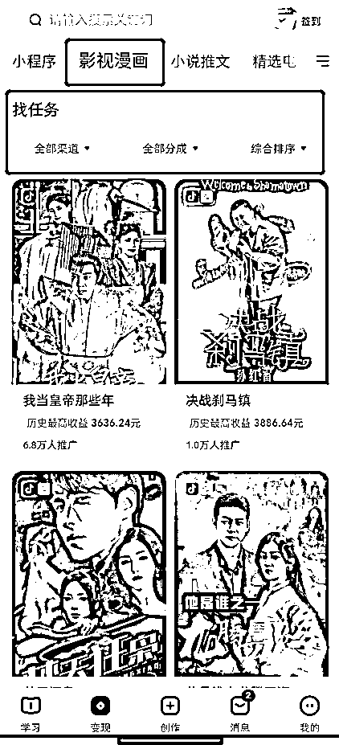

点开一部你感兴趣的短剧，推广视频素材、推广按钮等入口就会出现在眼前。

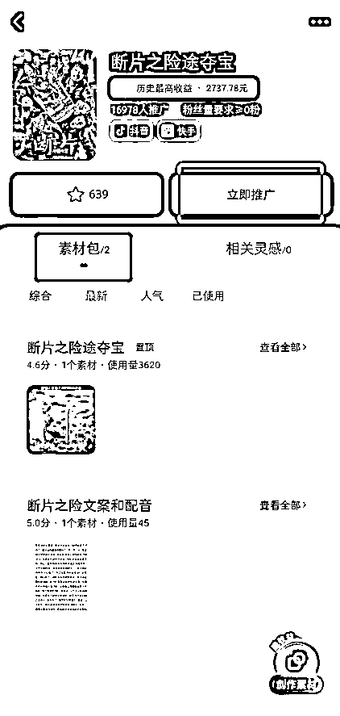

具体推广流程，后面「3.2.3 如何实现短剧推广」会展开。

「影视漫画」页才是推广短剧的主阵地。若在「变现」页点「影视漫画（任务台）」，就会进入一个新页面：

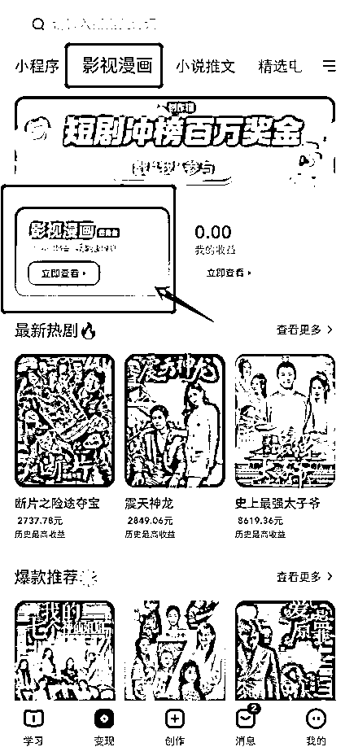

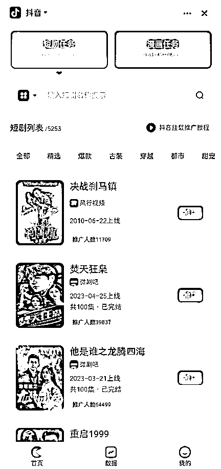

点「短剧任务」，大量剧目会列出来。你既能按精选、爆款、古装、穿越等标签挑选，也能在左上角先定好准备发布视频的平台。

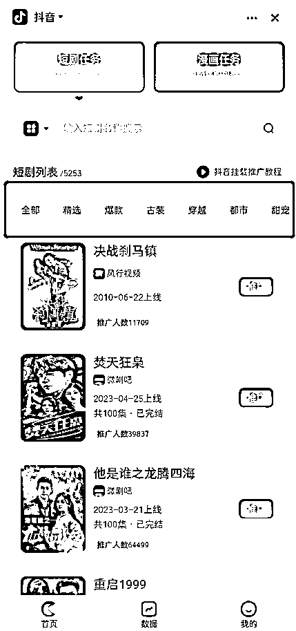

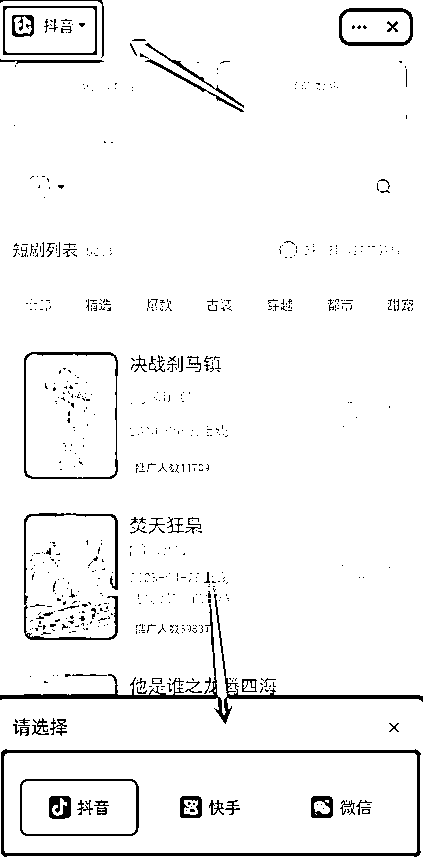

选中心仪短剧后，会进入推广页；该页会展示分成方式、分销比例、推广素材等信息，左上角同样可切换发布平台。

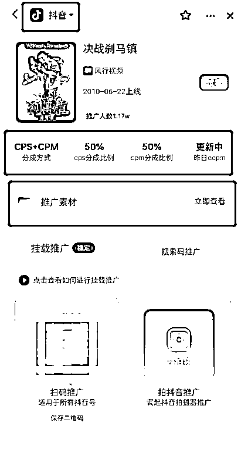

回到前面提到的页面，点底部「数据」和「我的」，就能查看自己的推广表现和收益情况。

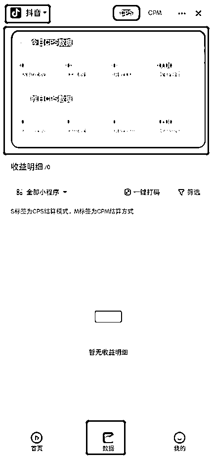

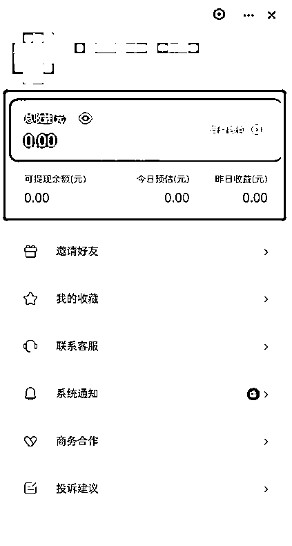

提现方面，可绑定银行卡或支付宝。结算周期为：cps 是 T+7，cpm 是 T+30。

创作猫的短剧推广，核心界面基本就是这些。建议大家多点点、多试试，把常用流程用熟。