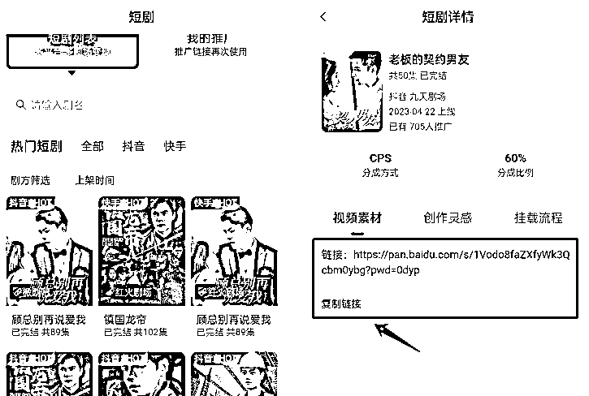
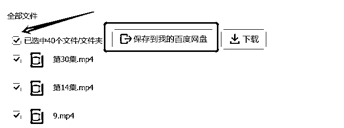

# 4.2.1 渠道一：用麻雀 Matrix 拿素材

说到麻雀 Matrix 这个渠道，资源基本都是通过百度云盘来放的。你从主页进到任何一部剧的推广页面，就能看到对应的云盘链接，直接复制到浏览器打开就行：

接着，勾选箭头指定的全选小框，点“保存到我的百度云盘”，这时候页面会让你登录百度账号：

有账号直接登，没账号就现场注册一个。

登录完成后，去云盘把剧集下载下来就完事了。官方剧场放出来的剧集，一般就是 1-20 集或者 1-40 集，因为版权问题，几乎不会给你整部剧的全部素材。

但有些爆款模板里，偶尔会出现官方素材库没有的内容。比如《顾少的隐婚罪妻》的爆款开头，用的是 96 集和 97 集，这种就得自己想办法找对应资源了。常规操作是问问身边可能有资源的同学或前辈，看人家有没有拿到，或者去别的平台搜一搜，碰碰运气。

