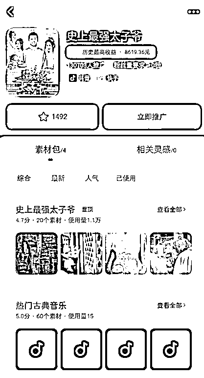
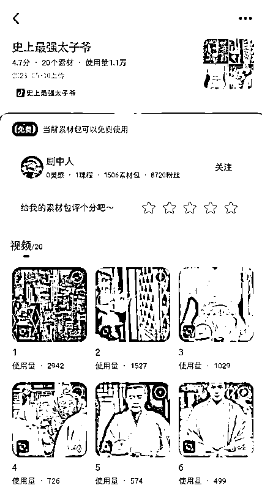

# 创作猫：素材即取即用，告别繁琐下载

深耕内容创作的朋友，一定对素材管理深有体会。想高效产出视频，工具的选择至关重要。今天要和大家分享的渠道，能帮你彻底摆脱素材搬运的困扰。

在创作猫这个平台上，你会发现它的流程设计非常贴心。看中哪个素材，无需再经历传统的下载、保存、再导入剪辑软件这一套繁琐流程。平台支持一键操作，素材被选中后可以直接进入剪辑环节，所有操作都能在创作猫内部一气呵成地完成。

这意味着你的创作效率将得到显著提升，节省下来的时间和精力，完全可以投入到更核心的脚本构思和画面编排中去。对于追求快节奏产出的创作者来说，这种无缝衔接的体验无疑是一大利好。

从界面演示也不难看出，其操作逻辑清晰明了，上手几乎没有门槛。如果你也在寻找更顺滑的创作流，不妨试试这个渠道，相信它会给你带来惊喜。