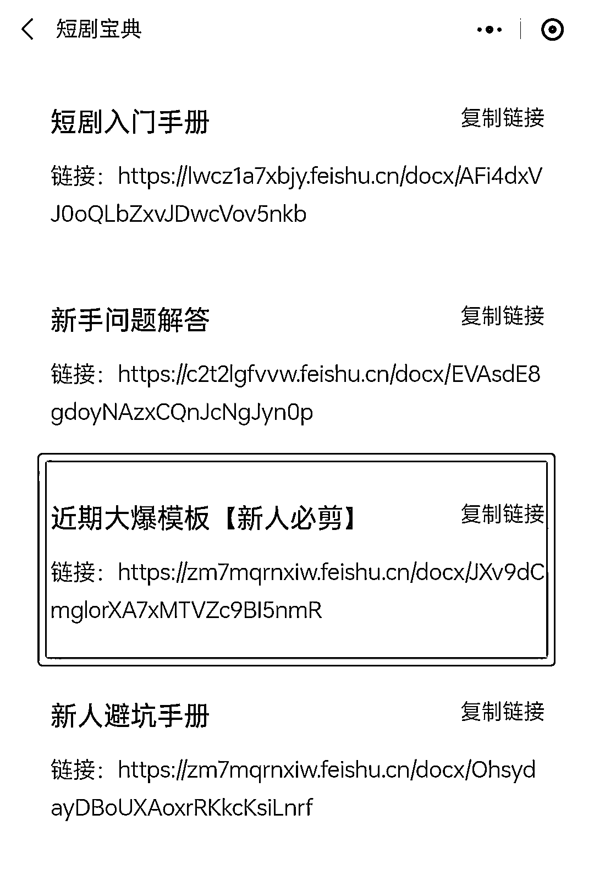
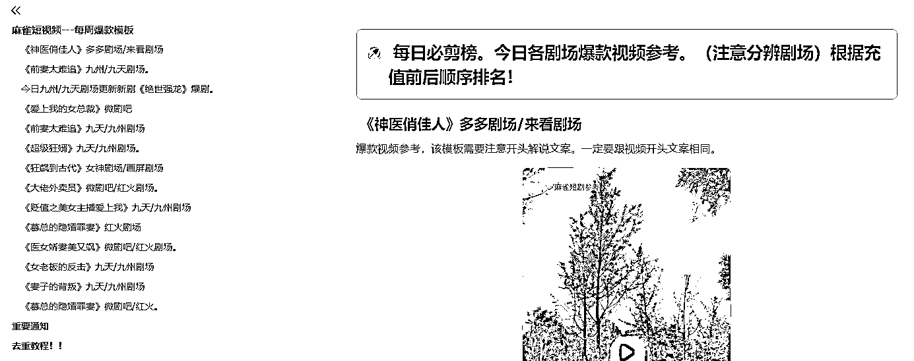

# 5.3 初级方法三：用麻雀 Matrix 模板快速出片

想提高剪辑效率，不妨先看看平台上已经验证过的热门模板。麻雀 Matrix 会持续汇总并每日更新若干条高播放视频，你可以先挑出自己要剪的短剧，再对照相应模板做一比一复刻。这样做不只是找现成参考，还能顺手拆解别人的剪辑思路。

进到麻雀 Matrix，点开「短剧宝典-近期大爆模板」，入口链接就在其中：

复制链接后，用浏览器或🛰️都能打开：

这些模板通常给出三项内容：值得关注的热门短剧、一两句剪辑要点，以及剪好后的参考视频。很多爆款短剧的开场和收尾，本来就有约八成是相似套路，照着模板操作，能省下大量重复试错的时间。

