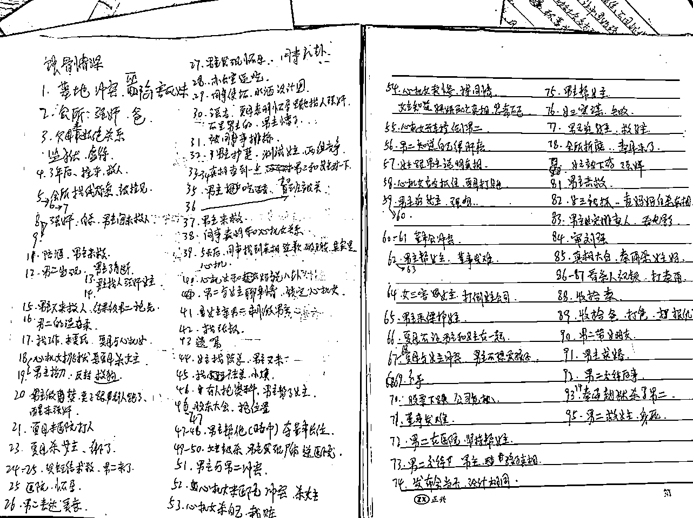

# 5.4.2 素材筛选：只留高能戏

开头、中段、收尾都定好后，接下来要解决的是：哪些内容该进片子？

先按人物线挑。做女频时，如果这一集核心是男女主和反派女配，就只取与这三者相关的戏；若核心换成男女主与婆婆，那就围绕他们选，反派女配尽量不露面或只留少量镜头。单集控制在5—10分钟最合适；真没灵感，3分钟也能成片。

再按情节线排。整体节奏可以走：开场即高能—虐—小逆袭—虐—小逆袭—虐—留悬念。所谓虐，是男主、女配或炮灰让女主吃亏，主角处在下风；小逆袭则是女主回击伤害她的人，可以是用话怼回去、动手反击，也可以是男主或旁人替她发声。很多段落里，虐和反击本来就紧挨着，剪辑时就是反复做“先压后翻”的循环：2分钟片长可只翻一次、共两个循环；10分钟片长可做5—6轮再收。多余过渡一律砍掉。

怎么判断过渡是否多余？删掉后观众依然看得明白，不会冒出“这人是谁、为什么突然帮主角”的疑问，就说明可以不要。把这套逻辑练熟，剧热不热门都能剪得好看，你也能成为爆款制造机。前提是拿到素材先完整看一遍并做好笔记，如下图：

另外，务必熟悉抖音发布规范；可能违规或拿不准的情节，不要放进成片。