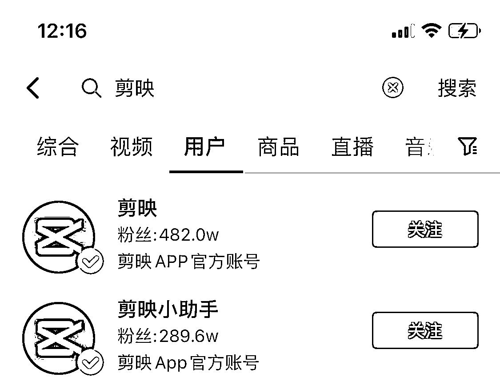
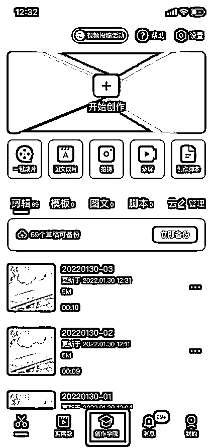
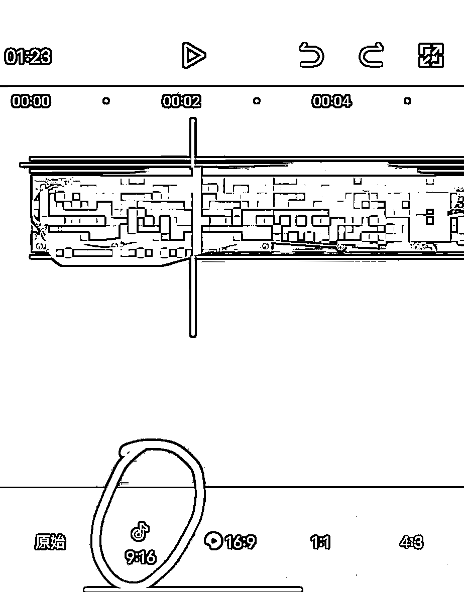
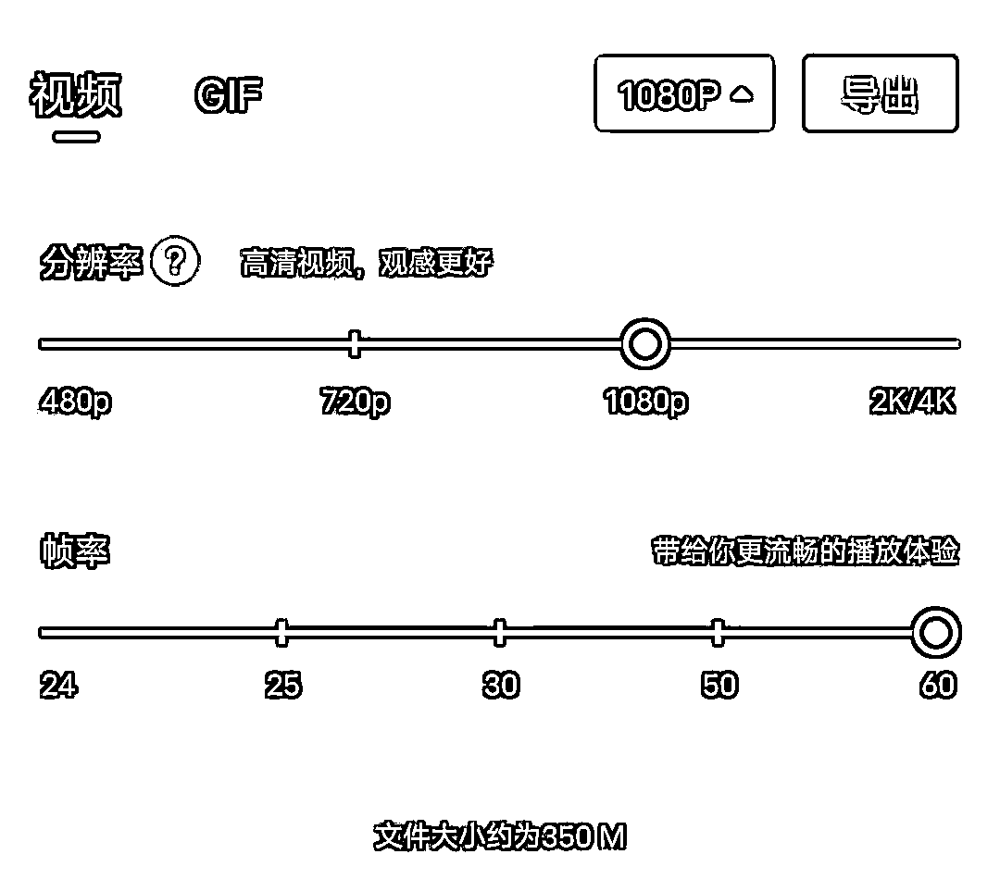

# 6.1 零基础剪辑上手

刚接触剪辑的朋友，先看下面这个入门演示，边看边在剪映里动手试一遍，把界面结构和常用功能摸熟即可：

[mmexport1677167802702.mp4](https://search01.shengcaiyoushu.com/upload/doc/SUYad816hofSjmxGHeWcbjoEnpc/JELWbCAkXosvqpxq45wcrGBGnHe)

跟着视频完整走一遍流程，能顺利把作品导出，这一步就达标了。

想继续提升，可以到抖音关注【剪映】和【剪映小助手】两个官方账号，里面有不少进阶技巧；遇到具体问题也能直接搜，比如“剪映怎么做镜像翻转”，通常能找到对应教程。若想系统学习，打开剪映后进入【创作学院】，输入你的问题检索；或者点【剪辑入门】再选【剪映剪辑】，浏览课程合集，挑适合自己水平的课来学。

成片长度建议控制在4到6分钟：过短会让观众觉得不过瘾，追看全集的意愿也会下降；过长则容易拉低完播率，观众可能看到一半就划走。

导出时通常选择竖屏比例9:16，清晰度1080p、帧率60帧：

另外提醒一句：如果你用的是旧版剪映，导出时可能默认带上【剪映片尾】，记得先把它删掉再导出。

