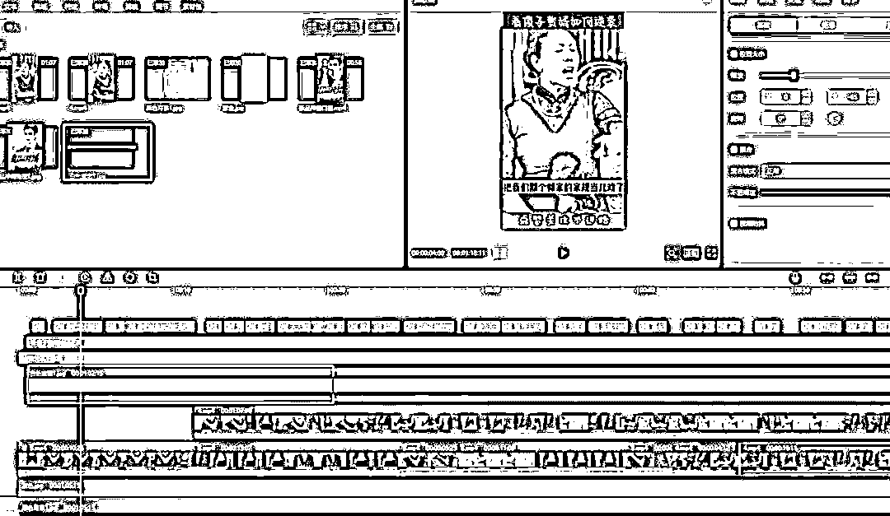
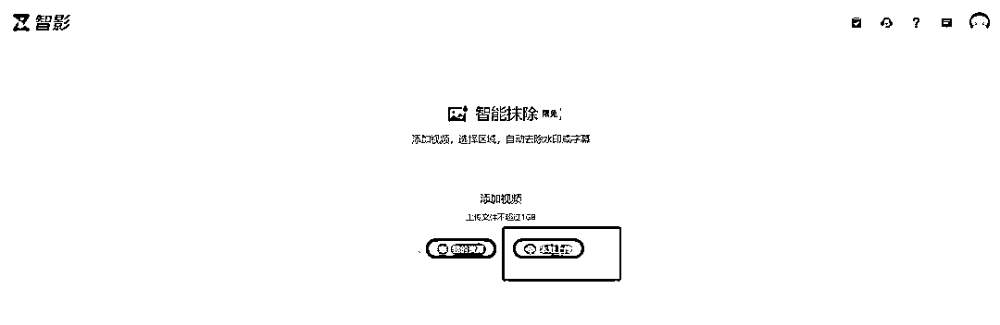
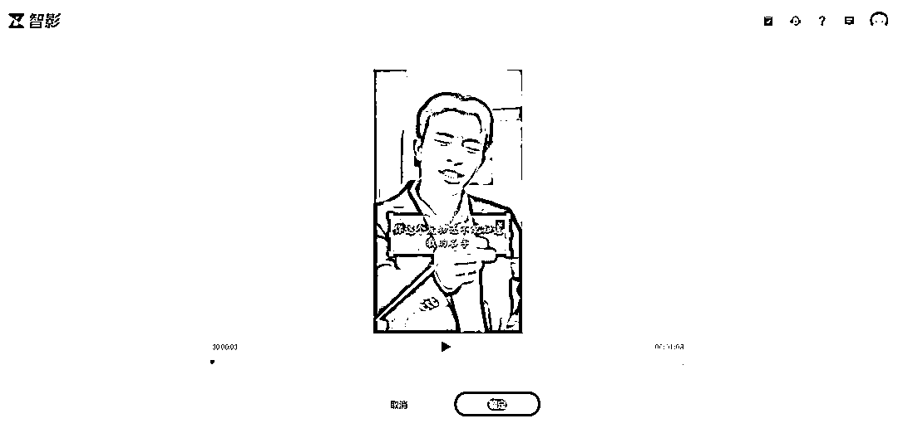
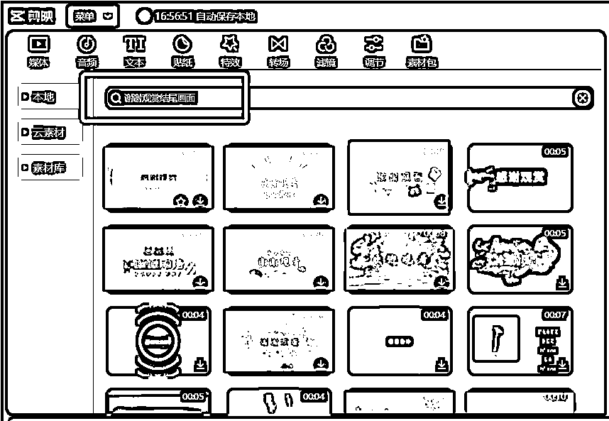
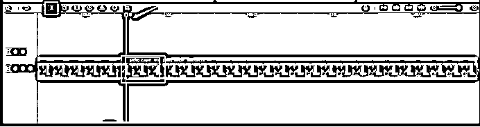
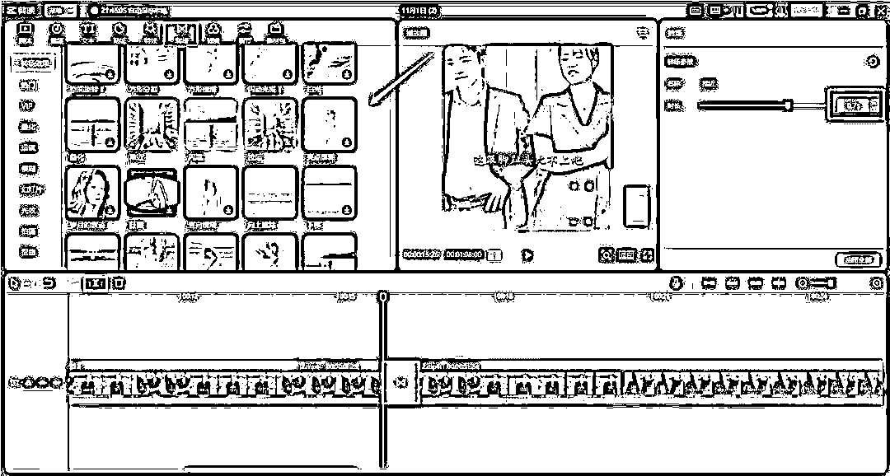
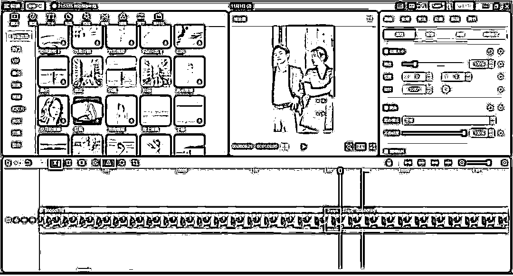
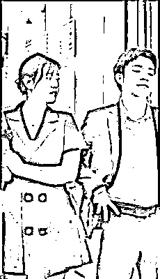
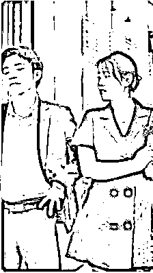
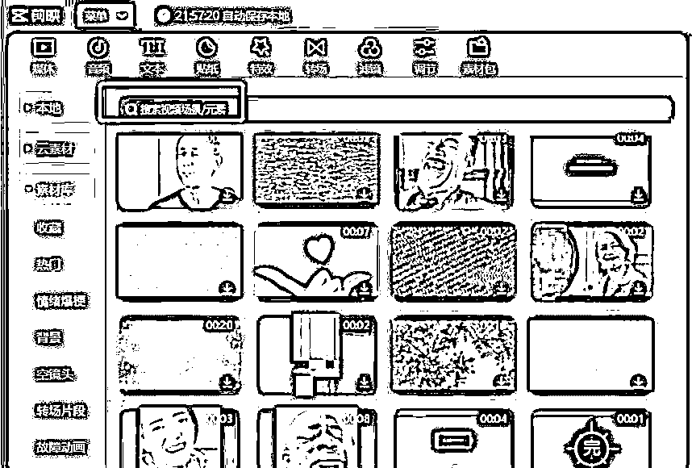

# 6.2.2 方法二：剪辑手法叠加去重

@狼魂小毛 和 @云珞 YunL 两位老师的去重思路，说到底是一回事：把多种常见剪辑动作叠加使用，让视频完成去重。

**@云珞 YunL 常用的20种剪辑手法**

分别是：叠化转场、移动水印、贴纸、滤镜；画中画（透明度控制在1%—30%，以不影响画面效果为准）；特效（透明度压到1%—15%，以不干扰观看为限）；扫光效果、旋转、参数调节、配乐、变速、镜像、字幕、解说、封面、标题、文字、音效、转场视频、裁剪。

视频版演示在这里，方便边看边学：

[短剧去重 20 个方法.mp4](https://search01.shengcaiyoushu.com/upload/doc/SUYad816hofSjmxGHeWcbjoEnpc/GVHabRdIPoO6ePxBe42cFQFanxc)

更习惯看图文的话，@狼魂小毛 老师也给了步骤版，下面继续。

**先处理字幕**

从原片下载的原创视频如果自带字幕，可以先去掉；没有字幕的跳过，之后再用剪映补上。也可以一开始保留字幕，等视频剪完再处理；有人会加一层白底，再把新字幕放上去。具体做法如下：

这里分享一个省事的办法：用【智影】去字幕。先提醒一句，它稳定性一般，偶尔时好时坏，字幕抹得不够干净时，原字幕位置可能发虚。其他办法还有蒙版、裁剪、放大等。

【智影】去字幕：https://zenvideo.qq.com/smart/waterMask

把链接复制到浏览器打开，点本地上传，或者点右上角登录；登录后点本地上传：

上传事先下载好的视频，框住要去掉字幕的位置，点确定，字幕就被处理掉了：

最后把去完字幕的视频下载下来。也有小伙伴会把 PR 和剪映搭配起来处理字幕。

**换封面**

封面是观众对视频的第一印象，挑得合适，点进去的意愿会更高，播放量也更容易起来。这一步用剪映就能做，操作比较基础，这里不展开。

**片头片尾**

成片别照搬原片结构：先去掉头尾，再用软件补做片头片尾，几秒就够。片尾可在素材库搜“谢谢观赏”或“下集更精彩”；做法不唯一，有别的想法也能换。最后导出保存，导出的文件可传到手机：

**变速**

导入后先做常规变速，速度降到0.9，再进入抽帧。完成导出后重新导入，把速度提到1.1，成片时长就会贴近原片。

**抽帧**

抽帧的做法，是隔固定帧数取若干画面，再组合回视频，效果类似定时拍一张照片后连成片子，也就是低速摄像。操作如下：

把播放指针移到想抽帧处，选择分割（快捷键 CTRL+B 也行），随后删掉切出来的片段。

注意：处理时避开人物正在说话的时刻，最好选无人声，或一句话说完、下一句未起的空档。若在讲话中抽，容易把台词抽掉，影响前后衔接。观赏效果不受影响时，抽得越多，去重越充分。

**转场**

打开转场选项，可用效果不少。若只想给某段加转场，先分割，再选效果；右侧还能调整时长，按需设置：

**镜像**

镜像会让画面左右对调。先分割出要处理的部分，再直接应用镜像：

镜像前后的效果对比如下：

**视频、音频和滤镜**

视频、音频和滤镜都可以按喜好添加。也可以随手拍一段画面、配一段音乐、套一个滤镜，然后把强度设到最小。这样做不是为了堆东西，而是让平台识别出我们对视频做了创作。

**素材库**

素材库要利用起来，里面不少热门素材就是平时在别人视频里常见的。想用什么直接在搜索框搜，加到自己的视频里，往往能起到事半功倍的效果：

**特效和贴纸**

加特效可以改变原片的一些风格，选择与视频内容相搭的效果，在不同位置加不同特效，能拉开与原视频的相似度。贴纸同理。

**画中画**

画中画也是改变原视频 md5 值的关键操作。可以在画中画里导入一张自己拍的图片，拉长到覆盖整个视频时长，并铺满画面；也可以导入一段自己拍的纯色视频，拍家里的墙壁或地板都行，长度和原视频一致，同样铺满画面，再把不透明度调到最低。

**调节视频参数**

亮度、对比度、饱和度、光感、锐化等参数都可以微调，幅度控制在10以内即可。数值拉得越大，越可能影响原视频的清晰度。

**视频混剪**

可以找剧里的几个亮点拼成一段，剪掉中间啰嗦无用的部分再拼接；也可以把亮点放到视频开头，或者加一段前情回顾。

实操心得：剪得散一点，再多加些转场，基本没什么问题，也没有出现不能上热门的情况。还可以适当加入自己的内容，比如解说之类的原创专场。

这些是常用的剪辑手法，但说实话，单靠它们并不能做到完全去重。还可以在此基础上配上解说画外音——也就是常见的影视解说，对剧情做一些讲解——以及多集混剪。

内容来源：《短剧自然流打法 1 个月变现 2w 的实战经验分享》

