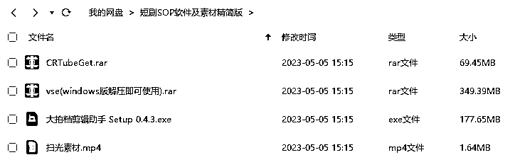

# 6.3.1 开工前先备好这些工具

先把几样顺手的工具准备齐全，后面操作会省心不少。

VSE 源码仓库：https://github.com/YaoFANGUK/video-subtitle-extractor
VideoSrt 源码仓库：https://github.com/wxbool/video-srt-windows
大拍档剪辑助手获取页：http://spdpd.net/

上面三处都能直接访问。若想一次性打包拿走，这里也备好了网盘资源：
https://pan.baidu.com/s/1C5MK8mokDmalsj6rKhYNpg?pwd=3325
取件口令：3325