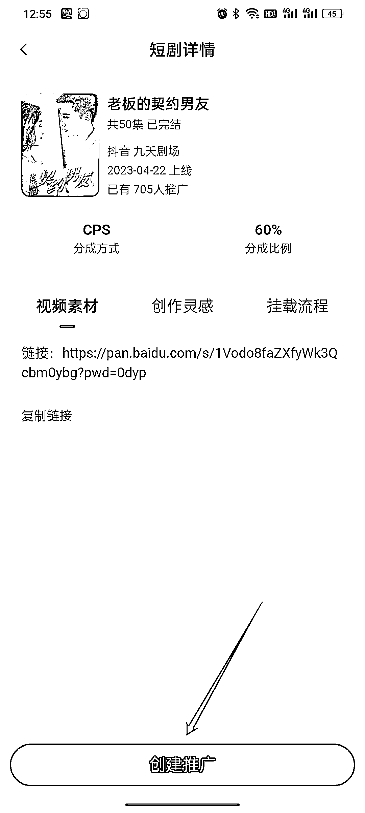
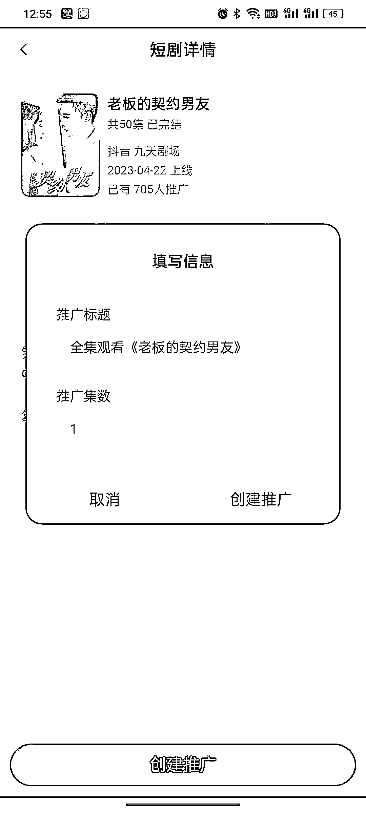
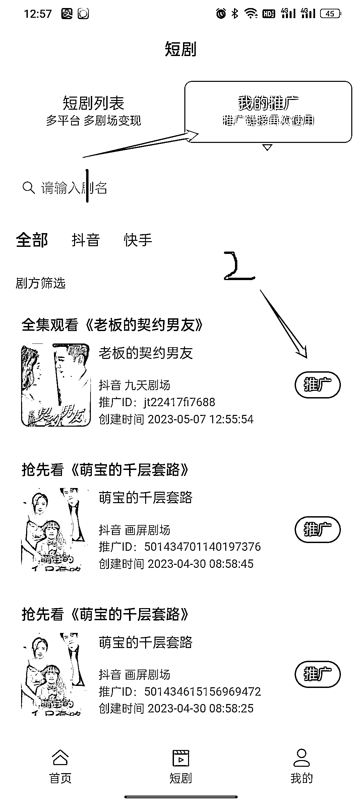

# 7.1.1 麻雀 Matrix 短剧推广流程，一次讲清🔥 @思蒙

想用麻雀 Matrix 做短剧推广？按下面几步操作即可。

先打开「短剧」板块，在列表里挑中准备推广的那部短剧，点进去，然后选择「创建推广」。

页面中的信息保持默认状态就行，不需要额外修改。

接着按下「创建推广」，系统会提示你从相册挑选视频。首次操作时，需要先允许应用读取相册权限。视频选好后，通常会自动打开抖音或快手。

要是没有自动跳转，也不用着急：先退回手机主页，手动启动抖音/快手，再回到麻雀 APP，进入「我的推广」，找到刚刚生成的那条链接，点击「推广」。随后从手机相册中选出已经制作好的视频，上传到抖音，补上 #标题、话题等内容，最后点击发布即可。

标题和话题怎么定？多看看爆款账号的写法，参考着来就行。