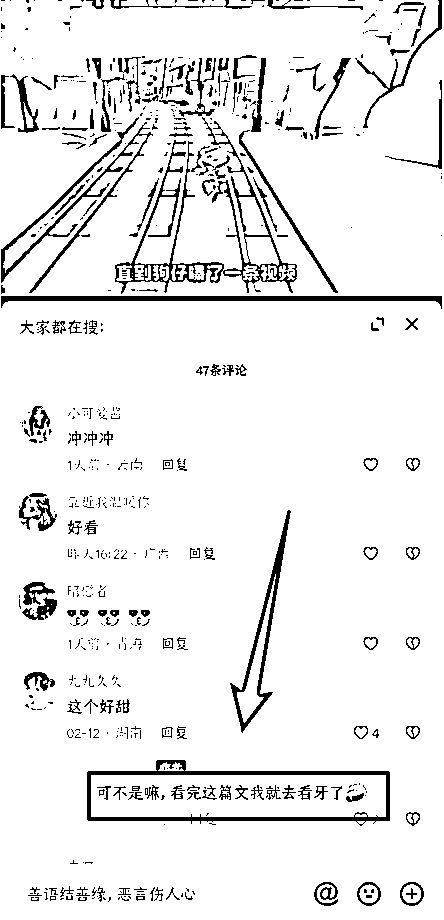
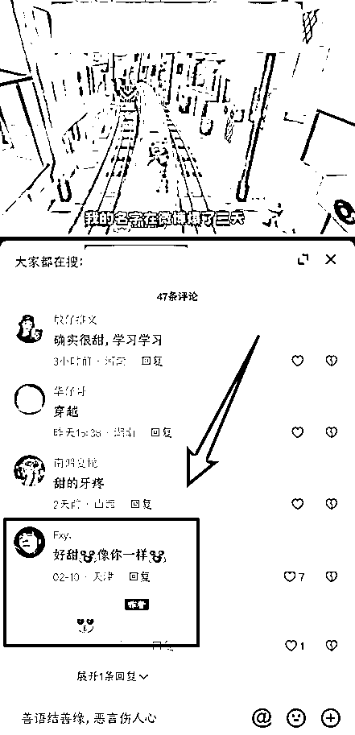

# 7.2.1 方法一：用回复撬动评论区活力

一条视频能不能真正“热”起来，评论区往往起着决定性作用。粉丝愿意留言，是奔着互动而来的——你回复得勤快、走心，他们就能感受到你的在意与重视。因此，别忘了在刷评论的过程中，该点赞就点赞，该回话就回话。比如有人在认真分析剧情，你就顺着聊几句；观众对某个角色有意见，你也亮明态度加入讨论；哪怕对方只留下一个表情包，也值得用一个表情回敬过去。

尤其遇到那种脑洞大开的评论，比如“室友快没气了，就想看下一集”，你的回复千万别走形式——“马上”“好的”“稍等”这类公事公办的措辞绝对要避免。这时候得拿出点幽默感，像朋友闲聊那样玩起梗来，甚至可以刻意多写几句，把气氛推向高潮。譬如来一句“生产队的驴也需要喘口气”“让你室友撑住，实在扛不住了我烧给他看”，就远比一句干巴巴的“知道了”来得亲切、讨喜。

