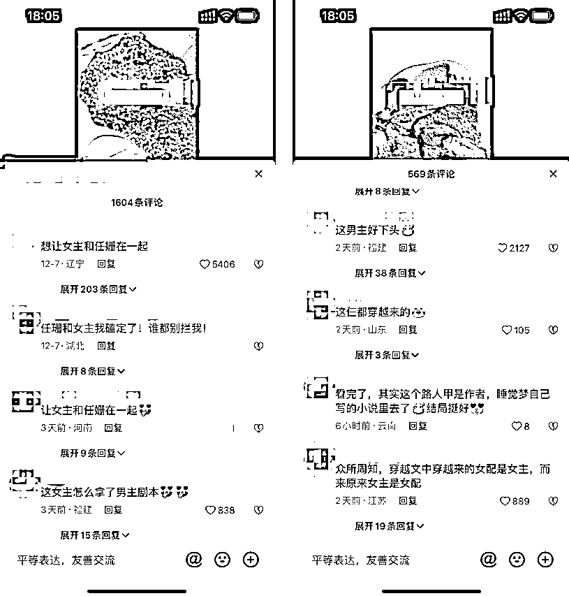

# 7.2.2 方法二：自己抛话题，让评论区先热起来

别把评论区当成被动等留言的地方。运营者不妨主动设置议题，用有讨论欲的话题把气氛带起来。话题不必和正文强绑定，相关可，无关也可，重点是让读者产生表达欲、站队欲或共鸣。

比如针对文中人物开一句：“这角色真让人败好感，换我早就出手了”，或者扔出一个离谱问题：“邻居家媳妇马上要生，我姓王，各位能赐个名吗？”读者很容易接梗、吐槽、出主意。必要时稍微添把火，也能把讨论热度推上去。

