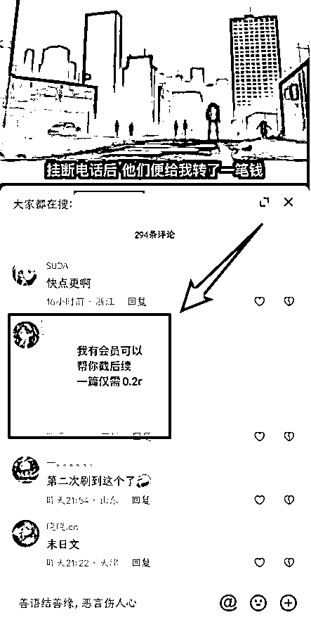

# 第三招：评论区清场

评论区常常鱼龙混杂，各种不友好的声音时有出现。那些带着辱骂性质的攻击性言论、打着广告旗号的无意义刷屏，都在清理范围之内。把这类内容及时处理掉，能有效规避平台因违规内容带来的流量限制。最让人头疼的，莫过于某些与视频内容八竿子打不着的引战言论——有时双方情绪上头，能在评论里互怼几十条。遇到这种情况，别犹豫，直接删除，情节严重就顺手拉黑。

另外，还有一种值得警惕的现象：不少推文博主会另开小号，专门来评论区截取流量。常见操作是，在用户询问“在哪找资源”“作品叫什么名字”这一类问题的下方，他们的评论区便迅速出现自家关键词的回复。针对这种情况，正确做法分三步：先把其评论清理掉；随后在消息通知栏点开对方头像，进主页直接拉黑；最后回到原评论位置，引导读者到正确的关键词入口。

例如下图的评论区，就属于必须处理的典型场景：

别小看这一步，评论区管理可是门技术活。清理一次容易，难的是持续维护一个干净的讨论空间。既要及时移除违规内容，又要洞察那些隐藏的截流套路，才能守住自己评论区的一方净土，让粉丝真正聚焦在内容本身。