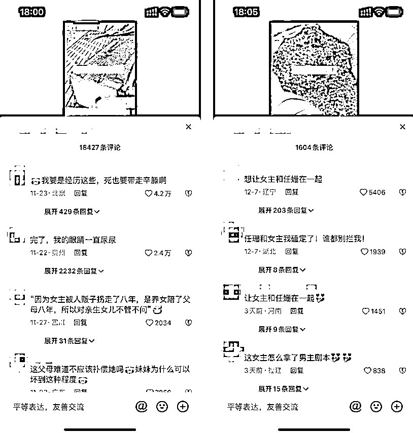

# 7.2.4 自己先看完，把评论区热起来

想让推文视频的互动起来，第一步不是等观众，而是自己先把场子暖好。用主号和备用号把自己发出去的视频完整看一遍，点赞、收藏都做上。接着让备用号在评论区留几句自然的话，比如“会员先来打卡”“刚看完，这篇 xx 文确实上头”，先把后续互动的口子留出来。

也可以轻轻透一点剧情，让点进评论区的观众带着好奇继续看，比如“结局很舒服”“渣男最后的下场挺解气”。分寸不用大，吊起观众对后面内容的好奇就够了。

内容来源：《小说推文进阶玩法，精细化运营所带来的稳定出单》

