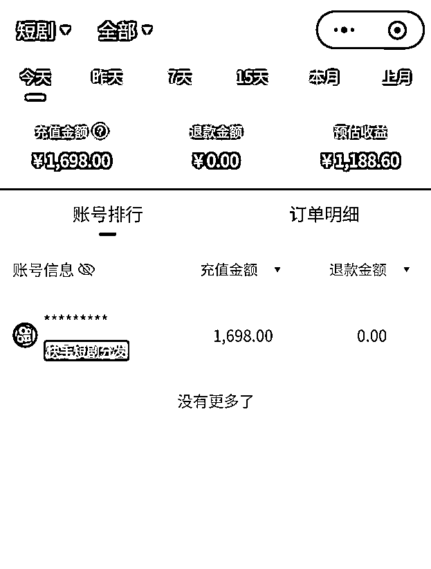
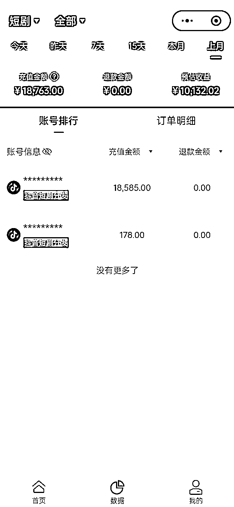
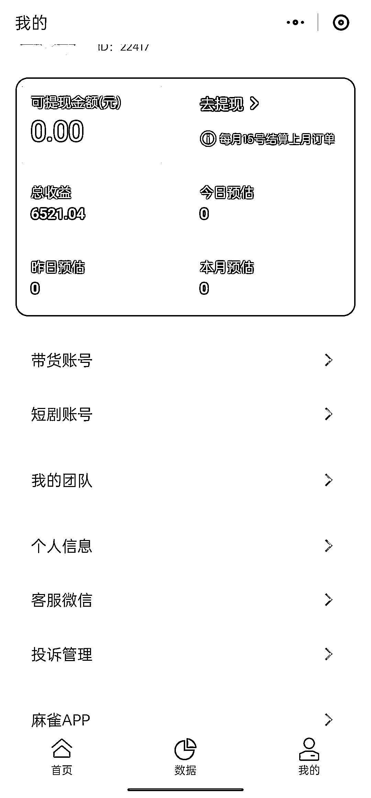
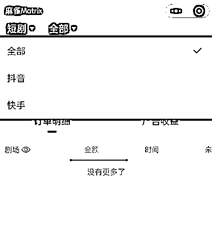
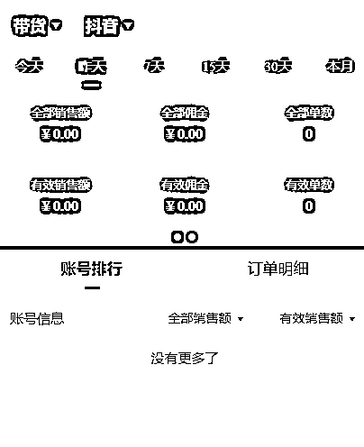

# 8.1.1 收益去哪儿看？

先划重点：视频要从麻雀 APP 发布，但收益不在 APP 里查，而是回到小程序查看。

进入小程序后，点底部「数据」，就能看到自己的收益情况。这里要特别注意，别把充值金额和真正到手的「预估收益」混在一起：

页面会展示今天、昨天、7 天、本月、上月等不同时间段的数据。

还有一个时间节点要记牢：每月初数据更新后，上个月的记录会先归入「上月」，不会出现在个人中心的数据页；等 10-15 日结算完成，才会显示在个人中心的「可提现金额」里。

如果想看不同平台的数据，点「抖音」或「快手」即可切换，如图：

要是某条视频爆了，第二天却没看到收益，先点这里检查一下，看看是不是显示成了「带货」。需要切换到「短剧」，才能看到对应收益：

