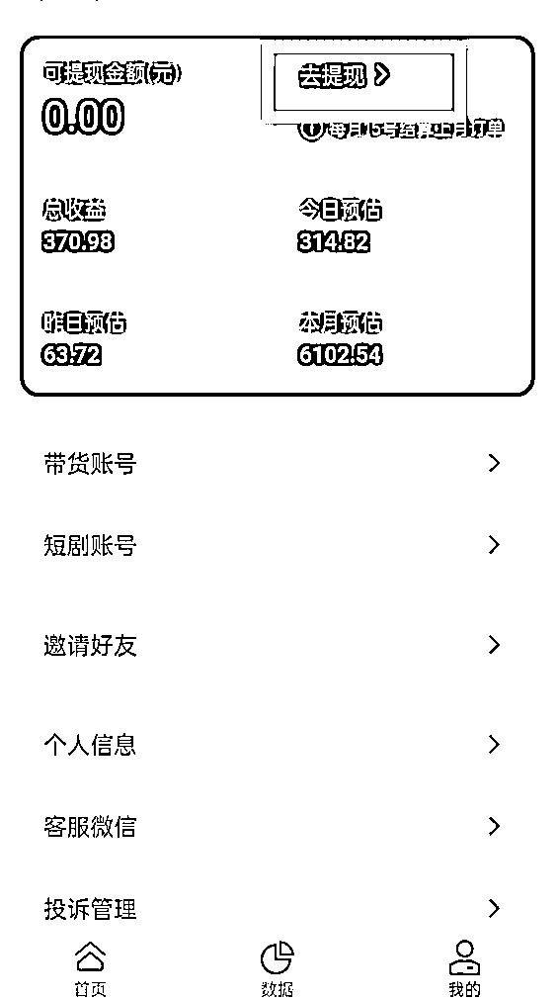
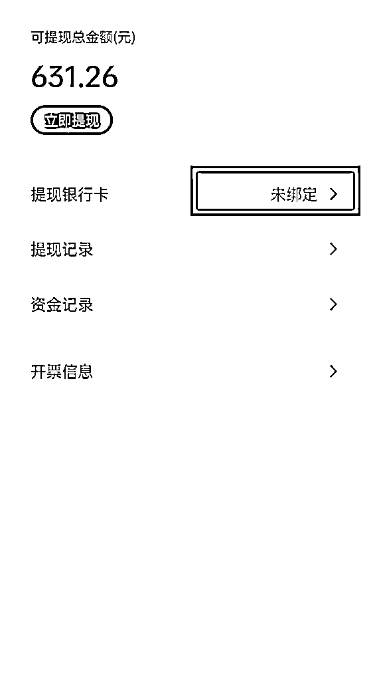
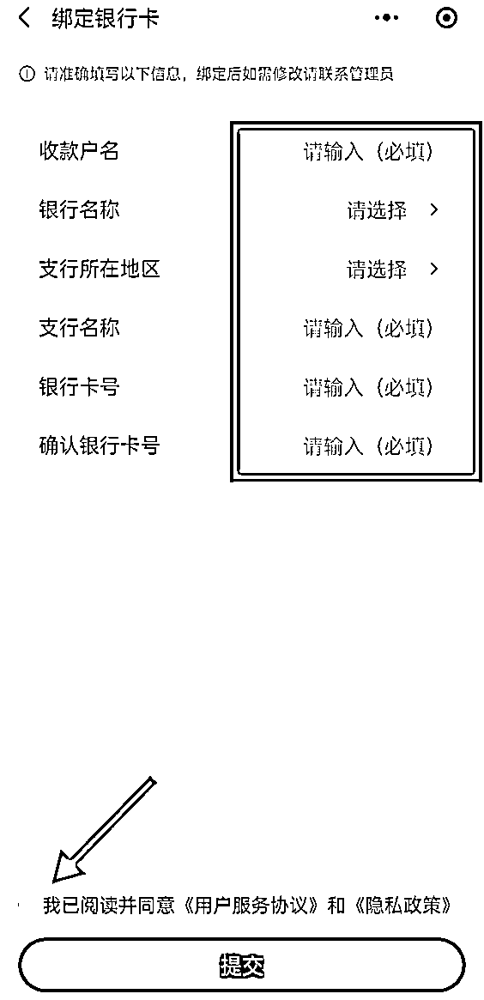
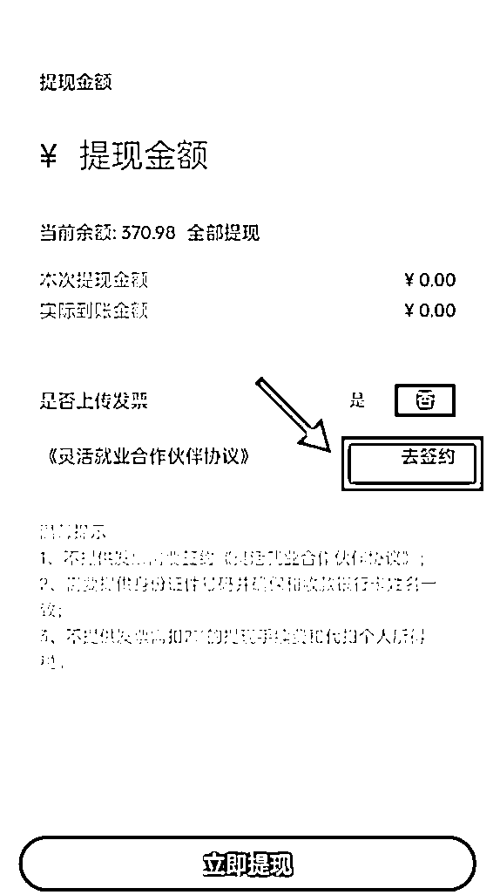
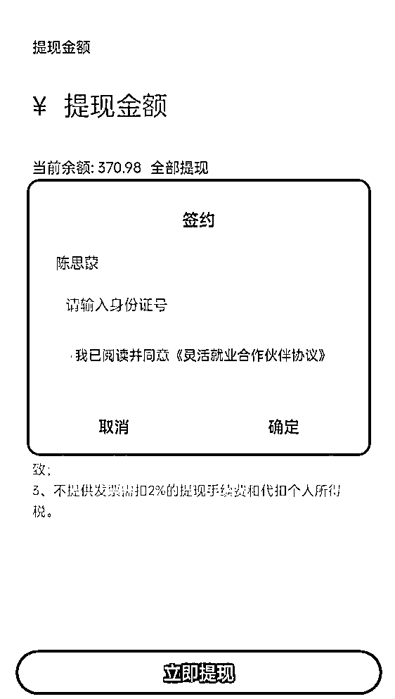
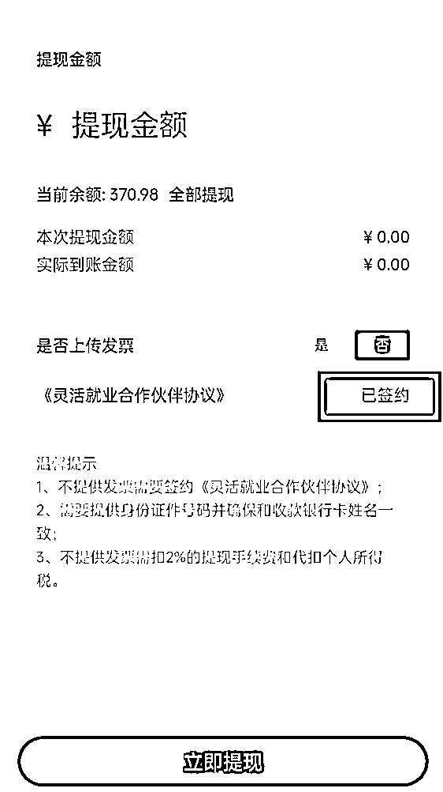

# 8.1.3 提现到账，看这篇就够了

想把麻雀小程序里的收益提出来，入口在【我的】页面。先点【去提现】，再选【去绑定】，根据页面要求填写本人银行卡信息，完成绑定即可。

点进去把银行卡绑好后，就能发起提现。收益还没结算时，不用急着提前绑卡；等钱到账、可以提现了再绑也不迟。这里提醒一下，提现时会扣除2%的税。

绑好银行卡后，点【立即提现】，页面下方会出现【去签约】。点进去填写自己的身份证号码，勾选相关协议，再点【确定】。当页面显示【已签约】，返回后直接点【立即提现】就行。

通常，提现资金会在1-3个工作日内到账。

内容来源：《目前为止最详细的【短剧推广实操手册】，没有之一！》

