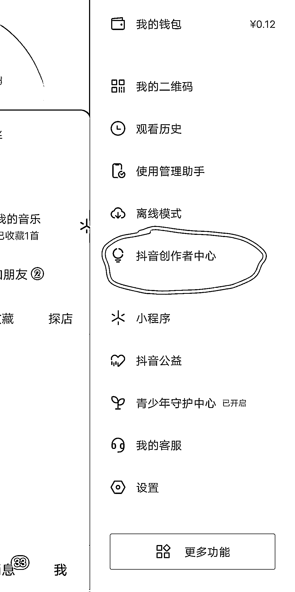
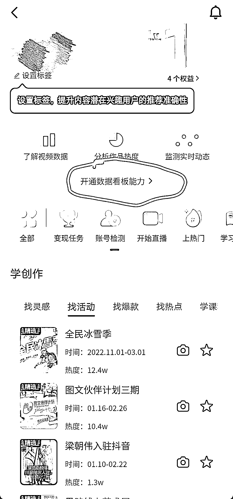
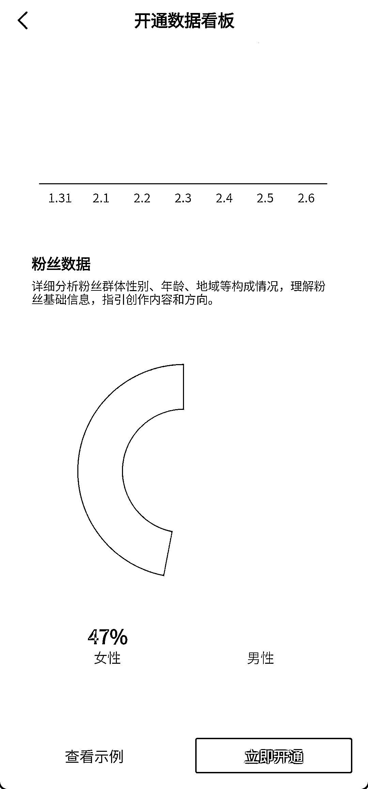
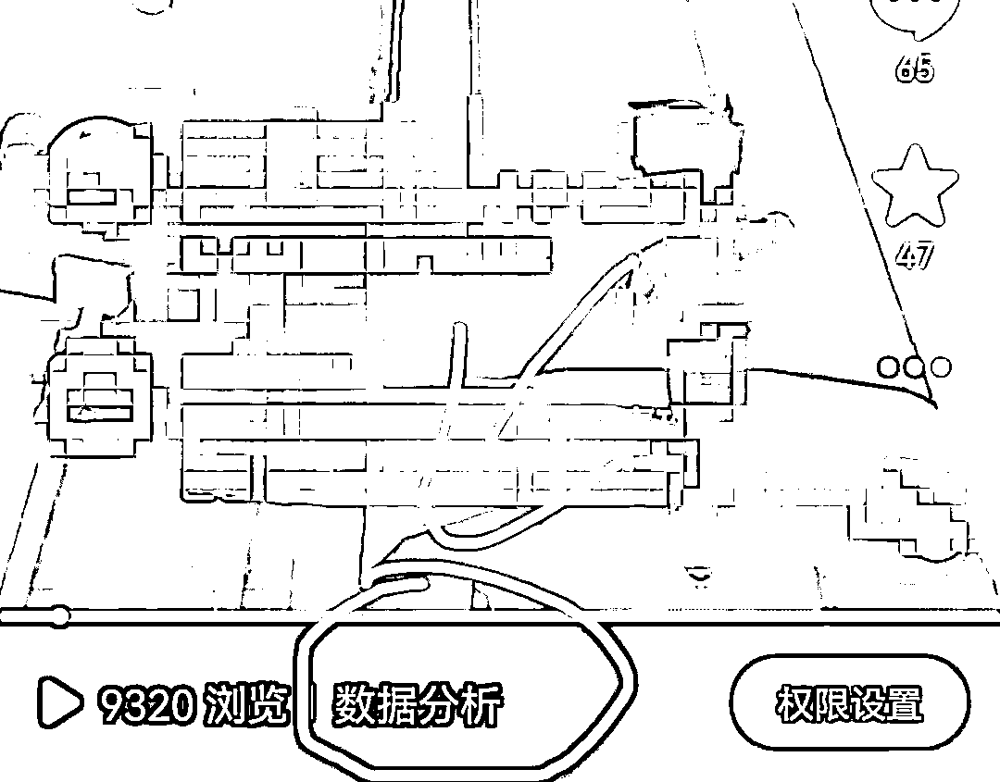
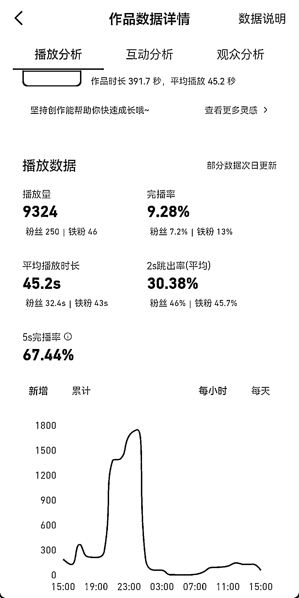

# 8.1 数据看板，转化率才是关键 @思蒙

账号刚搭建好，数据后台从哪里进？打开个人主页，右上角有个“三”字菜单（也就是三条横线图标），点开就能找到【抖音创作者中心】：

进入后，页面会显示【开通数据看板能力】入口：

点进去，往下拉到页面底部，选择【立即开通】：

系统一般会提示：次日10点左右，已发布作品的分析数据就能查看。第二天，打开自己发过的视频，左下角会多出【数据分析】按钮，点击即可进入单条作品的详细数据页：

详细数据页覆盖播放量、完播率、平均播放时长、2秒跳出率与5秒完播率，还提供【互动分析】【观众分析】等模块，可以按需浏览：

尤其要盯紧5秒完播率和完播率。多数情况下，这两项足以帮我们判断内容质量，也能看出有没有爆款潜质。

但别忘了，作品挂着推广链接，最终要落到变现上。因此，单条视频的转化率才是更重要的衡量标准。

于是经常能看到这种反差：

自己的作品各项数据看起来都不错，完播率甚至达到50%，播放量却只跑了四五万；别人的完播率只有13%，播放量反而冲到了几十万。

原因就在于，对方的转化率比你高得多。

内容参考：《目前为止最详细的【短剧推广实操手册】，没有之一！》

