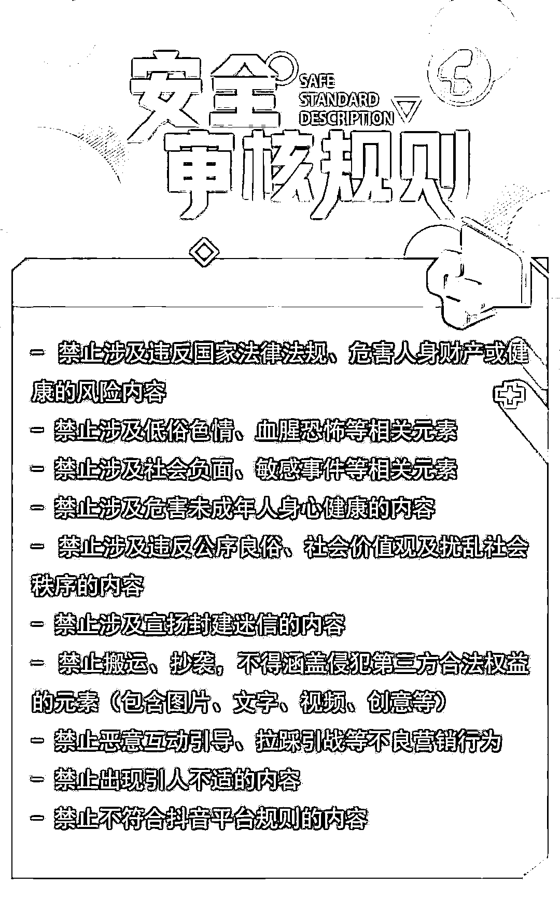
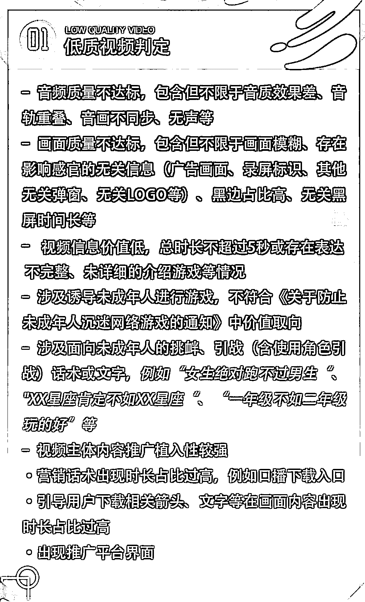

# 8.3 违规红线别硬闯 @思蒙 @惟乔

在平台做内容，先别急着发作品，第一件事是把规则摸透。别跟平台规则对着干，除非你算过账，收益确实明显大于代价。

抖音的规则在【抖音安全中心】都能查到，核心无非几条：不碰国家政策、法律法规红线；不涉黄、不涉暴、不涉毒；内容价值观要正向。

所以，任何可能踩线的素材，能不碰就不碰。不冒险，风险自然离你远一点。

最该警惕的几类素材是：

• 衣着过度暴露、露肤面积太大
• 用侮辱性称呼贬低他人，比如“狗东西”“呆子”“贱人”等
• 暴力冲突、羞辱、复仇情节别堆太多
• 尤其脏话、威胁再加打架的组合，最容易触发违规

如果剧情非剪不可，可以改用解说方式处理。

还有一种常见情况：同一份素材，你发被判违规，别人发却没事。原因在于每个账号体质不同，不同审核员的尺度也不一样。别过度纠结，删除、修改、重发就行。

心里要始终算清一笔账：时间花在哪里更值钱？纠结抱怨、反复申诉的时间，够不够你再做一个作品？

一定记住，你的时间最值钱。

素材参考：《目前为止最详细的【短剧推广实操手册】，没有之一！》《新手用生财的方法做短剧 CPS，一个月 1.4w+收益》

