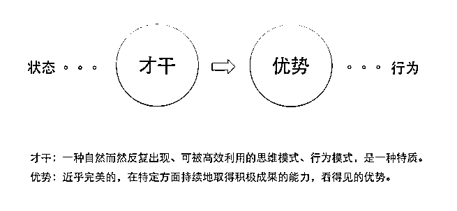
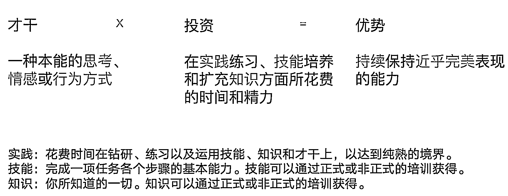

# 1.1 优势到底是什么？

我们常说某个人有优势，意思往往是：同一件事交给他，他做起来更顺手、更出色，好像天生就多了几分把握。把优势拆开来看，它由三部分构成——天赋才干、技能和知识；其中真正起决定作用的，还是天赋才干。

天赋才干可以理解为老天爷发给你的一手“底牌”，是与生俱来的特质，通常很早就已定型，后来再想改变并不容易。盖洛普所呈现的，正是一个人身上那些擅长的天赋才干；一个人的优势，也正是从这些天赋才干中生长出来的。

如果把天赋才干看作人的内在特质，那么优势就是这种特质被发挥到极致后所呈现的结果。

盖洛普官方曾用一个公式说明才干与优势的关系：才干 × 投资 = 优势。所以，想弄清自己有哪些优势，第一步是先认出自己具备哪些天赋才干。

