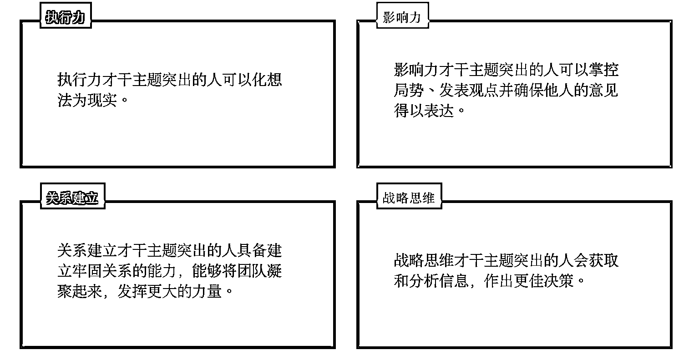
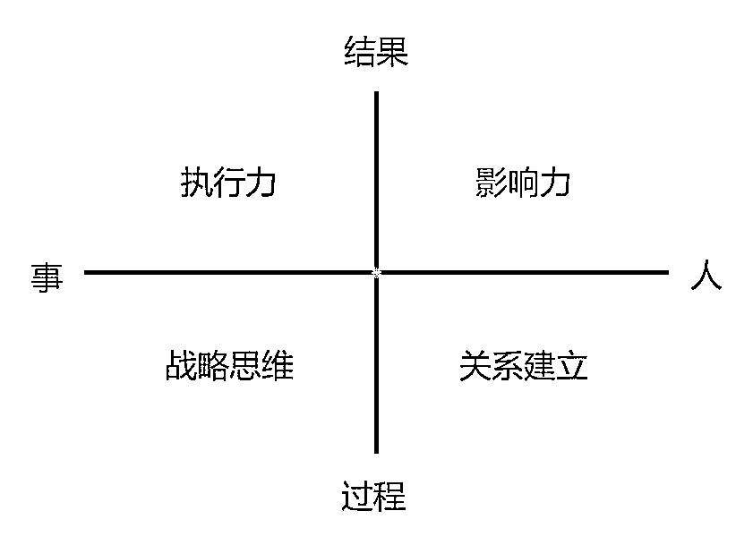
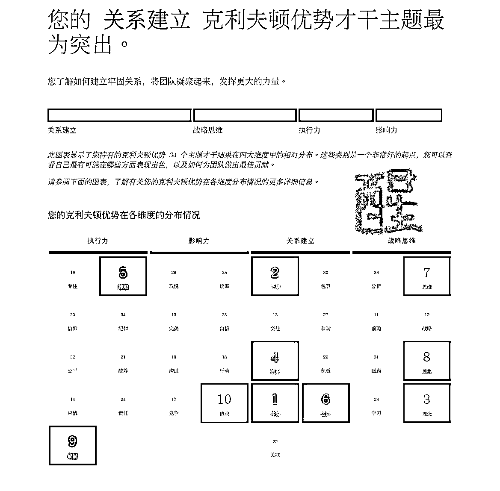
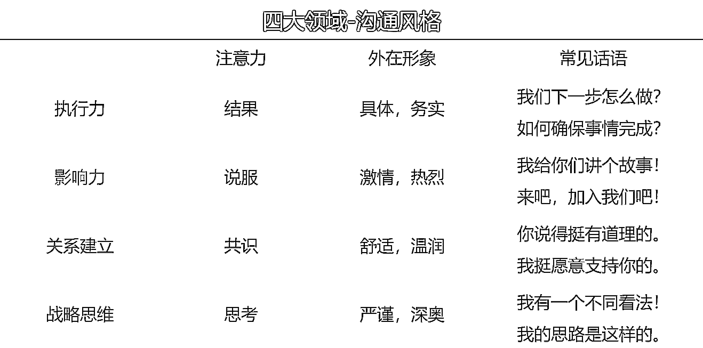

# 3.1 优势维度，先看清再发力

盖洛普把人的优势归成四组：执行力、影响力、关系建立、战略思维。四组之下共有 34 项才干。每个人才干的排列和搭配不一样，最终显现出来的优势也会不同。这一节重点聊四组维度之间有什么区别。

翻到盖洛普 34 项才干报告第 21 页，你会看到四个维度的先后顺序和长度并不一致。通常，位置越靠前、条形越长的维度，越可能代表你更突出的优势方向；排在越前面的才干，也越可能是你习惯调用、比较拿手的天赋。需要注意的是，翻译可能带来理解偏差：你以为是 A 含义，实际可能指向 B。关于 34 项才干的具体概念，会在「3.4 了解 34 项基础才干」里展开。

也别让这四个维度把思路框死。假如你在某个领域没有任何才干主题，不必紧张，这不等于你做不成事、不会做战略思考、无法影响别人或建立关系。完成任务、影响他人、建立关系、处理信息，是每个人都能做到的。把突出的才干主题用在合适领域，同样能拿到好结果。

•执行力：偏向“做事”，擅长把想法变成落地结果。你可能更在意“怎样把一件事做成”，在把任务做完、达成目标、做组织规划、推进执行、跟进进度这些方面有天赋。具体天赋与执行力维度前十的才干有关。
•影响力：偏向“带人”，以自己为主去推动局面。你可能更关心“怎样让别人行动起来”，在沟通协商、说服引导、激励他人、掌控局面上有天赋。具体天赋与影响力维度前十的才干有关。
•关系建立：偏向“支持人”，以他人为主。你可能更关注“怎样建立信任”，在形成深厚信任、维护并搭建有支持感的团队上有天赋。具体天赋与关系建立维度前十的才干有关。
•战略思维：偏向“想事”，擅长做判断和决策。你可能更关注“怎样做决策”，在收集与分析信息、处理信息、制定策略、判断趋势上有天赋。具体天赋与战略思维维度前十的才干有关。

💡可以翻出自己的 21 页报告，试着列一列：在大方向上，你更擅长什么？再回想过去有成就感、或者让你满意的时刻，是否正好落在自己比较强的领域？

以 @醒醒 为例，她的四个维度排序是关系建立>战略思维>执行力>影响力。她更习惯先找到合适的人，把团队搭起来，再开始行动；在她看来，人对了，事情才更容易做对。

她排名前十、甚至前十五的才干，在四个维度里都有比较亮眼的部分。再往里看，还能发现更具体的潜在优势。比如：

•她更擅长通过支持别人成长来建立深度关系（体谅+个别+伯乐），而不是四处交朋友、跟人竞争（取悦 26+竞争 17）；
•她更适合需要创意、想法和策略的岗位（思维+理念+搜集+战略+前瞻），而不是数据、逻辑、学术研究类工作（分析 33+回顾 31+学习 23）；
•她更擅长解决问题、把任务流程化（排难+成就），而不是做计划（纪律 34）和目标管理（专注 15）。

如果让她每天带兵打仗、做科研、几乎不跟人接触，她会很痛苦：关系建立几乎用不上，数字代表什么她理解不了，规则会限制想象力和创造力；命令别人做事又像在伤害关系，她对“权威式”领导模式本能反感。

在她过去的职业经历里，社群运营、群发售、咨询、教练、写作都能拿到不错的结果。这些工作都离不开与人打交道，也需要支持他人发展、持续输出新想法、给别人带来启发，从而获得价值感，还帮她认识了不少贵人。相反，凡是要求定时打卡、推导逻辑、处理数据、严格按步骤执行的业务场景，她常觉得被束缚、不够灵活，甚至会怀疑：“规矩是死的，人是活的，为什么要这样？”

越能找到优势发挥的位置，越容易出结果。这些其实都能从报告里看出来。不过，四个维度在用的时候也有盲区：

•执行力：执行力强的人若只顾埋头做事，不让团队看见贡献，被重用的机会可能变少。
•影响力：擅长推动他人却难以建立信服感，容易被贴上强势难相处的标签，甚至被看作只会说、不落地。
•关系建立：善于体谅别人却总把自己放最后，过度让步，可能被误读成软弱、玻璃心。
•战略思维：善于拍板却说不清依据，或嫌别人理解慢而不愿解释，容易被认为高冷，别人也不知道为何要跟随。

了解并运用优势维度时，要多留意自己在哪些领域更容易发挥长处，同时有意识地觉察和调整盲点。举个例子：一个人执行力+战略思维很靠前，关系建立+影响力靠后，找工作若做销售，去研究营销工具、提升转化率，会比直接跟人面对面打交道更贴合他的天性。

